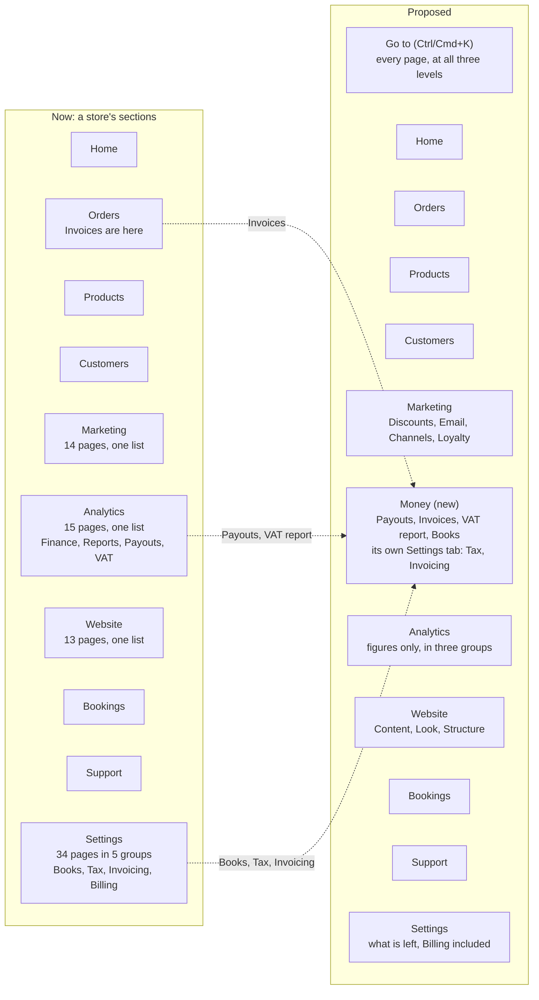

# Code review: Kaizena Flow (November 2026)

Written 9 November 2026. A review of the code only, by 8 reviewers, one per part of the system: the admin's navigation; the admin's
screens; the page builder and the big editors; the storefront and the public site; the server layer (commerce, payments, permissions);
the database, migrations and API; the AI manager, shopper chat and autopilot; and the repository, tests, CI and build. Each sampled the
central and largest files of its part.

**Its limits.** No screens were run: no build, no tests, no browser, no phone, no production data. What a person sees, how fast a page
is and how the admin behaves on a phone are read from the code. The 24 most serious findings were checked against the code a second
time by another reviewer and carry a tick (✓). None failed the check; 9 were corrected and stand here as corrected. The other 64
findings are one reviewer's reading.

**What it builds on.** Two documents, not repeated here: `docs/audits/admin-usability-2026-11.md` (the admin usability audit, D454,
4 November 2026: its phase 0 is built, phases 1 to 4 are planned) and `docs/audits/psi-followups.md` (deferred items from the PSI
audits). Where a finding is an open item of the admin audit, its row says which (for example *audit N6, phase 1*), and that document
stays the place where the item is described.

**Yardsticks.** The house rules in `CLAUDE.md`: every screen serves Homer (one obvious action, nothing to understand first) and Lisa
(every setting, one deliberate step away), and the platform (Kaizena Flow's own site and `/admin/platform`) gets what stores get.
Severity runs from 1 (cosmetic) to 4 (a catastrophe), as in the admin audit. Of 88 findings, 29 are severity 3, 54 are 2 and 5 are 1;
none is a 4. Effort: S under a day, M a few days, L a week or more.

Short forms in paths: `S/` is `src/app/admin/(gated)/[store]/`, `P/` is `src/app/admin/(gated)/platform/`, `A/` is
`src/components/admin/`, `F/` is `src/app/s/[store]/[market]/`.

## Progress

This report is a working document: the plan below is the list of work, and this table says where each step stands. Keep it true as the work goes, in the same commit as the fix.

- **Status** is one of: Open, In progress, Done, Dropped (with the reason in Notes).
- When a step is done, set Done and put the date and the commit in Notes. Check the step's "done when" before ticking it.
- If a finding proves wrong or the code has moved on, say so in Notes and correct the finding's row; do not delete it.
- New findings met on the way get the next free ID in their series and a step in the plan, then a row here.
- The grades in the headline's scorecard started at C, C and D on 9 November 2026. When verified fixes raise one, change it in the scorecard, note the old grade and the date beside it, and show the owner the new table (the owner, 9 November 2026). Raise a grade only for fixes seen working in production.
- Add a line to the change log at the foot of this section for each session that changes the table.

**Phase 0: This week**

| Step | What | Closes | Effort | Status | Notes |
|---|---|---|---|---|---|
| 0.1 | Hold a release for every suite | FH2 | S | Done | 9 Nov 2026, D526: `hosts` and `signed-in` are in `release`'s `needs` and `if`. The "done when" (a red `signed-in` run holds a migration push) follows from GitHub's `needs`; not yet seen on a real red run. |
| 0.2 | Put a cheap gate before the fast deploy, and go back by itself | FH1 | M | In progress | 9 Nov 2026, D526: the gate is built (lint, type check and `pnpm test:smoke` in the `pending` job before the deploy hook). Seen working on CI run 1160 (commit 15eb8ec): lint, type check and smoke tests took 5 min 11 s, then the deploy went out and `/api/health` reported the commit. Still open: going back by itself when a full check fails after a deploy. It needs a Vercel token as a repository secret and a check that production still runs the failing commit. |
| 0.3 | Drop the old snapshots | FD1, FH3 | S | Done | 10 Nov 2026, D532: 774 snapshots deleted (1.1 GB to 2.7 MB in the working tree); `pnpm db:check` passes and a new migration generates from the one left. `pnpm db:generate` prunes; a scan test fails at more than five; `.vercelignore` added. Git's history still holds the old files, so an existing clone is not lighter until it is cloned again. |
| 0.4 | Build the test database once | FD2 | S | Done | 10 Nov 2026, D532: a Vitest global setup applies the migrations once and keeps the database; each test file loads a copy. The unit run went from 7 min 35 s to 5 min 34 s here. CI builds the kept database once per run (nothing is cached between runs). |
| 0.5 | Log every failed payment webhook | FV2 | M | Done | 9 Nov 2026: a failed store webhook writes `stripe.webhook_failed` (store, event, type) in `handleStripeEvent`, and Kaizena Flow's own plan-billing webhook writes `stripe.platform_webhook_failed`; `stripe-webhook-log.scan.test.ts` fails on a new silent 500 in a Stripe route. 10 Nov 2026: the platform home lists Stripe events of the last 7 days that failed and are still not done (`failedWebhookEvents()`), and the four silent catches in `stripe-refunds.ts` log (a failed read of pending refunds is an error, not "nothing to check"). 10 Nov 2026: the six silent failures in `payment-capture.ts` (a capture, a void, reading the hold, the capture-due alert) and the account refresh in `connect.ts` log at warn. Left as they are, on purpose: catches whose silence is the answer (`requestIp()` outside a request, a payment domain already registered, payment facts read after a capture). The scan test covers the Stripe routes, not every catch in these files. Not yet seen on a real failure in production. |
| 0.6 | Claim a webhook event before working on it | FV6 | S | Done | 10 Nov 2026, D529: built. `commerce.claim_webhook_event()` records and claims in one statement; the handler gives the claim up when it fails. Five cases tested against the migrations. The step's "done when" is `stripe-webhook-claim.int.test.ts`: one event delivered twelve times at once on a real Postgres is claimed once (written after the release; a Postgres was on this machine all along). Released 10 Nov 2026 11:00 UTC (CI run 1176) after an incident: the code was live for about an hour before its migration (D530), and the first function was wrong (replaced by `webhook_claim_exact`). In production the function and the column exist; no event arrived meanwhile, so none failed. Advisors: nothing new about either (the standing INFO that the table has RLS and no policy, as every private table). Not yet seen on a real event. |
| 0.7 | Make two money writes all-or-nothing | FV7, FV11 | S | Done | 10 Nov 2026: built. `confirmAtVenue()` and `confirmOnTerms()` write the contact, the payment row and the completion in one transaction each. 11 Nov 2026: the tests the step asked for. A completion refused after the writes (a trigger refuses the order's move on) leaves a venue booking pending with no venue payment and the shopper's details unwritten (`checkout-kinds.int.test.ts`, D379) and an order on terms with no terms payment (`payment-terms.int.test.ts`); each fails with its transaction taken out. Two `assignPlan()` calls at once start one Stripe subscription (`billing.int.test.ts`), and fail without the lock. Writing it found more: the lock was taken after `prepare()`, so two calls each made the store a Stripe account. The lock (`oneAtATime()`, by the store's address) now covers `prepare()`, and the owner's `choosePlan()` too. The idempotency key is unchanged (see above). Done in the commit that adds these tests (FV7, FV11). |
| 0.8 | Give the AI manager's turn a deadline and a cost ceiling | FA2, FA5 | M | In progress | 10 Nov 2026, D539: built. `nextRound()` (`src/lib/turn-budget.ts`) gives each turn 240 s, the last 45 s a round without tools; 400,000 tokens a turn; the store's month of AI looked at again between rounds; US$25 a day per platform admin (`platformManagerCostToday()`). A stopped turn saves a plain message with its tool trail. The done-when's tests pass on a real database: a slow fake connection ends in a saved answer with its trail, a provider that stops answering is cut at the round's time with what ran saved, a turn over the ceiling stops with a plain message, and a platform admin past the day's cost is refused. The autopilot's steps pass their own shorter limits. Live 10 Nov 2026 (commit 4e4e345, `/api/health` on it); not yet seen on a real turn that meets a limit. |
| 0.9 | Let shoppers reach every product | FF1 | M | Done | 10 Nov 2026: built for category, tag and *All products* listings. `listingPage()` returns the first `page` pages and the full count; the listing says "48 of 65 products" and offers *Show more products* as a plain link (`?page=2`, up to 20 pages, 960 products), in en, nb, sv and da. The test found a second cap: `listGridProducts()` cut any list at 48 by itself (now `GRID_PRODUCTS_MAX`). The page builder's product grid, which draws a store's listing pages (`FilterableGrid`), is paged the same way in steps of its own number; past its first page it reads in the listing's order, which may differ from the grid's own. Seen in a browser on a local build with 64 products: "48 av 64 produkter", *Vis flere produkter*, then all 64. `listing.int.test.ts` builds a store of 60 or more products and checks the count, the order and that nothing repeats. Live 10 Nov 2026 (CI run green, production on the commit). Search results are paged too: the search is asked for `page` times 48, and *Show more* is offered while it fills that (a search ranks at most about 150 candidates, so it has no total to show); not seen in a browser. 11 Nov 2026: the theme store's list has no cap to page (`loadCards()` reads every published theme and the list draws them all), so the platform needs nothing here. The done-when is met: the 60-product test, and *Show more products* is a plain link that works without scripts. On 10 Nov no store in production had more than 10 active products, so paging has not been seen there; the demo store's *All products* reads "9 produkter". |
| 0.10 | Show that a click worked | FS1 | S | In progress | 10 Nov 2026: one `loading.tsx` at `S/` and one at `P/`, drawn on the server (its words are the only script). The signed-in suite (209 tests) passes on a local build made as CI's. The Products page went 9 bytes over its script budget, which is now Home's and Orders' (2,470,000); Home itself has about 550 bytes of room left, so the admin's first load needs trimming before much else is added. 11 Nov 2026 (D540): the pending bar built: `LinkPending` (`useLinkStatus`) on the sidebar, the section's links, the tabs and the rail, a thin bar at the link's foot, always drawn and only shown; held by `e2e/signed-in/admin-text-fallbacks.spec.ts`, which holds the next page back and sees it. The room it needed came with PSI PERF-01: the admin's English fetched per area, every screen's first scripts about 1.1 MB smaller (Home 1.28 MB, budget 1.34). Live 11 Nov 2026 (production on d8b90fa; the sign-in page loads with no errors and no fallback). The signed-in screens are not yet seen in production: the admin needs the owner signed in. |
| 0.11 | Group Marketing, Analytics and Website | FN5 | S | In progress | 10 Nov 2026: Marketing is Discounts, Email, Channels, Loyalty, On the site; Analytics is Overview, Money, Customers and products, The site; Website is Content, Look, Structure. No address moves; the headings have Norwegian words. `permissions.baseline.json` is unchanged; one line of `store-nav.test.ts` changed: a website without the shop opens Marketing on Broadcasts, where it opened on A/B tests. Seen in a browser on a local build; the signed-in suite passes (one unrelated test timed out under load and passed alone). The Analytics group is named Money (open question 3). Not yet seen in production. |

**Phase 1: Foundations**

| Step | What | Closes | Effort | Status | Notes |
|---|---|---|---|---|---|
| 1.1 | Type the money reads | FV1, FF9 | M | Done | 11 Nov 2026: every read in the twelve files FV1 names (checkout, order-insert, order-edits, returns, exchanges, draft-orders, stripe-refunds, billing, catalog, cart, listing, search; about 230 reads) goes through `typedRows()`/`typedRow()`: each money column `col.minor`/`col.minorOrNull`, each code `col.currency`. Small rows describe every column; the wide rows passed on as `Row` (a cart line with its product and plan, `select *` of an order, a return, a draft, an exchange) describe their id, money and currency columns and keep the rest as read (`looseObject`), which step 1.2's ratchet can tighten. A write that returns no row now throws instead of reading `undefined`. `money-reads.scan.test.ts` fails on an `execute<` in any of them. Checked by the type check, lint, the unit tests and the whole integration suite (4,931 passing; the two failures were not this change, see the change log). |
| 1.2 | Ratchet the rest | FD6, FH11 | S (burn-down L) | Done | 11 Nov 2026: `src/server/ratchet.scan.test.ts` holds `src` (tests and test support aside) to `src/server/ratchet.baseline.json`: unchecked reads (`execute<…>(`) per file, 3,131 in 453 files after step 1.1, and `as unknown as` (122) and switched-off `no-explicit-any` (0) in total. A rise fails, a new file starts at none, and a fall fails too until the baseline is lowered with `node scripts/ratchet.mjs` (which refuses to raise a number), so the room is never spent again. Counting shared by both in `scripts/lib/ratchet-count.mjs`. The burn-down goes on as files are touched. FD6's "about 50 suppressed any" no longer matches the code: there are none (the matches were the word in comments). |
| 1.3 | Carry the store in every write | FV5 | M | Done | 11 Nov 2026: the ratchet of step 1.2 also counts, per file, the writes that pick a store's row by its id alone (`update`/`delete` of a table with a `store_id`, whose `where` names an id and not the store or `owned()`; `unscopedWrites()` in `scripts/lib/ratchet-count.mjs`, the tables read from `schema.ts`): 321 in 100 files are the allow-list, which may only shrink, and a new one fails `ratchet.scan.test.ts`. The writes FV5 named now name the store: the media library's delete, saved parts' two updates and delete, the experiment cleared when its version B failed, and the five form-submission updates. `cancelUnpaidOrder(storeId, …)` and `completeOrderPayment(storeId, …)` act only on an order of that store (through `orders where store_id = …`), and every one of their 34 callers passes the order's own store; the two jobs that did not read it (`releaseHeldCredits()`, `expireApprovals()`) now do. FV5 counted 237: the scan counts more, as it also takes `id in (…)` and aliases (`e.id`). Checked by the type check, the scan tests and the integration suites of the touched areas (879 tests). |
| 1.4 | One wrapper for server actions | FV9 | M | Done | 11 Nov 2026: `storeAction({ store, key, action, answer }, handler)` and its platform twin `platformAction({ area, access, action, answer }, handler)` (`src/server/store-action.ts`, listed in `DELEGATED_GUARDS`): the key is checked once (a member without it gets *You do not have access to this.* in their language, never a 404), the handler runs in the person's language, and anything it throws that nobody planned for is logged once (`action.failed`, the action's name and the store, never the error's words in the form) and answered with a plain line; `redirect()`, `notFound()` and `refresh()` pass through (`unstable_rethrow`). `answer(message, kind)` builds each action's own result shape, refused or failed. Every action of orders (11), returns (15) and books (19) runs through it; their helpers take the member instead of guarding again. The done-when's test: an approval that throws answers *That did not go through…* in the form with one `action.failed` line and changes nothing (`returns-actions.int.test.ts`, which fails with the catch taken out); the wrapper's own tests in `store-action.test.ts`. Other `actions.ts` files move onto it when touched (`docs/rules/admin/platform.md`). |
| 1.5 | Bound every query and webhook route | FD9 | S | Done | 11 Nov 2026: the app reaches the database as the `postgres` role through Supavisor's transaction mode, which drops a connection's own start-up settings, so the limits are the role's: migration `20261111151548_statement_timeouts` sets `statement_timeout = 15s` and `lock_timeout = 5s` on it, on Supabase only (where `supabase_admin` exists), so developers' and CI's databases stay unbounded. FD9 no longer matched in part: Supabase had already given the role `idle_in_transaction_session_timeout = 30s` and `transaction_timeout = 60s`. A job that needs longer raises its own limit for one transaction with `longerTimeout()` (`src/db/client.ts`, `set local`, at most 55 s under the 60 s transaction cap); the migration runner already sets its own per file. Production's slowest statement by the role over its recorded history was 6.6 s (a schema query of Supabase's tools), so nothing the app or the nightly jobs run comes near the limit. The five payment webhook routes (Stripe's store, Connect, Connect accounts and billing, Mollie) have `maxDuration = 60`, and `cron-routes.scan.test.ts` requires one on every route under `api/stripe`, `api/mollie` and in a `webhook(s)` folder. The done-when's check on a database with the migration's branch taken: `select pg_sleep(20)` was cancelled at 15 s, and one that raised its limit ran through. Live 11 Nov 2026 17:23 UTC (D567): in production the role carries both limits and `select pg_sleep(20)` is cancelled. |
| 1.6 | Safe indexes on hot tables | FD4 | M | Done | 11 Nov 2026 (D569): a migration whose first line is `-- kaizen:no-transaction` runs statement by statement outside a transaction (`scripts/db-migrate.mjs`, and the same split in `db-setup.mjs`, `db-template.mjs` and the tests' PGlite, `statementsOf()` in `scripts/lib/migrations.mjs`), its ledger row after the last; a failed concurrent build's invalid index is dropped again, so the file runs again once fixed. `migration-safety.scan.test.ts` fails a plain `create index`, or a foreign key or check added without `not valid`, on orders, order_lines, visits, products, product_variants, customers, carts and cart_lines in any migration after `20261111172838` (unless the file makes the table), a `concurrently` in an unmarked file, and a `not valid` constraint never validated; run over the old files it finds 185 such statements. `migrate-no-transaction.int.test.ts` builds an index concurrently on a scratch database, sees the unmarked file refused and a failing unique build leave no ledger row and no index. The rule is in `docs/ci-migrations.md`. No real index was needed: in production every foreign key on these tables is indexed, and the largest is 700 kB. |
| 1.7 | Squash to a baseline | FD3 | M | Done | 11 Nov 2026 (D572): the 789 files up to `20261111172838_sms_campaign_index` are four (`…39_baseline_1_schema`, `…40_baseline_2_data`, `…41_baseline_3_rules` from `pg_dump`, and `…42_baseline_4_roles_and_supabase` kept by hand), each marked `-- kaizen:baseline-through=…`; `scripts/db-migrate.mjs` records them without running them where the ledger has the cut; in production CI's `release` job does so. `scripts/squash-migrations.mjs` checks before it writes: a database from the files and one from the baseline give the same `pg_dump`, the schema line by line (63 checks differ only in parentheses Postgres regroups) and the data row by row. The old files are in `supabase/archive/20261111172838/`; the tests that read one (`commerce.test.ts`'s two, the plan-features tests, the VAT replay and others) go through `src/db/migration-files.ts`. `pnpm db:check` passes. A fresh database with the demo catalogue takes about five seconds. |
| 1.8 | Give the build room, and deploy what was checked | FH10 | M | Open | |
| 1.9 | Test what gets owners paid | FH9 | M | Open | |
| 1.10 | Make the written rules cheap to read | FH4, FH5 | M | Open | |
| 1.11 | Pull the drop rules out of the builder | FB7 | M | Open | |
| 1.12 | Build the admin kit | FS4 | L | Open | |
| 1.13 | One way to search and page a list | FS2 | M | Open | |
| 1.14 | One date formatter | FS5 | M | Open | |
| 1.15 | Forms that answer | FS6 | M | Open | |
| 1.16 | Unsaved work survives | FB5 | M | Open | |
| 1.17 | Free a page's permission from its place in the menu | FN2 | M | Open | |
| 1.18 | One structure for the platform's navigation | FN9 | M | Open | |
| 1.19 | One source for a page's name | FN8 | M | Open | |

**Phase 2: Structure**

| Step | What | Closes | Effort | Status | Notes |
|---|---|---|---|---|---|
| 2.1 | Build *Go to* | FN1 | M | Open | |
| 2.2 | Say where you are | FN7, FN6 (and FN12) | S | Open | |
| 2.3 | Bring Basic and groups to the platform and the account | FN4 | M | Open | |
| 2.4 | Do the audit's phase 2 moves | (admin audit, phase 2) | M | Open | |
| 2.5 | Add the Money section | FN3 | L | Open | |
| 2.6 | Split Books | FS3 | L | Open | |
| 2.7 | Fit the menu to a phone | FN10 | M | Open | |
| 2.8 | One way to start | FS7 | M | Open | |
| 2.9 | Empty screens with a next step | FS8 | M | Open | |
| 2.10 | Give the platform's Stores list the store admin's list | FS9 | M | Open | |
| 2.11 | A Basic view in the builder | FB3 | M | Open | |
| 2.12 | Select parts in the builder | FB4 | M | Open | |
| 2.13 | A trail on the storefront | FF7 | S | Open | |
| 2.14 | Search in the header | FF8 | M | Open | |
| 2.15 | Filters that work without script | FF6 | M | Open | |
| 2.16 | Show what the AI changed | FA7 | M | Open | |

**Phase 3: Depth**

| Step | What | Closes | Effort | Status | Notes |
|---|---|---|---|---|---|
| 3.1 | Split the page builder | FB1 | L | Open | |
| 3.2 | One definition per block | FB6, FB9 | M | Open | |
| 3.3 | Stop re-drawing the canvas | FB2 | M | Open | |
| 3.4 | Load the builder's dialogs on demand | FB8 | M | Open | |
| 3.5 | Split the product editor | FB10 | M | Open | |
| 3.6 | A ceiling for page files | FS10 | L | Open | |
| 3.7 | Stage `placeOrder` | FV3 | L | Open | |
| 3.8 | Cut the repeated round trips | FF4, FV8 | S | Open | |
| 3.9 | Stop reading the whole catalogue for one page | FF2, FF5 | S | Open | |
| 3.10 | Cache tags per product | FF3 | M | Open | |
| 3.11 | One card query; smaller storefront files | FF10 | M | Open | |
| 3.12 | One accounting adapter, one `afterOrNow` | FV10 | M | Open | |
| 3.13 | Domain folders | FV4, FH6 | L | Open | |
| 3.14 | Split `schema.ts` | FD5 | M | Open | |
| 3.15 | Keep the big tables lean | FD7, FD8 | M | Open | |
| 3.16 | One error shape for the API | FD10 | M | Open | |
| 3.17 | Limit floods at the edge | FD11 | S | Open | |
| 3.18 | Cheaper, faster AI rounds | FA1, FA9 | M | Open | |
| 3.19 | A cut or failed round recovers | FA3, FA4 | S | Open | |
| 3.20 | A quick model for small jobs | FA8 | M | Open | |
| 3.21 | A tool's facts in one place | FA6 | M | Open | |

**Phase 4: Polish, and keeping it so**

| Step | What | Closes | Effort | Status | Notes |
|---|---|---|---|---|---|
| 4.1 | Lint rules for the boundaries | FH7, FH8 | M | Open | |
| 4.2 | All environment reads through `env.ts` | FD12 | S | Open | |
| 4.3 | Generate the navigation doc | FN11 | S | Open | |
| 4.4 | The small ones | severity 1 findings | S to M | Open | |
| 4.5 | Check that each guard exists | - | S | Open | |
| 4.6 | Measure, then tune | (admin audit, phase 4) | M | Open | |

**Change log**

- 9 November 2026: the review written; every step Open.
- 9 November 2026: step 0.1 done and the gate half of step 0.2 built (D526).
- 9 November 2026: the gate seen working on its first live run (CI run 1160).
- 9 November 2026: step 0.5 begun: failed Stripe webhooks are logged, for stores and for the platform.
- 10 November 2026: step 0.5: the failed-events count on the platform home and the refund code's logs.
- 10 November 2026: step 0.5 done: the capture and Connect code log their failures.
- 10 November 2026: step 0.6 built (D529), with a migration.
- 10 November 2026: step 0.6 released and done, after the incident recorded in D530.
- 10 November 2026: step 0.7 built; step 0.6's race test added.
- 10 November 2026: step 0.9 built for listings; search still to do.
- 10 November 2026: step 0.9 live for listings; search paged.
- 10 November 2026: step 0.10: the shared loading outline for store and platform admin pages.
- 10 November 2026: step 0.11: Marketing, Analytics and Website in groups.
- 10 November 2026: steps 0.3 and 0.4 done (D532).
- 10 November 2026: step 0.8 built (D539): the AI manager's turn has a deadline and a cost ceiling; live the same evening.
- 11 November 2026: step 1.5 done: 15 s per statement and 5 s per lock on the app's role, a limit on every payment webhook route.
- 11 November 2026: step 1.4 done: one wrapper for server actions, orders, returns and books on it. The live accessibility scan's dark-mode findings on the front page were its own: since D533 a row's background sits in a wrapper the scan did not look inside (fixed, 07cec9b).
- 11 November 2026: step 1.3 done: writes by id counted and held, the named ones and the two order functions carry the store.
- 11 November 2026: the agents' eval recording of 12:04 committed after the deadlock of the morning: three new admin pages were kept out of the AI manager's prompt for one deploy (383cee4) so the migration they came with could go out, then put back (dc5f06a) and recorded.
- 11 November 2026: step 1.2 done: the ratchet and its baseline; FD6's suppressed `any` corrected to none.
- 11 November 2026: step 1.1 done. Its integration run found two failures on main that were not it: the agents' eval recording is older than the AI manager's prompt (it needs a new run on Platform → AI, which only a person with the platform's model can make), and e-invoices skipped new documents once more than 50 business documents without a Peppol number fell in the two-day window (fixed in the same change: each run pages through the window, `runEinvoiceSending()`, with a test).
- 11 November 2026: step 0.9 done: the theme store's list has no cap.
- 11 November 2026: step 0.7 done: its tests, and the plan lock moved before the Stripe account is made (FV11).
- 11 November 2026: step 0.10's pending bar built with PSI PERF-01's first step (D540).
- 10 November 2026: Phase 0 looked at in production: 0.7, 0.9, 0.10 and 0.11 are deployed; 0.7's paths have had no order, 0.9's paging no store large enough, and 0.10 and 0.11 are admin screens that need the owner signed in.
- 11 November 2026: step 1.6 done (D569): the no-transaction marker for concurrent indexes, and the scan test for the hot tables.
- 11 November 2026: step 1.7 done (D572): the migrations squashed to a baseline, the old files archived.

## 1. The headline

**The rules are good; they do not yet reach the riskiest places.** Money is worked out in the database, every admin action is guarded
and the tests are many. But a push reaches production before any check has finished, and the admin's own test suite never holds a
release back: close that first (FH1, FH2). The house's own rules (typed money reads, the store's time zone, shared form and list
pieces, the platform gets what stores get) are met least where they matter most: checkout, the cart, dates on orders and
`/admin/platform`. One fault costs sales today: a storefront listing stops at 48 products and offers no next page (FF1). Navigation is
still the weakest part: the plan of 4 November is the right one, none of its navigation items is built yet, and its regrouping must
wait for one change: a page's permission has to stop following its place in the menu (FN2).

| Asked for | Grade (A to E) | Why, in a line | The most useful change |
|---|---|---|---|
| Code quality and efficiency | C | Sound rules and money logic, but the rules stop short of the riskiest code, nothing holds a bad push back, and a few files and folders have outgrown anyone's head. | Gate the deploy: a cheap check before it and every suite before a release (steps 0.1, 0.2: FH2, FH1). |
| Usability and intuitiveness | C | Single pages are good and Basic helps, but feedback is uneven: no sign that a click worked, lists that stop without saying so, dates on the wrong day, a builder with no simple view. | Build the admin kit (field, empty state, confirm, pager) and put every list and form on it (step 1.12: FS4). |
| Navigation and information structure | D | The plumbing is sound; the map is not: no way to jump to a page, three flat lists, money in three sections, and the platform admin has none of Basic. | Build *Go to* on Ctrl/Cmd+K at all three levels (step 2.1: FN1), after freeing permissions from the menu (step 1.17: FN2). |

## 2. What is good and should stay

- **Money correctness lives in the database.** `placeOrder` is one transaction with the cart and customer rows locked; payment
  completion and cancellation are single SQL functions; no float arithmetic in checkout, cart, returns, exchanges or billing.
- **Authorisation goes through one small set of helpers, held by a scan test.** Of 183 admin `actions.ts` files only sign-in has no
  guard, as it should; refusals are logged and audited. The navigation offers only what a member may open, from the same filter.
- **Webhooks and the API are defended the same way everywhere sampled.** Signatures over the raw body with per-store secrets, events
  recorded once, public POSTs that check same-site, cap the body and parse with zod, a timing-safe cron check.
- **Migrations are delivered with care.** One transaction and a checksum per file, an advisory lock, a project guard, deploy only after
  the migration, and `scripts/await-deploy.mjs` waiting until `/api/health` reports the commit.
- **Scan tests hold rules a linter cannot** (who refreshes a store's cache tag, prompt safety, cron routes, the rules index), with
  allow-lists that may only shrink. 17 skipped tests in about 18,000; 7 `ts-ignore` in the whole tree.
- **One shell for all three admin levels, and a map with no dead ends.** All 158 navigation entries lead to a real page; Basic hides
  links, never pages, and a deep link still shows where it is.
- **`ActionForm` and the orders list are models.** The form keeps what was typed, marks the failing fields and posts without
  JavaScript (209 files use it); the orders list has filters in the address, cursor paging with a count, and the store's time zone.
- **The storefront reads without JavaScript and streams only what is per visitor**, with bundle discipline written down and enforced
  (`docs/performance.md`), a keyboard-complete `Dropdown`, and an error page that keeps header and footer.
- **The builder's data is strictly typed and visitors do not pay for the builder.** A 34-member union checked by zod with no real
  `any`; undo is a small pure module; dragging works by keyboard and is announced.
- **AI actions are safe by construction, and new carriers or payment providers are one file.** 95 of 236 store tools need a yes from
  the person, claimed atomically and re-checked when run; role and features decide which tools the model is even offered.

## 3. Measured

| Measure | Figure | Finding |
|---|---|---|
| Size | 5,762 `.ts`/`.tsx` files, about 1.07 million lines, about 321,000 of them tests | |
| Tests | 1,186 unit files (about 17,900 tests), 545 integration files, 212 Playwright specs (750 tests) | FH9 |
| What gates a release | static, integration, e2e and audit; not `hosts`, not `signed-in` (80 specs, 187 tests). A push without a migration waits for nothing | FH1, FH2 |
| Typed database reads | about 940 `typedRows()` against about 3,450 `execute<Row>()` outside tests: one read in five. In the money write modules: none | FV1, FD6 |
| Swallowed errors in `src/server` | 291 bare `catch {` and 159 `.catch(() => null…)`, against 574 `log()` calls | FV2 |
| Flat folders | `src/lib` 953 modules, `src/server` 765 (24 over 1,000 lines), tests beside them | FV4, FH6 |
| Largest files | `schema.ts` 19,082 lines; `page-builder.tsx` 6,461; `page-content.ts` 4,000; `product-editor.tsx` 3,740; `work-invoices.ts` 3,083 | FB1, FD5 |
| Migrations | 768 SQL files in 47 days (4.6 MB); 769 snapshots beside them (1.1 GB); 65 test files each replay all 768 | FD1, FD2, FD3 |
| Build | Vercel peak about 7.2 GB of 8; CI builds the app three times from cold | FH10 |
| Admin pages | 437 `page.tsx` (253 store, 110 platform); 14 over 340 lines, the largest 1,071 and 1,029 | FS10, FS3 |
| Loading states | 76 `loading.tsx` for 437 admin pages; 3 for the platform's 110; no progress indicator | FS1 |
| Hand-written interface | the input class string 248 times in 212 files; 429 native `<select>`; `window.confirm` in 43 files; 31 of 33 empty states with no next step | FS4, FS8 |
| Dates | `Europe/Oslo` written out in 66 admin files, `slice(0, 10)` dates in 46, the store's zone in 86 | FS5 |
| Navigation | 107 store entries (41 in Basic), 51 platform, 13 account; the platform's Settings is 26 links under one heading | FN4 |
| Page names | the menu and the admin map disagree on 17 store and 13 platform pages | FN8 |
| Builder | 48 `useState`, 0 `memo`, 0 on-demand imports; 20 of 34 block types in the registry | FB1, FB2, FB8 |
| AI manager | up to 124 tool definitions per model call, up to 11 calls per turn, 0 cache markers, no turn deadline | FA1, FA2 |
| Storefront listing | 48 products at most, no next page, the count shows 48 | FF1 |
| Written rules | `CLAUDE.md` 39.5 KB in every session; `docs/decisions.md` 1.24 MB in 892 lines | FH4, FH5 |

## 4. Findings

A tick (✓) after an ID means the finding was checked a second time. Two IDs in a cell are two reviewers' findings of one problem.

### 4.1 Code quality and efficiency

FV4 and FH6 were filed as "navigation" (finding one's way in the code); they belong here. FN2, FN8, FN9 and FN11 are code findings
that decide how cheaply the admin's map can change; section 4.3 points back to them.

| ID | Sev | Problem | Evidence | Fix | Effort |
|---|---|---|---|---|---|
| FH1 ✓ | 3 | A push without a migration deploys at once; lint, type check and tests only report beside it. Vercel's build skips the type check, so a type error or a failing checkout test is live until someone sees the red run. | `.github/workflows/ci.yml:262-268, 291-299`; `next.config.ts:46`; `docs/build-memory.md:37` | A cheap job (lint, typecheck, smoke unit tests for money, checkout, VAT) in front of the deploy hook. An automatic return to the previous deployment when a later job fails on a deployed commit. | M |
| FH2 ✓ | 3 | `release` does not wait for `hosts` or `signed-in`, the only cover of the admin as owners see it. Even a migration push can ship a broken admin. | `ci.yml:320` (needs), `:313-319`, `:170`, `:215` | Add both jobs to `needs` and the `if` of `release`; correct the comment at `ci.yml:40-42`. | S |
| FV1 ✓, FF9 | 3 | The rule "every read that carries money is typed" is not met where money is written or shown to shoppers. These modules have no typed read and coerce with `Number()`; a changed column becomes NaN or 0, not an error naming the column. The rule allows "when touched"; these are the ones left. | `execute<` / `typedRows` in `src/server`: `checkout.ts` 13/0, `order-edits.ts` 32/0, `exchanges.ts` 51/0, `draft-orders.ts` 38/0, `returns.ts` 21/0, `billing.ts` 16/0, `cart.ts` 12/0, `search.ts` 8/0, `listing.ts` 8/0, `catalog.ts` 7/0 (`:191, 244-256`); `psi-followups.md:45-52` | Convert in this order: checkout, order-insert, order-edits, returns, exchanges, draft-orders, stripe-refunds, billing, then catalog, cart, listing, search, with `col.minor` and `col.currency`. A scan test that fails on `execute<` in the listed files. | M |
| FV2 ✓ | 3 | A failed Stripe webhook writes no log line; its only trace is `last_error`, seen as a platform-wide daily count in live drills. About 450 catch sites in `src/server` swallow errors the same way, among them the pending-refunds job, which reports success when its own query fails. | `src/app/api/stripe/webhook/[storeId]/route.ts:35-39`; `src/server/stripe-webhooks.ts:84-87`; `stripe-refunds.ts:108-118, 314-316, 325`; `live-drills.ts:110-111` | `log('error', 'stripe.webhook_failed', …)` before the 500; count unprocessed events with an error on the platform home; warn-log with ids in the payment files' catches and tell a provider error from "no match"; a scan test for silent catches in those files. | M |
| FA2 ✓ | 3 | The AI manager's turn has no overall deadline: up to 11 model calls of 60 s plus tool time, in a route cut at 300 s. When cut, no answer or error is saved and the tools that ran are not reported. The autopilot has a deadline. | `src/server/owner-assistant.ts:129, 754-783`; `ai.ts:682`; `S/assistant/turn/route.ts:5`; `assistant-route.ts:67-102`; `autopilot-runner.ts:311` | Combine Stop with a deadline of about 240 s (`AbortSignal.any`); force the last, tool-free round when time is short; a test with a slow fake connection. | S |
| FN2 ✓ | 3 | A page's permission area comes from the menu section it sits in (three overrides aside), while 92 of 211 page guards also name the key by hand. Moving a page in the menu changes its area. The baseline file would show the mismatch, so this is not a hidden hole, but the planned regrouping cannot start until the two are apart. | `src/lib/permissions.ts:94-109`; `src/lib/platform-access.ts:68-77`; `src/lib/permissions.baseline.json` | An explicit `area` on each nav item (or `ADMIN_PAGES` entry), defaulting to today's section; `areaOfPath` reads it; pages take their key from the path. *Do this before any move in the audit's phase 2.* | M |
| FV3 ✓ | 3 | `placeOrder` is one function of about 920 lines: some 40 awaited steps in one transaction that holds the cart and customer locks. One transaction must run in sequence; the cost is that it cannot be tested in parts and every feature lengthens the lock. `startCheckout`'s six independent reads before it run in turn for no reason. | `src/server/checkout.ts:280-1203`, locks `:313, :323`; `:1396-1412` | Stages in `src/server/checkout/`: loadBasket, checkBasket (pure), priceBasket (pure), writeOrder. Move reads that need no lock ahead of it; `Promise.all` in `startCheckout`; unit tests for the pure stages. | L |
| FB1 ✓ | 3 | `PageBuilder` is one component of 1,134 lines and 30 props; `Dialogs` is another 1,000. Drag and drop, templates, theme, motion, dual page and responsive state share one closure in a 6,461-line file. | `A/page-builder.tsx:612-1746`, `:3401-4409`; `psi-followups.md:443` | Split by job with no change in behaviour: builder-drag, builder-sidebar, builder-canvas, builder-dialogs, builder-stand-ins, builder-theme-panel; one `BuilderContext` in place of the 30 props. | L |
| FB2 ✓ | 3 | Every keystroke replaces the page content at the top of `PageEditor`. Nothing below is memoised, so every row, column and block renders again, and the global-parts pass and the full page checker re-run. Long pages lag. | 0 `memo(` in the six builder and editor files; `A/page-editor.tsx:307-320, 426-432`; `A/page-builder.tsx:826, 867, 1037`; `src/lib/global-parts.ts:282-304` | Measure a 30-row page first. Then memo the row, column and block items with a stable actions object; the drag target in a small context; `pageIssues` on a deferred value; skip `settleUses` without global uses. Or try the React Compiler on the admin. | M |
| FA1 ✓ | 3 | Each model call resends up to 124 tool definitions and the whole prompt, up to 11 times a turn. No cache markers are sent, the prompt carries the time to the minute near its top, and `load_tools` re-sorts the tool list, so automatic prefix caches miss too. | `src/lib/tool-budget.ts:15, 78, 87-91`; `owner-assistant.ts:407, 413, 711-728, 754-757`; 0 matches for `cache_control` in `ai.ts`, `ai-provider.ts` | A stable prefix: fixed tool order, unchanging rules and the admin map first; date (not minute), page, approvals and memories last. Cache breakpoints for `anthropic/*` models. A default set of about 40 tools with `load_tools` for the rest. Re-run the agent eval and record the prompt version. | M |
| FS4 ✓ | 3 | The admin's ui kit (9 files) has no input, select, empty state, confirm or pager. A few areas keep local ones; most screens copy class strings and call `window.confirm`, so look and behaviour drift and a change means hundreds of edits. | `A/ui/`; local helpers at `A/templates-parts.tsx:42`, `A/work/work-parts.tsx:35`, `A/block-fields.tsx:339`; counts in section 3 | Add Field, TextInput, Select, EmptyState, ConfirmButton and Pager to `A/ui`; convert the 17 list pages first; scan tests that fail on a new hand-made pill link, `window.confirm` or raw input class in `src/app/admin`. | L |
| FV4 ✓, FH6 | 3 | 765 server modules and 953 lib modules lie flat, grouped only by file-name prefix. `work-invoices.ts` (3,083 lines, 61 exports, imported by about 52 files) and `owner-tools.ts` (2,629) are catch-alls. Nothing stops one feature importing another's internals. | `src/server` (3 subfolders), `src/lib` (8); clusters by prefix: work, analytics, order, platform, support, each 21 to 27 files | Move by prefix into domain folders, one domain per change, re-exports left for a release. Split the two catch-alls. Update the paths in `CLAUDE.md` and `docs/rules` in the same change. Price it on one cluster first. | L |
| FD1 ✓, FH3 ✓ | 3 | 769 Drizzle snapshots (1.1 GB, 2.6 MB each) are tracked beside 4.6 MB of SQL. Every clone, CI job, Vercel upload and agent worktree pays. The folder has doubled since 28 October and has already caused one outage through Tailwind's scan. | `supabase/migrations/meta`; `drizzle.config.ts:7`; `package.json:18`; `docs/build-memory.md:25`; no `.vercelignore` | Keep the newest snapshot only (or the last few, if `drizzle-kit check` needs the chain), proved with `pnpm db:check` on a scratch checkout. A `.vercelignore` line. A CI step that fails when `meta` grows past a limit. | S |
| FD2 ✓ | 3 | Each of 65 test files replays all 768 migrations (83,374 lines) into a new PGlite. | `src/db/testing.ts:10-20`; `vitest.config.mts` (no globalSetup, 60 s hook timeout) | Build once in a Vitest globalSetup, save with `dumpDataDir()`, start each file from `loadDataDir`; cache the dump by a hash of the migration names and sizes. Measure before and after. | S |
| FH4 | 3 | `docs/decisions.md` is one table of 1.24 MB in 892 lines, with cells up to 17,985 characters: about 300,000 tokens. `CLAUDE.md` cites it on almost every line and nobody can afford to open it. | `docs/decisions.md` (Settled, lines 8-380; Migration versions, 420-866) | One file per hundred decisions (or per decision) with a generated one-line index; Migration versions in its own file; a scan test holds the index to the files. | M |
| FV6 | 2 | A webhook event still being worked on is worked on again by a duplicate delivery, because `recordEvent()` calls it new while `processed_at` is null. Order completion and renewals are safe; confirmation emails and dispute and payout writes can run twice. | `src/server/stripe-webhooks.ts:29-37, 62-88` | Claim the event first: a `claimed_at` column (new migration, add only) set in the upsert, or an advisory lock on the event id. An integration test that fires one event twice at once. | S |
| FV7 | 2 | Orders confirmed without a provider (venue bookings, payment terms, Mollie payers) write the contact, the payment row and the completion as separate statements. A failure between them leaves a pending order with the shopper's details and no payment. | `checkout.ts:1229-1238, 1282-1286, 1321-1328, 1472-1499` | One transaction per confirm path: pass `tx` into `writePayer`, the payments insert and a `completeOrderPayment(tx, …)`; emails stay in `after()`. | S |
| FV5 | 2 | Tenant isolation rests on read-then-write: 237 updates and deletes address a row by id alone. Each one opened was safe because of the read before it. A later edit that moves that read would cross stores, and the database would not stop it. | `src/server/media-library.ts:703-710`; `saved-parts.ts:233`; `experiment-admin.ts:362`; `forms.ts:233`; `checkout.ts:1332-1350` (no store id) | `and store_id = …` (or the file's `owned()`) in each write; `delete … returning` in place of read-then-delete; pass `storeId` into `cancelUnpaidOrder` and `completeOrderPayment`; a scan test over store-scoped tables. | M |
| FA5 | 2 | The interactive manager's only limit is 300 messages a day per store, each worth up to eleven large calls. The monthly allowance is checked once at the start; platform turns have no cost limit. | `owner-assistant.ts:133, 590-621`; `ai.ts:214-216, 235-239` | Count tokens per round in `runTurn()` and stop at a ceiling per turn; re-check `aiRoomLeft` between rounds; a daily cost ceiling per platform admin. | M |
| FD9 | 2 | App connections have no statement timeout, and 97 of 119 routes no `maxDuration`, the Stripe webhook among them. One slow query holds one of an instance's five connections until the function is killed. | `src/db/client.ts:64-71`; `src/app/api/stripe/webhook/[storeId]/route.ts` | `statement_timeout`, `lock_timeout` and `idle_in_transaction_session_timeout` on the app role in a migration; long jobs raise it with `set local`; `maxDuration` on webhook routes, required by `cron-routes.scan.test.ts`. | S |
| FD4 | 2 | No index is built `CONCURRENTLY` and every migration is one transaction, so an index on orders or visits blocks writes while it builds: milliseconds today, a stalled checkout once tables are large. | 1,203 create-index statements, 0 concurrent, 55 on hot tables; `docs/ci-migrations.md:9-14` | A first-line marker (`-- kaizen:no-transaction`) in `scripts/db-migrate.mjs`; concurrent indexes on hot tables; a scan test (also `not valid` then `validate constraint`); the rule written beside "add, never rename or drop". | M |
| FH10 | 2 | Vercel's build peaks at about 7.2 GB of 8 with the type check, cache and workers already off; the next growth fails every deploy, as on 27 and 28 October. CI builds three times from cold and runs 750 Playwright tests in one job. | `docs/build-memory.md:16, 38`; `next.config.ts:46, 82`; `ci.yml:152, 206, 249` | The 16 GB build machine, or build once in CI (`vercel build`) and deploy `--prebuilt`, so the deployed build is the checked one. Share `.next` between e2e and hosts; shard Playwright. | M |
| FH9 | 2 | Stripe Connect (`connect.ts`, 646 lines: how owners get paid) has no test of its own, and 215 action files have 20 test files beside them, while pure helpers have about 17,900 tests. | no `src/server/connect*.test.ts`; no test imports it | `connect.int.test.ts` against a Stripe stand-in (account creation, status changes, the webhook that turns payouts on); then list money and permission modules without a test and close them by traffic. | M |
| FD6, FH11 | 2 | Four of five database reads are unchecked casts, and production code holds 123 `as unknown as` and about 50 suppressed `any`. With the type check off in Vercel's build these are the least protected lines. | counts in section 3; e.g. `src/server/analytics-visits.ts:162`, `cron-auth.ts:22` | Do not convert everything. Ratchet scan tests: `execute<` per file and `as unknown as` in total may only fall. Convert by risk: money (FV1), webhook handlers, the rest when touched. | L |
| FV9 | 2 | Each of 183 `actions.ts` files builds its own guard wrapper, refusal text and result shape. Authorisation is correct, but 9 of 10 sampled files catch nothing, so an unexpected failure shows Next's error page, not a line in the form. | `S/orders/actions.ts:14, 43-57`; `S/settings/books/actions.ts:47-58`; `S/discounts/actions.ts:17` | One `storeAction(key, schema, handler)` in `src/server` (guard, zod, language, catch and log, one result shape), listed in `DELEGATED_GUARDS`, with a platform twin over `requirePlatform(area)`. Move files as touched. | M |
| FA3 | 2 | The manager's rounds are capped at 1,200 output tokens and `finish_reason` is never read. A long answer stops mid-sentence; a large tool call is cut into bad JSON, blamed on the model and retried, using up rounds. | `ai.ts:681, 737-758`; `owner-assistant.ts:757-759, 895-899` | Read and return `finish_reason`; on "length" retry a tool call once with a higher limit, or add "ask me to continue" to an answer; a larger limit for rounds with tools. | S |
| FA4 | 2 | One 429, 5xx or network error on any call ends the turn, even after tools ran. There is no retry, and direct providers have no fallback. | `ai.ts:684-715, 389-403`; `owner-assistant.ts:784-790` | Retry once after a short wait when no text has been sent yet; a *Try again* button in `AiManagerChat`. | S |
| FD3 | 2 | 768 migration files in 47 days: a fresh setup, CI, the template build and the tests replay all of it. The ledger already supports a baseline. | `supabase/migrations`; `docs/ci-migrations.md:13, 17, 56-58` | Squash up to a cut into one schema file and one reference-data file; archive the old files outside the applied path; record it with `baseline_through`; point `commerce.test.ts:6732, 7405` at the archive. Repeat per quarter. | M |
| FD5 | 2 | `schema.ts` (19,082 lines, 467 tables) is only a source for migrations: no server code uses the query builder. Yet `client.ts` imports all of it into every function's cold start. | `src/db/client.ts:11, 78`; 0 `relations()`; 607 server files write SQL | Drop the `schema` argument from `drizzle()`. Then split along the section banners into `src/db/schema/*.ts`; `pnpm db:check` must write no migration. | M |
| FD7 | 2 | `orders` carries about 91 columns, 8 jsonb blobs and 24 indexes, at least one of them redundant; every insert and status change keeps them all. | `src/db/schema.ts:4465-4852`; `:4822` and `:4824` (same key) | Drop `orders_retention_idx` now. After some weeks of traffic drop each index with `idx_scan = 0` that backs no constraint; make it a standing check beside the advisors step. | S |
| FD8 | 2 | Retention blanks rows but never deletes them in carts, webhook_events, email_messages, experiment_events, referral_visits and work_events, and the webhook_events scan has no index that fits. | `src/server/retention.ts:321-322, 500`; `schema.ts:7133-7137` | A delete step per table in `runRetention` with a stated period, listed in `src/lib/retention.ts`; an index on `webhook_events (processed_at)`, or delete by id range. | M |
| FD10 | 2 | The API has no single error shape (four JSON shapes and plain text), and client address, body cap and JSON parse are typed again per route (`x-forwarded-for` in 15 files). | `src/app/api/admin/v1/[...path]/route.ts:29-30`; `platform/editor/css/route.ts:18-19`; `blog/comments/route.ts:32-41`; `visit/route.ts:35` (`console.warn`) | `src/server/api-route.ts` with `problem()`, `readJson()`, `clientAddress()`; move the browser-facing families one per change; webhooks may stay plain text. | M |
| FD11 | 2 | Rate limiting upserts one or two counter rows in Postgres on every counted call, on a row all callers of a store share, and most endpoints are let through when the count fails. | `src/server/request-budget.ts:153-196`; `storefront-route.ts:35` | Keep the counter as the per-store budget. Put a coarse per-address limit in front at the edge (Vercel Firewall, in the EU) for storefront, chat, visit and MCP routes; confirm `chat_usage` is pruned daily. | S |
| FD12 | 2 | 91 reads of `process.env` bypass `env.ts`; `SETTINGS_ENCRYPTION_KEY` alone is read 22 times in at least 8 files, each with its own handling of a bad value. | `src/lib/env.ts`; `src/db/client.ts:96`; `src/lib/secret-box.ts:22` | Accessors in `env.ts` (`settingsKey()`, `emailEnv()`, `siteEnv()`, `readDatabaseUrl()`); an `env.scan.test.ts` with a short allow-list. | S |
| FV8 | 2 | Every admin request from an account without two-step makes an extra call to Supabase Auth, plus up to two small writes inside the session read. | `src/server/auth.ts:132, 144-153, 158-175` | Use `accounts.two_step_since` as the fast path, or keep the factors five minutes per user and clear them on enrol and remove; move the two writes into `after()`. | S |
| FV10 | 2 | Tripletex and Fiken each carry their own client and sync loop, so a fix to retries is made twice. The `try { after(fn) } catch { await fn() }` block is written out 16 times. | `tripletex-client.ts:27-205` against `fiken-client.ts:30-132`; `checkout.ts:1243-1487` (5 times) | `src/server/books/accounting-client.ts` and an `AccountingAdapter` with one sync runner, as carriers have; an `afterOrNow(fn)` helper. | M |
| FA6 | 2 | A tool's facts live in six or more hand-kept places (definition, handler, permission, feature, area, audit area, gate exceptions, label). A miss shows as a wrong area in the log or a raw name in the panel, not as a type error. | `src/lib/owner-tools.ts:253`; `src/server/owner-tools.ts:2592-2629`; `tool-budget.ts:39-51`; `A/ai-manager.tsx:328` | An options object on `tool()` (gate, permission, feature, audit area, label) from which the sets and maps are derived; a scan test that every tool has a handler and a label. | M |
| FA8 | 2 | One text model does every job: reasoning, the memory pass after every turn and the shopper chat. A careful model is paid for small jobs; a cheap one is given multi-step work. | `ai.ts:46-48, 112-113`; `owner-assistant.ts:797-802`; `assistant-memory.ts:332-354`; `chat-agent.ts:139` | An optional quick model on `commerce.ai_providers` and a `quick(connection)` helper for learning, summaries and tone, with a default per provider so Homer never chooses. | M |
| FA9 | 2 | Tool calls in a round run one after another, and each tool's zod schema is turned into JSON Schema again on every `toolsNow()` call. | `owner-assistant.ts:766-782, 711-728`; `src/lib/owner-tools.ts:2076-2082` | Memoise `toolDefinition()` per tool; run a round's read-only calls together, changing calls in order. | S |
| FB6, FB9 | 2 | A block's definition is spread out. 20 of 34 types use the `BLOCK_EDITORS` registry; the rest are hand-wired in `Dialogs`. Type and zod schema sit 1,800 lines apart in a 4,000-line module that 161 files import. A new block touches about 13 files. | `A/block-fields.tsx:186-232`; `A/page-builder.tsx:3640-4185`; `src/lib/page-content.ts:1679, 2001, 3491` | Move the hand-written blocks into the registry. Make `page-content` a folder with the same public surface, one file per block (type from `z.infer`, limits, schema). A scan test: every block type has an editor, icon, renderer and message. | M |
| FB7 | 2 | The rules for where a dragged part lands (about 270 lines) live in `PageBuilder`'s render closure. With no DOM test environment they are covered only by slow signed-in Playwright specs. | `A/page-builder.tsx:1020-1037, 1095-1288`; builder unit tests total 286 lines | A pure `dropOutcome(rows, from, to, after, context)` in `src/lib/builder-drop.ts`, unit tested as `page-rows` is; the same for the choice of drag target. | M |
| FB8 | 2 | Nothing in the builder loads on demand: the rich text editor, drag and drop, nine template modules, motion, theme, translation and dual page arrive together. PSI measured 4.71 MB and names the editors for the admin's slow largest paint (3.93 s at p75). | 0 dynamic imports in the builder files; `A/page-builder.tsx:1-97`; `psi-followups.md:358-362` | `next/dynamic` for the template dialogs, saved-part and layout dialogs, translation, the theme panel, the dual frame and the settings dialog's body. Add the page editor to the budgets in `e2e/signed-in/admin-scripts.spec.ts`. | M |
| FB10 | 2 | The product editor is one file of 3,740 lines and 26 components, with the whole product as one state object and no memo: a keystroke in the title renders the variants grid again. | `A/product-editor.tsx:149-186`; `psi-followups.md:443-445` | One file per section under `A/product-editor/`; memo the sections and `VariantRow`, each with its own slice and a stable update. | M |
| FF2, FF5 | 2 | Two pages read the whole catalogue for one need. The default front page draws every active product, and a built front page still reads them all for its JSON-LD. A product page's metadata loads the store's whole index to learn one product's markets. | `F/page.tsx:68, 82, 121-136`; `src/server/catalog.ts:185-237`; `F/p/[handle]/page.tsx:73, 116-128`; `src/server/seo.ts:229-241` | Front page: the listing path with FF1's paging, and a small cached read (or none) for the JSON-LD. Product page: the market codes on `getProduct`, and `productsPageOf` inside the `Promise.all`. | S |
| FF3 | 2 | One catalogue tag per store: changing one product's price expires every product page, listing and facet of that store, and a VAT rate change expires every store's catalogue. | `catalog.ts:33-34, 188, 269, 504`; `src/server/vat-admin.ts:39, 41, 345, 372` | A `productTag(productId)` on the single-product reads plus a lists tag; keep the store tag for store-wide changes; a VAT change refreshes only the stores that sell in that country. | M |
| FF4 | 2 | Cart and checkout, the two pages that cannot be cached and decide a sale, read their data one query after another (up to eight awaits each). | `F/cart/cart-contents.tsx:95-195`; `F/checkout/checkout-section.tsx:68-74, 109-116` | One `Promise.all` for the reads that depend only on store, cart and customer; bonus and gift cards together; start codes, delivery and the payment form before awaiting them. | S |
| FF10 | 2 | The product card query (45 lines) is written twice, and a few files carry whole screens: `product-parts.tsx` 1,289 lines, `chat-widget.tsx` 1,109, `cart-contents.tsx` 968. | `catalog.ts:191-237` against `:525-560`; `src/components/product-parts.tsx:105-446, 927-1205` | One `summarySelect` fragment and row mapper. Split `cart-contents.tsx` into a loader and its parts; move the booking parts and `VariantsWithStock` out of `product-parts.tsx`. | M |
| FS10 | 2 | 14 admin page files over 340 lines read, decide and draw everything in one server component (the order page: 1,071 lines, 13 awaits). They cannot stream in parts or be shared with the platform's twin screens. | `S/orders/[orderId]/page.tsx`; `S/settings/moving/page.tsx` (27 awaits); `S/customers/[customerId]/page.tsx` | A soft ceiling of about 250 lines: the page checks permission and lays out; each card is an async server component that reads its own data in Suspense, as Home does (`S/page.tsx:116-161`). | L |
| FN8 | 2 | Three hand-kept lists name each page (the menu, `ADMIN_PAGES`, the page's header) and disagree on 30 pages: the assistant says *Support inbox* where the menu says *Inbox*. The platform's map groups no longer match its tabs. | `src/lib/admin-map.ts:1325`; `src/lib/store-nav.ts`, `platform-nav.ts` (compared by script) | The nav item is the source for a page's menu label and section; `ADMIN_PAGES` takes `group` and a `navLabel` from it at all three levels; delete the dead group arguments. | M |
| FN9 | 2 | The platform's navigation is put together in three places (four item arrays, a hand-listed tab list, areas rebuilt in the layout) and read a fourth time for permissions. Some static platform routes are in no list. | `src/lib/platform-nav.ts:18-68, 118-132`; `P/layout.tsx:44-56`; `platform-access.ts:68-77` | `PLATFORM_SECTIONS` in the shape of `StoreSection`, from which tabs, areas and `platformAreaOfPath()` are derived; the platform's own test "puts every page folder in a section". | M |
| FN11 | 2 | `docs/admin-navigation.md` describes a much smaller admin: no Analytics or Support for stores, Marketing with 6 pages (the code has 14), no Themes or Support for the platform. `CLAUDE.md` sends every contributor there. | `docs/admin-navigation.md:59-67, 82, 127-133` | A script beside `scripts/parity.mjs` that writes the three tables between markers, with a check mode in CI. *Audit N14, phase 4: not built.* | S |
| FH5 | 2 | `CLAUDE.md` costs about 10,000 tokens in every session, and 28 of its 301 index lines are cut mid-sentence, hiding the paths. | `CLAUDE.md` (418 lines, 39.5 KB) | Reduce the Storefront and Admin sections to the six area files (the per-rule index moves to the top of each, where `rules-index.test.ts` checks it); break Conventions into short bullets. | S |
| FH7, FH8 | 2 | ESLint is the Next.js default; architecture is policed by 39 regex scan tests that report only in `pnpm test`. One rule has no check at all: `src/lib` is called pure, yet 33 of its files import `server-only`, 3 import `@/server` and 4 drive a browser. | `eslint.config.mjs:1-20`; e.g. `src/lib/order-edit.ts`, `work-invoice-ui.ts`, `cookie-scan.ts`, `theme-shoot.ts` | `no-restricted-imports` for `src/lib/**` with today's offenders as a shrinking allow-list; move the import and call bans from scans to lint rules; keep the whole-repo scans, on one shared file walker. | M |

Severity 1: **FV11** the key that stops a double plan subscription changes every clock minute, and the check before it takes no lock
(`src/server/billing.ts:772-773, 793`): lock per store and key on something stable. **FH12** `three` is a dependency nothing
imports; `playwright-core` and `@sparticuz/chromium` are traced into functions; `pg` is kept beside `postgres` for one module
(`package.json:37, 59-61, 68`).

### 4.2 Usability and intuitiveness

| ID | Sev | Problem | Evidence | Fix | Effort |
|---|---|---|---|---|---|
| FF1 ✓ | 3 | A category, tag, search or *All products* listing returns at most 48 products with no next page, and the count says "48 products" because it counts what came back. A shopper cannot reach, or learn of, the rest; the owner loses sales and cannot see why. | `src/server/listing.ts:42, 212`; `src/components/product-listing.tsx:91`; `src/server/search.ts:301` | A page parameter in `parseListingParams` and `listingProducts`, the full count from the query, a *Show more* plain link (`?page=2`), the count as "48 of 200 products". The same for `searchProducts`. | M |
| FS1 ✓ | 3 | Most admin pages give no sign that a click worked until all their data is read. The old page stays put and the owner clicks again. The platform admin is almost wholly without skeletons. | no `loading.tsx` for products, customers, discounts, deals, `S/settings/books`; only boundary at `src/app/admin/(gated)/layout.tsx:23` | One generic `loading.tsx` at `S/` and at `P/`, built from the `block` class in `S/orders/loading.tsx`; keep the fitted ones; a thin pending bar on sidebar links with `useLinkStatus` (read the Next 16 docs first). | S |
| FS2 ✓ | 3 | Lists page, search and cap in at least four ways: orders by cursor, invoices by offset, returns by page number, products and the platform's stores load everything. Customers stops at 100 with no pager and no word that more exist. Search forms are hand-written in 24 files. | `src/server/customer-admin.ts:131`; `S/customers/page.tsx:37`; `S/products/page.tsx:91`; `S/orders/page.tsx:84-89`; `S/invoices/page.tsx:50`; `S/returns/page.tsx:44`; `P/stores/page.tsx:25` | Lift the orders pattern into `ListSearch` and `Pager` in `A/ui`; move Customers, Products, Invoices and Returns onto them; every list says when it was cut off. *Takes in the audit's phase 1 item for Products.* | M |
| FS5 | 3 | Dates are fixed to Norwegian time in 66 admin files and cut from UTC strings in 46, while 86 use the store's zone. For a store outside Norway an evening order shows on the wrong day on some screens; one order can carry two dates. | `S/customers/page.tsx:41`; `S/customers/[customerId]/page.tsx:119`; `S/page.tsx:183`; `src/app/admin/(gated)/(owner)/page.tsx:100` | One `adminDate(store, iso, style)` in `src/lib`; a scan test that fails on `Europe/Oslo` and `.slice(0, 10)` in the admin; on the control center, each row's own store zone. *Audit phase 1: not built.* | M |
| FS6 | 3 | Form feedback is uneven. 83 raw `<form action>` have no busy state and no outcome. `ActionForm` lists problems only at its foot, off screen on a long form; "Saved." is fixed English and stays after further edits; only 8 editors warn before leaving. | `A/action-form.tsx:41, 61-84, 99-117`; `A/ui/button.tsx` (no `useFormStatus`) | In `ActionForm`: each problem under its field, the first scrolled into view, *Not saved* on the first edit, words from `useCommonText()`. `Button` reads `useFormStatus`. A `QuietActionForm` for the raw forms. One `useLeaveGuard`. *Audit phase 1: not built.* | M |
| FB3 ✓ | 3 | The builder has no Basic view. The wrench on a heading opens General, Style, Motion and Advanced for everyone, and the palette shows 24 components plus store, product and site parts with no search. | `A/page-builder-fields.tsx:217-259`; `A/page-builder.tsx:251, 1827-2057` | Read the D454 view in `SettingsTabs`: Basic shows General and a short Look section, the rest behind one remembered *More settings*. A search box over the tiles and a *most used* group first. | M |
| FB4 ✓ | 3 | A part's tools show only while it is hovered or holds focus, and only for the innermost part: no kept selection, no Delete key, 28 px buttons. Keyboard users can reach and move a part through its handle; touch users, and rows covered by their columns, struggle. | `src/app/globals.css:376-385`; `A/page-builder.tsx:2589-2590, 466-467, 718-719` | A selected part in builder state (click or tap; Escape clears) whose tools stay shown; a trail in the tools (Row > Column > Heading); Move up and down; Delete and Ctrl/Cmd+D; 44 px on coarse pointers. | M |
| FB5 | 3 | Unsaved builder and product work has one guard, `beforeunload`, which does not fire on a click on a link inside the admin. There is no autosave and no recovery: a crash, a session time-out or a click in the menu can lose an hour. | `A/page-editor.tsx:414-420`; `A/product-editor.tsx:174-179`; `src/lib/edit-history.ts:8`; audit row at `admin-usability-2026-11.md:64` | The audit's leave guard, made to cover in-app links, in every editor. Keep unsaved page content in the browser per page id and offer *Restore unsaved changes*, or save the draft automatically. | M |
| FN6 | 2 | The sidebar marks two links as current on a sub-page: on Draft orders, Orders lights up too; the same for Blog and for Support's Inbox. Read from the code, not seen. | `A/store-admin-nav.tsx:40-44`; `src/lib/store-nav.ts:73-74, 198-200, 248-253` | Mark only the longest matching address among a group's items, the rule `sectionOf()` uses; a test that no address marks two links. | S |
| FN10 | 2 | On a phone the menu is one long scroll: every section, then the section's pages (over 40 links in Settings in Advanced; always 9 plus 26 on the platform). The top bar does not name the section. Judged from the code. | `A/store-admin-nav.tsx:111-120`; `A/admin-frame.tsx:105-146` | The sections as a scrolling row of icons pinned at the top of `AreaMenu`, only the current section's pages below; the section's name beside the menu button. *Audit N12, phase 2: not built.* | M |
| FS7 | 2 | The first run offers three ways to start on one screen, and *Your stores* shows two open create forms. Once the store is open, the unfinished setup steps are the last card on Home, and the checklist is worked out in two files. | `S/setup/[step]/page.tsx:78-101, 392-409`; `src/app/admin/(gated)/(owner)/stores/page.tsx:52-112`; `S/page.tsx:75-99, 192-214` | One start screen with two choices in plain words (*Build it for me*, *I'll set it up myself*); one *New store* button; the setup card first on Home (*audit N8, phase 1*); both checklists from one function. | M |
| FS8 | 2 | Empty screens state a fact and stop: 31 of 33 offer no next step, and "no match" and "none yet" share one block. A person with no store gets a title and one line. | `S/discounts/page.tsx:48-49`; `S/customers/page.tsx:122-125`; `(owner)/page.tsx:42-44`; the good one: `S/products/page.tsx:150-158` | The shared `EmptyState`: what this is for, the main action, optionally import or a docs link; a filtered form with *Clear filters*. Convert the 28 files; give the no-access page a way on. | M |
| FS9 | 2 | The platform admin lags on the same patterns: its Stores list has no search, filter or paging and is a raw table, with the sandbox funnel above the stores. | `P/stores/page.tsx:25, 32-60` | The store admin's list pieces on Stores (search by name, owner or domain; plan and state filters; pager); the funnel below or on Requests; platform pages in the scan test for shared pieces. | M |
| FF6 | 2 | Sorting and filtering a listing do nothing without JavaScript: the button has only a click handler and the form cancels its own submit. | `src/components/filter-dialog.tsx:196-199, 231-235`; `docs/performance.md:46-49` | `method=get` with real named inputs, so a submit without script is a navigation; a `noscript` block of sort links built with `listingQuery()`. | M |
| FA7 | 2 | What the AI did is shown as raw tool names ("used: list orders, edit page"). Changes made without a yes are not listed as changes, do not link to what changed and cannot be undone from the chat. | `A/ai-manager.tsx:749, 328`; `owner-assistant.ts:138-143`; `src/server/owner-tools.ts:2610` | The same translated labels after the answer as during it; the trail carries what changed and a link, shown as a *Changed* line; *Undo* where a version exists. | M |

Severity 1: **FN12** sidebar group headings carry clashing classes (`A/store-admin-nav.tsx:173`, *audit N13*), a badge's spoken
label is fixed English (`:150`), and the store switcher always lands on Home (`A/admin-menus.tsx:137`). **FS11** 434 admin pages
have a fixed English tab title, and one catalogue string shows a decision number (`src/lib/admin-messages/domains.en.ts:213`).
**FA10** the AI panel's first paragraph is fixed English (`A/ai-manager.tsx:455-459`).

### 4.3 Navigation and information structure

Six findings about the admin's frame and map are listed above under their own dimension: FN2, FN8, FN9 and FN11 (code) and FN6 and
FN10 (usability). FN2 comes before any regrouping.

| ID | Sev | Problem | Evidence | Fix | Effort |
|---|---|---|---|---|---|
| FN1 ✓ | 3 | There is no way to go to a page by name at any level, and Ctrl/Cmd+K still opens the AI manager. Basic hides 66 of 107 store pages and the platform's Settings holds 26. The search exists, for the AI only. | `A/ai-manager-launcher.tsx:133, 228, 276`; `src/lib/admin-map.ts:1384` (`findPages()`); `src/lib/recent-pages.ts` | A *Go to* dialog in `AdminFrame` for all three levels: `pagesFor()` filtered by `canOpenPath`, ranked as `findPages()` does, recent pages when empty, Advanced pages marked; the AI manager moves to Ctrl/Cmd+J; a search button for phones. *Audit N6, phase 1: not built. Build it as written there, and for the platform too.* | M |
| FN3 ✓ | 3 | Money is spread over three sections and five words: invoices under Orders; payouts, finance and the VAT report under Analytics; books, tax, invoicing and billing under Settings. The whole books product hangs off one Advanced-only Settings link. | `src/lib/store-nav.ts:76, 169-172, 270, 292, 294, 320`; `src/lib/permissions.ts:98` | A Money (or Finance) section: Payouts, Invoices, VAT report, Books, with Tax and Invoicing as its own Settings tab. Analytics keeps the figures. *New: the audit's N5 lists other double words, not this group. Follow its phase 2 rule: old addresses redirect. Needs FN2 first.* | L |
| FS3 ✓ | 3 | The accounting product is one page of 1,029 lines under Settings: about 21 cards (bank, receipts, budget, profit and loss, VAT return, SAF-T, year-end, the lock) read by a dozen query groups in turn, with no Suspense or skeleton. Homer has no obvious action there. | `S/settings/books/page.tsx` (cards from `:74` to `:975`, awaits at `:65-159`) | A short Books home (what needs doing, one main action) and sub-pages: Bank, Bills and receipts, Reports, VAT and SAF-T, Year-end, Settings. Each card reads its own data in Suspense; `/settings/books` redirects. | L |
| FN4 ✓ | 3 | The platform admin got none of Basic: its Settings is one heading over 26 unrelated links, with no groups, no Basic flag and no cap test. The owner's Account is a flat 13. This breaks the platform rule. | `src/lib/platform-nav.ts:14, 68-95`; `P/layout.tsx:55`; `S/layout.tsx:95, 110, 150`; `src/lib/owner-nav.ts:18-32` | A `basic` flag and groups on `SectionItem` (Site; Money and tax; AI; Compliance; Operations; Team); `AdminViewProvider` around the platform and owner layouts; the Basic cap test in `platform-nav.test.ts`. *The audit's phase 0, brought to the platform.* | M |
| FN5 | 3 | Marketing (14 pages), Analytics (15) and Website (13) are still one flat list each, in the order the features were built. Campaigns and Coupons, Workflows and Automation, and the two Header and footer places are still double. | `src/lib/store-nav.ts:134-153, 163-183, 193-212, 138-139, 288-289, 302` | First the part that moves no address: the audit's groups in `store-nav.ts`. Then the merges, with redirects. *Audit N1, N5, N11, phase 2: not built.* | S |
| FN7 | 2 | A page does not say which section it is in, and there are no breadcrumbs. Titles repeat across sections (Overview, Reports, Customers), and on a phone the title is the only clue. | `A/ui/page-header.tsx:12, 22, 44`: `eyebrow` is set on 2 of 437 pages; `PageHeader` is on 267 | `PageHeader` fills the eyebrow itself from the address (`matchPath()`, `sectionOf()`, `navWord()`); the 170 pages without it move over as touched. *Audit N7, phase 1: not built.* | S |
| FF7 | 2 | A product page has one way up, *Back to All products*; its category is known to search engines but not shown. The store's 404 offers only the front page. | `src/components/product-parts.tsx:119-122`; `src/lib/structured-data.ts` (BreadcrumbList); `F/not-found.tsx:19-24` | A visible trail (Home, category, product) in the built-in product layout, from the JSON-LD's data; the search form and top categories on the 404. | S |
| FF8 | 2 | Storefront search is an icon that opens another page: a page load and a second tap before typing, though instant suggestions exist. | `src/components/store-layout.tsx:258-261`; `src/components/site-parts.tsx:128-131`; `src/server/search.ts:348` | On desktop the field itself in the header (a GET form; suggestions when the script loads); on phones the field opens in place; offered as a variant of the search part. | M |

The store admin's top level today, beside what FN3, FN5 and FN1 propose. Nothing else at the top level moves.

The platform keeps its nine tabs (Home, Website, Themes, Stores, Customers, Plans, Requests, Support, Settings). What changes there
is inside Settings: six groups and a Basic view in place of 26 equal links (FN4).

## 5. The plan

Five phases, in the order to do them. Steps are numbered by phase (1.12 is phase 1, step 12) and ordered by what depends on what.
Every finding of severity 2 or more is closed by exactly one step. "Platform:" says whether `/admin/platform` or Kaizena Flow's own
site needs the same change, by the house rule.

**How this sits beside the admin audit's plan.** That plan stays; this one gives it an order, the platform, and the Money section.

| Admin audit's plan | Where it is done here |
|---|---|
| Phase 1: Go to, eyebrow, heading style | Steps 2.1 and 2.2 |
| Phase 1: date formatter and discount dates; Saved and the leave guard; ConfirmButton; Products' search and paging; Home's checklist | Steps 1.14; 1.15 and 1.16; 1.12; 1.13; 2.8 |
| Phase 1: confirm before Refund, Remove access, Disconnect Mollie | Not re-checked by this review. Still that plan's item; it protects money, so do it with step 1.12 |
| Phase 2: groups in Marketing, Analytics, Website | Step 0.11 (it moves no address) |
| Phase 2: moves and merges; the phone's icon row | Steps 2.4 (after 1.17) and 2.7 |
| Phase 3: the order page; the lint rule for pills | With steps 3.6 and 1.12. The rest of phase 3 is unchanged |
| Phase 4: generated navigation tables; measuring | Steps 4.3 and 4.6 |

### Phase 0: This week

**Goal:** close what can cost money or data today, and take the small wins. **A person will notice:** a click in the admin answers at
once; a shopper can reach every product; an AI turn always ends with an answer; a broken push no longer reaches shoppers unseen. A
clone is a gigabyte lighter. Eleven steps, seven small and four medium: after steps 1 and 2 they do not depend on each other and can
run side by side.

1. **Hold a release for every suite.** Add `hosts` and `signed-in` to `needs` and to the `if` of `release` in `.github/workflows/ci.yml`; correct the comment at `:40-42`. Closes FH2. S. Done when: a red `signed-in` run on a push with a migration leaves production on the old commit.
2. **Put a cheap gate before the fast deploy, and go back by itself.** Make the deploy step in `pending` need a job that runs `pnpm lint`, `pnpm typecheck` and a smoke set of unit tests (money, checkout, VAT). Add a job that promotes the previous deployment and alerts the owner when `static`, `integration` or `e2e` fails on a deployed commit. Closes FH1. M. Done when: a push with a type error does not deploy, and a deployed commit with a failing integration test is rolled back without a person. (Changes D5's "at once" by a few minutes: question 1 in section 6.)
3. **Drop the old snapshots.** Delete all but the newest file in `supabase/migrations/meta` after `pnpm db:check` passes on a scratch checkout; add `.vercelignore`; add a CI step that fails when `meta` holds more than a set number of files. Closes FD1, FH3. S. Done when: a fresh clone is about 1 GB smaller and `pnpm db:check` passes.
4. **Build the test database once.** In a Vitest globalSetup apply the migrations to one PGlite, save it with `dumpDataDir()`, and have `createTestDatabase()` (`src/db/testing.ts`) start from it; cache the dump by a hash of the migration names and sizes. Closes FD2. S. Done when: the migrations run once per `pnpm test`, and the run time before and after is in the commit message.
5. **Log every failed payment webhook.** Log in the catch of `src/app/api/stripe/webhook/[storeId]/route.ts`; show the count of unprocessed `webhook_events` with an error on the platform home beside cron health; log at warn in the catches of `stripe-refunds.ts`, `payment-capture.ts` and `connect.ts`; add the scan test for silent catches in those files. Closes FV2. M. Done when: a forced handler failure writes one `stripe.webhook_failed` line with store and event ids, and the scan test fails on a new silent catch. Platform: check Kaizena Flow's own plan-billing webhook in the same change.
6. **Claim a webhook event before working on it.** Add `claimed_at` to `webhook_events` (a new migration, add only) and claim in `recordEvent()` (`src/server/stripe-webhooks.ts:29-37`). Closes FV6. S. Done when: an integration test that delivers one event twice at the same moment sees the handler run once.
7. **Make two money writes all-or-nothing.** Wrap `confirmAtVenue`, `confirmOnTerms` and the terms path in `src/server/checkout.ts` in one transaction each. In `src/server/billing.ts` take a per-store lock for subscribe and use a stable idempotency key. Closes FV7, FV11. S. Done when: a forced failure after the contact write leaves the order cleanly pending (integration test), and two subscribe calls in flight make one Stripe subscription. Platform: the subscribe half is the platform's own sale.
8. **Give the AI manager's turn a deadline and a cost ceiling.** In `assistantTurn()` and `runTurn()` (`src/server/owner-assistant.ts`) add the 240 s deadline and the forced last round; count tokens per round, stop at a ceiling per turn, re-check `aiRoomLeft` between rounds. Closes FA2, FA5. M. Done when: a test with a slow fake connection ends in a saved answer with its tool trail, and a turn over the ceiling stops with a plain message. Platform: yes, the same loop serves `P/assistant`; the daily cost ceiling per platform admin is part of this step.
9. **Let shoppers reach every product.** Add paging to `listingProducts` and `searchProducts`, return the full count, and draw *Show more* and "48 of 200 products" in `src/components/product-listing.tsx`. Closes FF1. M. Done when: a seeded category of 60 products shows "48 of 60" and a link to the rest that works with JavaScript off. Platform: no catalogue of its own; check the theme store's list for the same cap.
10. **Show that a click worked.** Add a generic `loading.tsx` at `S/` and at `P/`, and a pending bar on sidebar links. Closes FS1. S. Done when: no admin page is without a fallback above it, and a slow page shows the skeleton within a frame of the click. Platform: yes, in the same change.
11. **Group Marketing, Analytics and Website.** Split each section's single group in `src/lib/store-nav.ts` into the audit's groups; move no address. Closes FN5. S. Done when: the three sidebars show their groups, and `store-nav.test.ts` and `permissions.baseline.json` pass unchanged. This is the audit's phase 2 grouping, brought forward because it moves nothing; its merges are step 2.4. Name the Analytics money group with step 2.5 in mind (question 3). Platform: its groups are step 2.3.

### Phase 1: Foundations

**Goal:** make the house rules hold themselves, and build the shared pieces the later phases stand on. **A person will notice:** dates
on the right day everywhere, forms that say what failed beside the field, lists that say when there is more, and unsaved work that
survives a slip. Mostly this phase is for whoever changes the code next: fewer ways to get it wrong.

1. **Type the money reads.** Convert the files named in FV1's row to `typedRows()` with `col.minor` and `col.currency`, in that order; add a scan test in the style of `store-writers.scan.test.ts`. Closes FV1, FF9. M. Done when: those files hold no `execute<` and the scan test fails on a new one.
2. **Ratchet the rest.** Add scan tests that record `execute<` per file and `as unknown as` in total outside tests, and fail when either rises. Closes FD6, FH11. S for the ratchet; the burn-down is L and happens as files are touched. Done when: both tests are in CI and the recorded numbers only fall.
3. **Carry the store in every write.** Add `and store_id = …` or `owned()` to the 237 writes by id, starting with media, saved_parts, experiments and form_submissions; pass `storeId` into `cancelUnpaidOrder` and `completeOrderPayment`; add the scan test over store-scoped tables. Closes FV5. M. Done when: the scan test passes with an allow-list that may only shrink.
4. **One wrapper for server actions.** Add `storeAction()` and its platform twin in `src/server`, list them in `src/lib/permission-guards.ts`, and move the orders, returns and books actions onto them. Closes FV9. M. Done when: a thrown error inside one of those actions shows a plain line in the form and one `log()` line (test). Platform: yes, the twin ships in the same change.
5. **Bound every query and webhook route.** Set the three timeouts on the app role in a migration; let long jobs raise theirs with `set local`; add `maxDuration` to the payment webhook routes and require it in `cron-routes.scan.test.ts`. Closes FD9. S. Done when: a 20 s sleep through the app connection is cancelled at 15 s, and the nightly jobs still finish.
6. **Safe indexes on hot tables.** Teach `scripts/db-migrate.mjs` the no-transaction marker; add the scan test for orders, order_lines, visits, products, product_variants, customers and carts; write the rule into `docs/ci-migrations.md`. Closes FD4. M. Done when: a test migration with the marker builds an index concurrently on a scratch database, and the scan test fails a plain `create index` on a hot table.
7. **Squash to a baseline.** After steps 0.3 and 0.4. Follow FD3's fix. Closes FD3. M. Done when: an empty database built from the baseline and the later files has the same schema as one built from all 768 (the diff is empty), production's ledger records the baseline, and `pnpm db:check` passes.
8. **Give the build room, and deploy what was checked.** Either take the 16 GB machine and turn the cache and workers back on, or build in CI and deploy `--prebuilt`; share one build between `e2e` and `hosts`; shard Playwright. Closes FH10. M. Done when: the build's peak is under three quarters of its machine or the deployed build is the one CI type-checked, and CI builds the app twice at most. (Question 2.)
9. **Test what gets owners paid.** Add `src/server/connect.int.test.ts` against a Stripe stand-in; list the money and permission modules without a test in `docs/audits/psi-followups.md`. Closes FH9. M. Done when: the test covers account creation, the status changes and the webhook that turns payouts on.
10. **Make the written rules cheap to read.** Split `docs/decisions.md` with a generated index and a scan test; move Migration versions out; reduce `CLAUDE.md`'s two long indexes to the six area files. Closes FH4, FH5. M. Done when: no decisions file is over about 100 KB, `CLAUDE.md` is about a quarter of its size, and `rules-index.test.ts` passes. (Question 5.)
11. **Pull the drop rules out of the builder.** Extract `dropOutcome()` and the drag-target choice into `src/lib/builder-drop.ts` with unit tests. Closes FB7. M. Done when: row, column, block and dual-page drops are unit tested, and `onDragEnd` only calls the function and sets state. Platform: the same component.
12. **Build the admin kit.** Add Field, TextInput, Select, EmptyState, ConfirmButton, Pager and ListSearch to `A/ui`; convert the 17 list pages; add the scan tests for raw input classes, `window.confirm` and hand-made pills in `src/app/admin`. Closes FS4. L. Done when: the seven pieces exist with tests, the 17 pages use them, and the scan tests pass with allow-lists that may only shrink. This carries the audit's ConfirmButton item and its phase 3 lint rule for pills. Platform: yes, the scans cover `P/`.
13. **One way to search and page a list.** After 1.12. Move Customers, Products, Invoices and Returns onto ListSearch and Pager; make each list read say when it was cut. Closes FS2. M. Done when: a store with 150 customers shows "100 of 150" and a next page. Platform: its Stores list follows in step 2.10.
14. **One date formatter.** Add `adminDate()` to `src/lib` and use it wherever the admin writes `Europe/Oslo` (66 files) or cuts a date with `slice` (46); add the scan test. Closes FS5. M. Done when: no `Europe/Oslo` literal and no `.slice(0, 10)` date is left in `src/app/admin` or `A/`. Platform: yes; a screen that spans stores uses each row's store zone.
15. **Forms that answer.** After 1.12. Change `ActionForm` and `ui/Button` as FS6's row says; replace the 83 raw action forms with `QuietActionForm`; write `useLeaveGuard` so it also catches in-app links. Closes FS6. M. Done when: a refused form shows each problem under its field, *Saved* clears on the next edit, and a scan test finds no raw `<form action={` outside the two components. Platform: the same components.
16. **Unsaved work survives.** After 1.15. Use `useLeaveGuard` in all eight editors; keep unsaved page and product edits in the browser and offer to restore them. Closes FB5. M. Done when: a signed-in e2e test closes the tab mid-edit, reopens the page and restores the edit. Platform: yes, the same editor serves the platform's pages. (Question 7.)
17. **Free a page's permission from its place in the menu.** Give every nav item an `area`; make `areaOfPath` and `platformAreaOfPath` read it; let page guards take their key from the path. Closes FN2. M. Done when: a test that moves an item to another section leaves `permissions.baseline.json` unchanged. This unblocks the audit's phase 2. Platform: yes, in the same change.
18. **One structure for the platform's navigation.** Model `PLATFORM_SECTIONS` as `STORE_SECTIONS` is and derive tabs, areas and permissions from it. Closes FN9. M. Done when: `P/layout.tsx` lists no area by hand, and the platform's "every page folder in a section" test passes with the orphan routes placed.
19. **One source for a page's name.** After 1.18. Let `ADMIN_PAGES` take `group` and `navLabel` from the nav data at all three levels. Closes FN8. M. Done when: a test finds no page whose name in the map differs from the menu, and each platform page's group is one of its tabs.

### Phase 2: Structure

**Goal:** fewer doors, one name on each, and a way to jump to any page. **A person will notice:** *Go to* on Ctrl/Cmd+K; the section's
name above every title; money in one place; a platform admin with Basic and groups; a phone menu that fits; a builder that opens
simple; a storefront with a trail back and search in the header.

1. **Build *Go to*.** As the audit's phase 1 describes it, in `AdminFrame`, for all three levels. Closes FN1. M. Done when: Ctrl/Cmd+K opens it everywhere, typing "VAT" in Basic lists the VAT report marked Advanced, Ctrl/Cmd+J opens the AI manager, and a phone has a search button. Platform: yes, the same frame. (Question 4.)
2. **Say where you are.** Let `PageHeader` fill its eyebrow; mark only the longest matching link in `A/store-admin-nav.tsx`; fix the three frame leftovers. Closes FN7, FN6 (and FN12). S. Done when: every page with `PageHeader` shows its section, and a test proves no address marks two links. Audit N7 and N13. Platform: yes, the same header and frame.
3. **Bring Basic and groups to the platform and the account.** After 1.18. Follow FN4's fix. Closes FN4. M. Done when: the platform's Settings shows six groups, the toggle works at all three levels, the cap test covers the platform, and the row in `docs/platform-parity.md` is ticked. Platform: this is the platform's half of the audit's phase 0.
4. **Do the audit's phase 2 moves.** After 1.17. Settings into their sections, one Discounts, one Automations, one place for headers and footers, a Marketing home, the words: as that plan lists them (audit N5, N11, N15). No new finding. Done when: each moved page opens from one place and its old address redirects. Platform: check each merge against `platform-nav.ts` (the platform has Workflows too).
5. **Add the Money section.** After 1.17. Add it to `STORE_SECTIONS` with Payouts, Invoices, VAT report and Books, and Tax and Invoicing as its Settings tab; redirect the old addresses; keep the `ADMIN_PAGES` entries. Closes FN3. L. Done when: an owner reaches all four from one section, the AI manager still finds them, and the permission baseline is unchanged. Platform: yes; give the platform's own books and VAT pages the same group (the *Money and tax* group of step 2.3). (Question 3.)
6. **Split Books.** After 2.5. A Books home under 250 lines and the six sub-pages, each card reading its own data in Suspense. Closes FS3. L. Done when: `/settings/books` redirects, the home names what needs doing with one main action, and no Books page awaits more than its own card's data. Platform: yes, the platform's books get the same split in the same change.
7. **Fit the menu to a phone.** Draw the sections as an icon row in `AreaMenu` and name the section in the top bar. Closes FN10. M. Done when: a signed-in e2e test at 390 px sees the icon row and only the current section's pages. Audit N12, phase 2. Platform: yes, the same menu.
8. **One way to start.** One start screen with two choices; one *New store* button on *Your stores*; the setup card first on Home; one checklist function in `src/server/setup.ts`. Closes FS7. M. Done when: the first wizard step shows two choices and nothing else to fill in, and both screens list the same open steps. Audit N8. Platform: not needed; it has no first run of its own.
9. **Empty screens with a next step.** After 1.12. Convert the 28 files to `EmptyState`; give the no-access page a way on. Closes FS8. M. Done when: a scan test finds no hand-written `p-8 text-center` block in `src/app/admin`. Platform: yes, the scan covers `P/`.
10. **Give the platform's Stores list the store admin's list.** After 1.13. Search, plan and state filters and a pager on `P/stores/page.tsx`; move the sandbox funnel. Closes FS9. M. Done when: Stores finds a store by name, owner or domain and pages, and the rows in `docs/platform-parity.md` are ticked. Platform: this step is the platform's.
11. **A Basic view in the builder.** Read the admin view in `SettingsTabs`; add the palette's search and *most used* group. Closes FB3. M. Done when: in Basic a heading's settings open on General and Look with one *More settings* step, and typing in the palette filters the tiles. Platform: the same builder.
12. **Select parts in the builder.** Follow FB4's fix. Closes FB4. M. Done when: a signed-in e2e test selects a block by click, steps up to its row through the trail, moves it and deletes it by key, and the tools measure 44 px on a touch device. Platform: the same builder.
13. **A trail on the storefront.** Add the visible breadcrumb to the built-in product layout and search and categories to `F/not-found.tsx`. Closes FF7. S. Done when: a product page shows Home, its category and its name from the same data as its JSON-LD. Platform: check that Kaizena Flow's own 404 page offers a way on too.
14. **Search in the header.** Add the field as a variant of the search part in `src/components/site-parts.tsx` and `store-layout.tsx`. Closes FF8. M. Done when: the field submits without JavaScript and suggests with it, and an owner can still choose the icon. Platform: the same header part serves Kaizena Flow's own site.
15. **Filters that work without script.** Follow FF6's fix in `src/components/filter-dialog.tsx`. Closes FF6. M. Done when: an e2e test with JavaScript off sorts and filters a listing.
16. **Show what the AI changed.** Extend `ToolTrail` and the panel as FA7's row says. Closes FA7. M. Done when: after a turn that edits a page the answer shows *Changed*, a link to the page and an *Undo* that restores the earlier version. Platform: yes, the same panel.

### Phase 3: Depth

**Goal:** break up the largest files, and stop repeating work on every request. **A person will notice:** typing in the builder keeps
up on long pages; editors open sooner; cart, checkout and admin pages answer faster; AI answers are cheaper, quicker and fail less.

1. **Split the page builder.** After 1.11. Follow FB1's fix. Closes FB1. L. Done when: no builder file is over about 1,500 lines, the 30 props are gone, and the seven signed-in builder specs pass unchanged. Platform: the same builder.
2. **One definition per block.** Move the hand-wired blocks into `BLOCK_EDITORS`; turn `src/lib/page-content.ts` into a folder with the same exports. Closes FB6, FB9. M. Done when: no importer of `@/lib/page-content` changed, and the scan test proves every block type has its editor, icon, renderer and message.
3. **Stop re-drawing the canvas.** After 3.1. Follow FB2's fix. Closes FB2. M. Done when: the profiler on a 30-row page shows a keystroke rendering only the edited block's path, with the figures before and after in the commit.
4. **Load the builder's dialogs on demand.** After 3.1. Follow FB8's fix. Closes FB8. M. Done when: the page editor is in the budgets of `e2e/signed-in/admin-scripts.spec.ts` and its first scripts are smaller than today's measure.
5. **Split the product editor.** One file per section, memoised. Closes FB10. M. Done when: the existing product-editor unit tests pass unchanged and typing in the title does not render `VariantRow`.
6. **A ceiling for page files.** Order page first (in one change with the audit's phase 3 reorder of that page), then the customer page, then the rest. Closes FS10. L. Done when: no admin `page.tsx` is over 340 lines and a scan test holds new ones to 250. Platform: yes, its long pages too (`P/plans/analytics/page.tsx`, 452 lines).
7. **Stage `placeOrder`.** After 1.1. Follow FV3's fix. Closes FV3. L. Done when: the four stages exist in `src/server/checkout/`, the pure ones have unit tests, the integration tests pass unchanged, and `startCheckout`'s reads run together.
8. **Cut the repeated round trips.** Run cart's and checkout's independent reads together; cache the two-step answer in `src/server/auth.ts`. Closes FF4, FV8. S. Done when: each loader has at most two waves after `getCustomer`, and a second admin request within five minutes makes no call to Auth.
9. **Stop reading the whole catalogue for one page.** After 0.9. Follow the fix in FF2 and FF5's row. Closes FF2, FF5. S. Done when: the default front page uses the paged listing and a product's metadata no longer calls `listIndexedProducts`.
10. **Cache tags per product.** Follow FF3's fix. Closes FF3. M. Done when: a test shows that saving one product refreshes its own tag and the lists tag only, and a VAT change refreshes only stores that sell in that country.
11. **One card query; smaller storefront files.** Follow FF10's fix. Closes FF10. M. Done when: both list functions use one fragment and mapper, and `cart-contents.tsx` and `product-parts.tsx` are each under about 500 lines.
12. **One accounting adapter, one `afterOrNow`.** Follow FV10's fix. Closes FV10. M. Done when: Tripletex and Fiken share the client and the sync runner, and the 16 hand-written blocks are gone.
13. **Domain folders.** Move one cluster first (Work) to learn the cost, then the others; split `work-invoices.ts` and `owner-tools.ts`. Closes FV4, FH6. L. Done when: each moved domain has its folder in `src/server` and `src/lib`, the paths in `CLAUDE.md` and `docs/rules` are right, and `rules-index.test.ts` passes.
14. **Split `schema.ts`.** Follow FD5's fix. Closes FD5. M. Done when: `client.ts` no longer imports the schema and `pnpm db:check` writes no migration.
15. **Keep the big tables lean.** Drop the redundant index and write the unused-index check into `docs/ci-migrations.md`; add the delete steps and periods to retention. Closes FD7, FD8. M. Done when: each table named in FD8 has a delete step with its period in `src/lib/retention.ts`, and the privacy text states the same periods. (Question 6.)
16. **One error shape for the API.** Follow FD10's fix. Closes FD10. M. Done when: the browser-facing route families answer through `api-route.ts` and no `console.warn` is left in `src/app/api`. Platform: its editor routes are among them.
17. **Limit floods at the edge.** Follow FD11's fix. Closes FD11. S. Done when: the firewall rules exist for the four paths, in the EU, and a burst from one address is refused before a function runs.
18. **Cheaper, faster AI rounds.** Follow the fixes in FA1 and FA9. Closes FA1, FA9. M. Done when: the provider reports cached input tokens from the second round on, the default set is about 40 tools, and a new eval run is recorded and committed. Platform: yes, the same loop. (Question 8.)
19. **A cut or failed round recovers.** Follow the fixes in FA3 and FA4. Closes FA3, FA4. S. Done when: tests with a fake provider show a cut tool call retried once with a higher limit, and one 503 retried so the turn completes.
20. **A quick model for small jobs.** Follow FA8's fix. Closes FA8. M. Done when: `learnFromTurn` and the summaries run on the quick model, with a default per provider. Platform: yes, Platform → AI gets the same field.
21. **A tool's facts in one place.** Follow FA6's fix. Closes FA6. M. Done when: the permission, feature, area and label maps are derived from the registry, and a scan test proves every tool has a handler and a label. Platform: yes, `src/lib/manager-tools.ts` too.

### Phase 4: Polish, and keeping it so

**Goal:** clear the small things, and put a guard behind each fix so it stays fixed. **A person will notice:** tab titles in their own
language, and little else. The point of this phase is that nothing above comes back.

1. **Lint rules for the boundaries.** Add `no-restricted-imports` for `src/lib/**` and move the import and call bans from scan tests to `eslint.config.mjs`. Closes FH7, FH8. M. Done when: a new `@/server` import in `src/lib` fails `pnpm lint` in the editor, and the allow-list of offenders only shrinks.
2. **All environment reads through `env.ts`.** Closes FD12. S. Done when: `env.scan.test.ts` passes with its short allow-list.
3. **Generate the navigation doc.** After 1.18. A script and a CI check for `docs/admin-navigation.md`, as `parity:check` works. Closes FN11. S. Done when: CI fails when the doc and the nav data differ. The audit's phase 4 item.
4. **The small ones.** Tab titles from the navigation data and the account's language (FS11); the decision number out of `domains.en.ts:213`, with a scan for `D` and digits in catalogue values; the AI panel's first paragraph into the catalogue (FA10); `pnpm why three`, and `pg` out of production dependencies (FH12). S to M. Done when: a Norwegian account sees Norwegian tab titles and the three small fixes are in.
5. **Check that each guard exists.** The table below. Done when: every row is a test or rule that runs in CI.
6. **Measure, then tune.** The audit's phase 4, unchanged: count how often people in Basic open an Advanced page and what they search for and miss in *Go to*; five owners, five tasks, before and after. Take section 3's figures again in three months.

| Guard | Stops the return of |
|---|---|
| Scan: no `execute<` in the money files; ratchets on `execute<` and `as unknown as` | FV1, FF9, FD6, FH11 |
| Scan: `store_id` in every write to a store's table; no silent catch in payment files | FV5, FV2 |
| Scan: concurrent indexes on hot tables; a cap on files in `meta`; `maxDuration` on webhook routes | FD4, FD1, FD9 |
| Scan: no `Europe/Oslo` or `.slice(0, 10)`, raw input class, `window.confirm`, hand-made pill, raw action form or hand-written empty block in the admin | FS5, FS4, FS6, FS8 |
| Tests: Basic's cap on the platform; no two current links; menu name equals map name; every platform folder in a section; a moved item keeps its permission | FN4, FN6, FN8, FN9, FN2 |
| Scan: every block type and every AI tool is complete; a line ceiling for `page.tsx`; script budgets for the page editor | FB6, FA6, FS10, FB8 |
| CI: the release needs every suite; the navigation doc check; the env scan; lint rules for `src/lib` | FH2, FN11, FD12, FH7 |

## 6. Not reviewed, and open questions

**Not reviewed.**

- Nothing was run. No build, tests, timings, browser, device, production data, advisors or `pg_stat` queries. FN6 and FN10 (phones
  and the sidebar) are read from the code. How much FF1 costs depends on catalogue sizes, which were not read from production.
- Admin: the content of individual pages; the internals of the product editor and of most builder field components; the templates
  modules, the dual-page editor and the motion code; Work's screens and its own sub-navigation; self-signup's public pages. The admin
  audit's phase 1 items outside navigation (confirm before Refund and the like) were not re-checked.
- Storefront: account, returns, withdraw, wishlist, blog and booking screens; the chat widget's internals; the page-builder blocks as
  shoppers see them; the docs portal beyond its route shell; the storefront's menus (`navigation.ts`).
- Server: the SQL functions that hold stock, order numbers and payment completion (`complete_order_payment`, `cancel_unpaid_order`,
  `reserve`); the bodies of `cart.ts` and `connect.ts`; Mollie's provider; the cron routes; all tests.
- Data and API: index detail on products, variants and customers; the Mollie, WooCommerce, OAuth and MCP handlers; retention beyond a
  search. About 14 of 119 route files were opened.
- AI: the bodies of the 42 tool handler files; the eval and prompt-version internals; the shopper chat's interface; voice. The chat
  agent and the autopilot runner were searched, not read.
- Repository: the git history is a shallow clone, so commit and revert rates were not measured; circular imports were spot-checked only.

**For a person to decide.**

1. **The deploy gate (FH1).** D5 says a push to `main` deploys at once. A gate of lint, type check and smoke tests delays every deploy
   by some minutes. Take the gate, or keep "at once" and rely on the automatic return alone?
2. **The build (FH10).** Pay for the 16 GB build machine, or build in CI and deploy the prebuilt output? The second also makes the
   deployed build the type-checked one.
3. **Money (FN3, FS3).** Its name (Money or Finance), and whether Books is a page group inside it or a section of its own. The audit's
   phase 2 also names a group *Money* inside Analytics: with a Money section that would be one word on two doors, so one of them needs
   another name before step 0.11 ships.
4. **Ctrl/Cmd+K (FN1).** It moves from the AI manager to *Go to*, as the audit proposed. People who learned the old key need a hint.
5. **`CLAUDE.md` (FH5).** It is the owner's instruction file. Trimming it to the six area files changes what every session loads and
   what `rules-index.test.ts` checks.
6. **Retention periods (FD8).** How long processed webhook events, guest carts and experiment events are kept is a privacy decision,
   and the privacy text must say the same.
7. **Builder drafts (FB5).** Recover from the browser, or save the draft automatically on the server.
8. **The AI manager's default tools (FA1).** About 40 with the rest loaded on demand, in place of up to 124: a new eval run has to
   show it still finds the right tool.

**Where the figures are soft.** Reviewers and checkers counted some things a little differently (bare catches 272 or 291, input class
strings 231 or 248); the checker's count is used. One reviewer counted 7,389 `execute<Row>()` calls; a recount for this report gives
about 3,450, close to the checked 3,378, and that is the figure used. Severity is each reviewer's own judgement on the admin audit's
scale. `statement_timeout` on a role behind the transaction pooler (FD9) needs a test before it is trusted.
