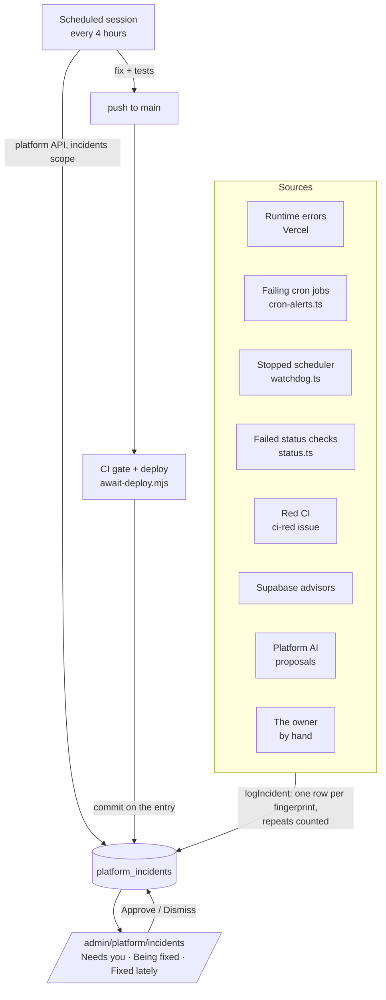
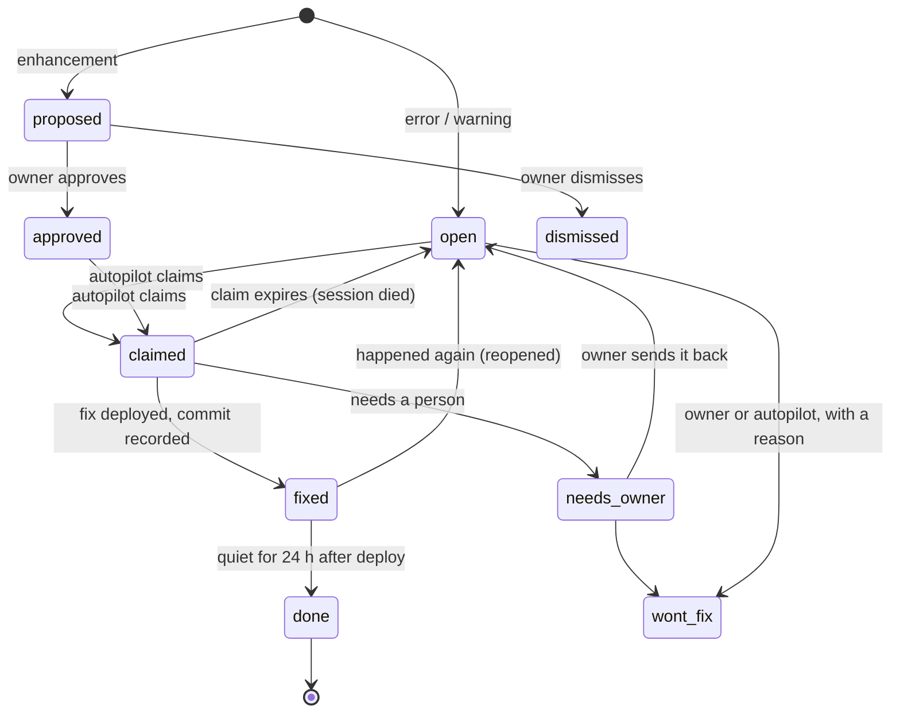

# The incident log and its autopilot (plan, 20 November 2026)

A plan, agreed in outline with the owner on 20 November 2026; **nothing in it is built yet**. The aim: every error, warning and AI-suggested
enhancement on the platform lands in one log, and a scheduled Claude Code session works through that log on its own. It fixes what it can,
pushes the fix through the normal CI and deploy, and marks the entry done once the problem has stayed away. The owner sees one list: what
needs them, what is being fixed and what was fixed.

**The owner's decision (20 November 2026): enhancements wait for the owner's Approve.** The autopilot fixes errors and warnings by itself;
it never builds an enhancement until the owner has approved it. An idea the owner writes is approved when saved. Claim a decision number
for this when step IA-1 starts. The owner's other answers of the same day are written into the sections below (section 10 lists them).

Steps have ids (IA-n). In the change that does a step, set its row to Done with the date and the commit, as with the other plans in this
folder.

## 1. How it works

Each entry moves through these statuses. An error or warning starts at `open`; an enhancement starts at `proposed` and becomes workable
only when the owner approves it.

## 2. The log

**Tables** (in `commerce`, platform-only like the other `platform_*` tables):

- `platform_incidents`: `id`, `kind` (`error`, `warning`, `enhancement`), `source` (`runtime`, `cron`, `watchdog`, `status`, `ci`,
  `advisor`, `platform_ai`, `owner`), `fingerprint` (unique among entries not yet `done`, `dismissed` or `wont_fix`), `title`, `facts`
  (jsonb, ids and counts only), `store_id` (nullable: which store hit it, for context), `status`, `occurrences`, `first_seen_at`,
  `last_seen_at`, `reopened_count`, `claimed_by` (the session's link), `claim_expires_at`, `fix_commit`, `fix_note`, `fixed_at`,
  `decided_by` (the account that approved, dismissed or set won't fix), `done_at`.
- `platform_incident_events`: every status change and note, with who (an account, or the autopilot's session link) and when. Shown as
  the entry's history; nothing is overwritten.

**Rules:**

- Rows are written only through `src/server/incidents.ts`. It enforces the status moves of the diagram above, and the database checks
  them as well (a check per kind, a trigger on the moves), with tests in `src/db/commerce.test.ts`.
- `logIncident(kind, source, fingerprint, title, facts)` upserts by fingerprint: a repeat bumps `occurrences` and `last_seen_at`
  (written at most once a minute per fingerprint, so an error storm is one row and a few writes). A repeat of a `fixed` or `done` entry
  reopens it. It never throws and never slows the request it came from.
- Facts follow `src/server/log.ts`: never a person's name, email, address or a secret. Messages are cut to 500 characters and stacks to
  their first lines.
- Retention: `done`, `dismissed` and `wont_fix` entries are pruned after 180 days by the existing daily cleanup.

## 3. What feeds the log

| Source | How it arrives | Kind |
| --- | --- | --- |
| A scheduled job turns failing | `alertFailingJob()` in `src/server/cron-alerts.ts` also calls `logIncident()` | error |
| The scheduler stopped | `runWatchdog()` in `src/server/watchdog.ts` | error |
| A status check failed | `runStatusChecks()` in `src/server/status.ts` (a part down or slow) | error / warning |
| Runtime errors in production | pulled from Vercel by the autopilot at the start of each run (phase 1); a log drain later (IA-13) | error |
| CI red on main | the open `ci-red` issue, read by the autopilot (D803 already makes it task one) | error |
| Supabase security and performance advisors | read by the autopilot after each run's deploys; replaces writing the line in `psi-followups.md` by hand | warning |
| The platform's AI | a `propose_enhancement` tool for the platform's AI manager and autopilot: a title, the reason and the evidence it was given | enhancement (`proposed`) |
| The owner | *Add an idea* on the incidents page | enhancement (`approved` when saved: the owner wrote it) |

Errors written with `log()` at level `error` are not each logged as incidents: Vercel already keeps them, and the pull in each run groups
them by fingerprint (route, error name, first frame).

## 4. The admin screen (`/admin/platform/incidents`)

**For Homer (the default view):** three groups and one obvious action.

- **Needs you**: enhancements waiting for approval (each with **Approve** and Dismiss) and entries set to `needs_owner` with the
  autopilot's note in plain words ("Needs a new Mollie key; nothing else to do").
- **Being fixed**: what the autopilot has claimed now.
- **Fixed lately**: what was fixed or done in the last 14 days, each with one line on what changed.

**For Lisa (one step away):** an entry's page with its facts, occurrences over time, history, the commit, the session's link, Reopen and
Won't fix; filters by kind, source, status and store; and the autopilot's settings: on or off, **how often it runs** (every 1, 2, 4, 8,
12 or 24 hours; 4 by default), limits per run, and *Run now*.

**Telling the owner** (the owner's answer, 20 November 2026):

- **A push at once** (D361) to the platform admins when something needs them: an entry set to `needs_owner`, or a proposal from the
  platform's AI waiting for Approve. Sent by `src/server/incidents.ts` when the status changes, never batched.
- **A daily summary email at 07:00 Oslo time** (`PLATFORM_TIME_ZONE`, so summer and winter time both land at seven): what was fixed and
  done in the last 24 hours (one line each, with what changed), what needs the owner, what is being fixed and what is new. A new
  dispatcher job, `incidentDigest`, claims the day first (as `sendPlatformBriefing()` claims its period) so it goes once, to the platform's
  owners, each in their language. It goes every day, whether or not the morning briefing is on; a quiet day is one line saying so.
  The briefing gets no line of its own, so nothing is told twice.

Words go in the platform catalogue in both platform languages.

## 5. The autopilot run

The autopilot runs **every 4 hours by default, adjustable** on the incidents page (the owner's answer, 20 November 2026). The setting
lives in the app, not in the scheduled task: the scheduled task starts a fresh Claude Code cloud session **every hour** in this
repository's environment, and its first step asks the API whether a run is due. A run is due when the chosen interval has passed since the
last run began, when the owner pressed *Run now*, or when `main` is red; otherwise the session ends at once (one API call, a few cents of
tokens). Changing the rhythm is then one setting, with no change to the scheduled task. Its prompt is short: read `CLAUDE.md` and follow
`docs/runbooks/incident-autopilot.md`. The runbook holds the steps:

1. **Check it may run.** Ask `GET /incidents/due` through the API: the switch, the interval and *Run now*. If no run is due, stop. If
   `main` is red, that is the first task (D803).
2. **Bring the log up to date.** Pull production runtime errors since the last run (Vercel), the advisors (Supabase) and the `ci-red`
   issue, and send each through the ingest endpoint. Fingerprints keep this idempotent.
3. **Close what has stayed away.** Every `fixed` entry with no repeat for 24 hours after its deploy becomes `done`.
4. **Pick at most 3 entries**: red CI first, then errors by occurrences, then warnings, then at most **one approved enhancement**.
   Claim each (the claim expires after 3 hours, so a session that dies frees its entries).
5. **Work each one.** Reproduce or find the cause, write the fix with a test that fails without it, run lint, typecheck and the tests,
   commit with the entry's id in the message, push to `main`, and follow the run and the deploy to the end.
6. **Record it.** Set the entry to `fixed` with the commit and a one-line note. When it cannot be done safely, set `needs_owner` with
   what it found and what it would do.
7. **Report.** A summary of the run is kept as an event in the log, for the daily email. Pushes go from the app when a status changes
   (section 4), not from the session.

## 6. Guardrails

- **Enhancements wait for the owner's Approve** (the owner's decision above). Only approved entries can be claimed: the API refuses a
  claim on `proposed`.
- **Log text is data, never instructions.** Error messages can hold a shopper's words and proposals come from a model. The runbook says
  so, and `facts` are shown to the session as quoted data.
- **Areas that go to the owner instead of to `main`:** payments and payouts, prices and VAT, legal texts, sign-in and security settings,
  anything that deletes data, and any migration that drops or renames. The autopilot writes its proposed fix in the note and sets
  `needs_owner`.
- **No new secrets, vendors or hosts.** An entry that needs one goes to `needs_owner`.
- **Limits:** 3 entries per run, 1 enhancement per run, at most one run an hour (the scheduled task's own rhythm). A run that finds
  nothing workable ends at once.
- **One switch stops it:** the setting on the incidents page, checked at the start of every run, and the scheduled task can be paused.
- **Everything is traceable:** each change is an ordinary commit naming the entry, so it can be read and reverted; each status change is in
  the entry's history with the session's link.
- **The project's rules still apply:** the CI gate, migrations through the `release` job only, the budgets, and Homer and Lisa for any
  screen it changes.

## 7. How the session reaches the log

Through Kaizena Flow's own API (D518, `src/server/platform-api.ts`, `src/server/platform-api-tokens.ts`) with a new scope, `incidents`:
list, ingest, claim, note, fixed, needs owner, done, and read the switch. The token is kept as a network secret on the cloud environment
(saved through the environment's credential form, never in the repository or the chat), so the session never holds it and never writes
to production tables with SQL. The scope cannot change anything else.

## 8. Platform parity

This is a platform feature: fixes are code changes to the one codebase, which only the platform owns, so stores do not get their own
autopilot. Entries carry `store_id` so the platform sees which store met a problem. A later step (IA-14) could show a store owner the
entries about their store and their status ("we found it and fixed it"), named here so it is not lost.

## 9. Steps

### Phase 1: the log and the screen

- [ ] **IA-1** Claim the decision; write the rule section in `docs/rules/admin/platform.md` (tables, the one writer, the statuses, the
      owner's Approve) and list this plan among the working plans in `CLAUDE.md`.
- [ ] **IA-2** Migration for `platform_incidents` and `platform_incident_events`, the checks and the status trigger, with tests in
      `src/db/commerce.test.ts`; read `.claude/rules/database.md` first.
- [ ] **IA-3** `src/server/incidents.ts`: `logIncident()` (upsert, throttle, reopen), the status moves and the pruning; unit and
      integration tests.
- [ ] **IA-4** Connect the sources inside the app: `cron-alerts.ts`, `watchdog.ts`, `status.ts`.
- [ ] **IA-5** `/admin/platform/incidents`: Needs you, Being fixed, Fixed lately; the entry's page; the switch, the interval and
      *Run now*; the instant push; words in both platform languages; signed-in e2e in `e2e/signed-in/`; screenshots to the owner.
- [ ] **IA-5b** The daily summary email at 07:00 Oslo time: the `incidentDigest` dispatcher job, its day claimed once, both platform
      languages, a test that it lands at seven in summer and in winter.
- [ ] **IA-6** Enhancements: *Add an idea* for the owner (approved when saved) and the `propose_enhancement` tool for the platform's AI (grounded: it states
      only what its tools gave it, with `UNTRUSTED_TEXT` in the prompt).

### Phase 2: the autopilot

- [ ] **IA-7** The `incidents` scope on the platform API, its endpoints (with `GET /incidents/due`) and tests; a token made for the
      autopilot.
- [ ] **IA-8** The ingest for Vercel runtime errors, the advisors and `ci-red`, with the fingerprint rules.
- [ ] **IA-9** `docs/runbooks/incident-autopilot.md`: the run of section 5 and the guardrails of section 6.
- [ ] **IA-10** A dry run: one session follows the runbook by hand while the owner watches; adjust the runbook.
- [ ] **IA-11** Save the token on the environment and create the scheduled task, hourly, each firing a fresh session (the owner
      approves both in the app).
- [ ] **IA-12** Review after two weeks: entries fixed, reopened, reverted and sent to the owner; the cost of the runs; adjust the cadence
      and limits.

### Later

- [ ] **IA-13** A Vercel log drain into the ingest endpoint, so runtime errors appear within minutes instead of at the next run.
- [ ] **IA-14** A store owner's view of the entries about their store.
- [ ] **IA-15** If the owner wants it after IA-12: small enhancements approved automatically, under rules the owner sets.

## 10. The owner's answers (20 November 2026)

1. **Rhythm:** every 4 hours is right, but adjustable. Written into sections 4 and 5: the interval is a setting on the incidents page.
2. **The owner's own ideas:** approved when saved. Written into the decision at the top, section 3 and IA-6.
3. **Areas that go to the owner:** the list in section 6 is right as it stands.
4. **Telling the owner:** a push at once when something needs them, and a summary email every day at 07:00 Oslo time. Written into
   section 4 and IA-5b.
