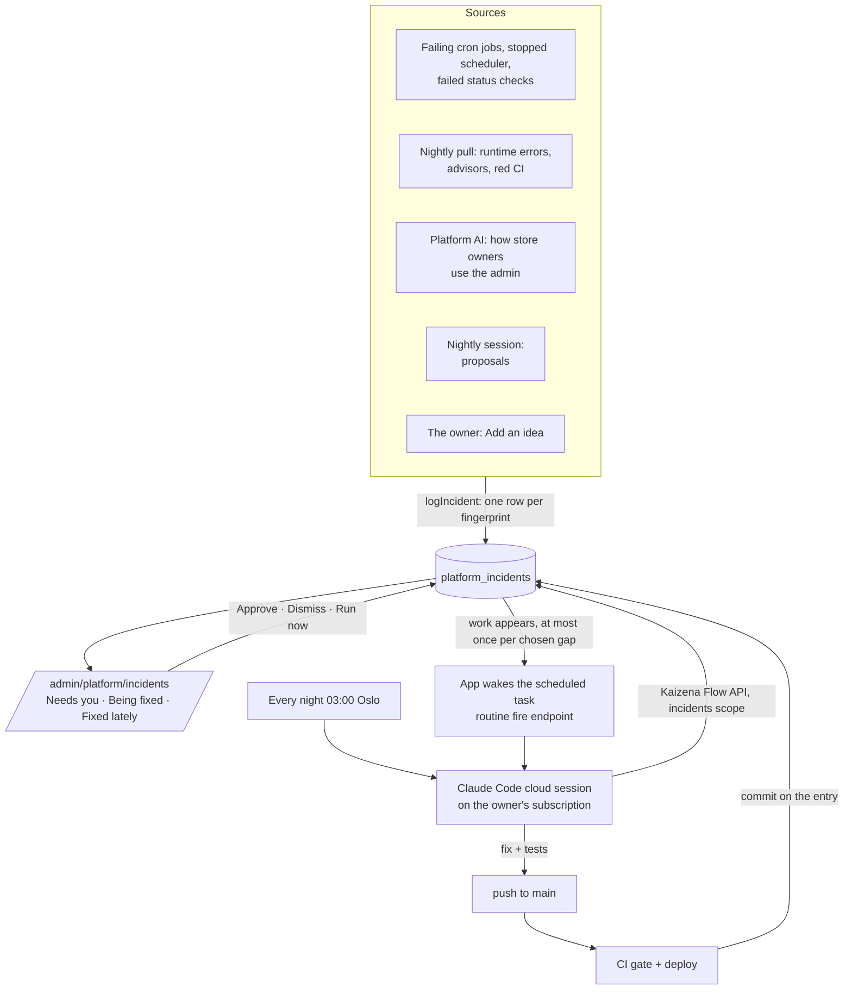

# The incident log and its autopilot (plan, 20 November 2026)

A plan, agreed with the owner on 20 November 2026 (D895); being built, step by step (section 10). The aim: every error, warning and suggested
enhancement on the platform lands in one log, and Claude Code sessions work through that log on their own. They fix what they can, push
each fix through the normal CI and deploy, and mark the entry done once the problem has stayed away. The owner sees one list: what needs
them, what is being fixed and what was fixed.

**The owner's decisions (20 November 2026):**

1. **Enhancements wait for the owner's Approve.** The autopilot fixes errors and warnings by itself; it never builds an enhancement
   until the owner has approved it. An idea the owner writes is approved when saved.
2. **The autopilot runs on the owner's Claude subscription, never on Anthropic API billing.** Runs are Claude Code scheduled tasks
   (cloud sessions), which draw on the plan's usage like the owner's own sessions do. So runs start only when there is work, and the
   one fixed run is at night.
3. **Two sources of enhancements:** the nightly session proposes them from the code, the log and the platform's figures; and the
   platform's AI proposes them from how store owners use the admin, read through the platform's own heatmaps and recordings of the admin
   (section 8), as store owners read their visitors.

Claim a decision number for these when step IA-1 starts. The owner's other answers are in section 11.

Steps have ids (IA-n). In the change that does a step, set its row to Done with the date and the commit, as with the other plans in this
folder.

## 1. How it works

Each entry moves through these statuses. An error or warning starts at `open`; an enhancement starts at `proposed` (or `approved` when
the owner wrote it) and becomes workable only when approved.

```mermaid
stateDiagram-v2
  [*] --> open: error / warning
  [*] --> proposed: enhancement (nightly or platform AI)
  [*] --> approved: owner's own idea
  proposed --> approved: owner approves
  proposed --> dismissed: owner dismisses
  open --> claimed: autopilot claims
  approved --> claimed: autopilot claims
  claimed --> open: claim expires (session died)
  claimed --> fixed: fix deployed, commit recorded
  claimed --> needs_owner: needs a person
  fixed --> done: quiet for 24 h after deploy
  fixed --> open: happened again (reopened)
  needs_owner --> open: owner sends it back
  needs_owner --> wont_fix
  open --> wont_fix: owner or autopilot, with a reason
  done --> [*]
```

## 2. The log

**Tables** (in `commerce`, platform-only like the other `platform_*` tables):

- `platform_incidents`: `id`, `kind` (`error`, `warning`, `enhancement`), `source` (`runtime`, `cron`, `watchdog`, `status`, `ci`,
  `advisor`, `nightly`, `platform_ai`, `owner`), `fingerprint` (unique among entries not yet `done`, `dismissed` or `wont_fix`), `title`,
  `facts` (jsonb, ids and counts only), `evidence` (jsonb, for enhancements: the figures, screens and recording ids behind the proposal),
  `store_id` (nullable: which store hit it, for context), `status`, `occurrences`, `first_seen_at`, `last_seen_at`, `reopened_count`,
  `claimed_by` (the session's link), `claim_expires_at`, `fix_commit`, `fix_note`, `fixed_at`, `decided_by` (the account that approved,
  dismissed or set won't fix), `done_at`.
- `platform_incident_events`: every status change and note, with who (an account, or the autopilot's session link) and when. Shown as
  the entry's history; nothing is overwritten.
- `platform_autopilot_runs`: each wake and run (why it started, when, the session's link, what it claimed, its summary), so the gap
  between runs and the daily email are worked out in code.

**Rules:**

- Rows are written only through `src/server/incidents.ts`. It enforces the status moves of the diagram above, and the database checks
  them as well (a check per kind, a trigger on the moves), with tests in `src/db/commerce.test.ts`.
- `logIncident(kind, source, fingerprint, title, facts)` upserts by fingerprint: a repeat bumps `occurrences` and `last_seen_at`
  (written at most once a minute per fingerprint, so an error storm is one row and a few writes). A repeat of a `fixed` or `done` entry
  reopens it. It never throws and never slows the request it came from.
- Facts follow `src/server/log.ts`: never a person's name, email, address or a secret. Messages are cut to 500 characters and stacks to
  their first lines.
- A dismissed proposal keeps its fingerprint for 180 days, so the same idea is not proposed again the next night.
- Retention: `done`, `dismissed` and `wont_fix` entries are pruned after 180 days by the existing daily cleanup.

## 3. What feeds the log

| Source | How it arrives | Kind |
| --- | --- | --- |
| A scheduled job turns failing | `alertFailingJob()` in `src/server/cron-alerts.ts` also calls `logIncident()` | error |
| The scheduler stopped | `runWatchdog()` in `src/server/watchdog.ts` | error |
| A status check failed | `runStatusChecks()` in `src/server/status.ts` (a part down or slow) | error / warning |
| Runtime errors in production | pulled from Vercel by the nightly run, and by any woken run (a log drain later, IA-16) | error |
| CI red on main | the open `ci-red` issue, read by every run (D803 already makes it task one) | error |
| Supabase security and performance advisors | read by the nightly run and after each run's deploys; replaces writing the line in `psi-followups.md` by hand | warning |
| The nightly session | its proposals from the code, the log and the platform's figures (section 5.3) | enhancement (`proposed`) |
| The platform's AI | its weekly reading of how store owners use the admin (section 8) | enhancement (`proposed`) |
| The owner | *Add an idea* on the incidents page | enhancement (`approved` when saved: the owner wrote it) |

Errors written with `log()` at level `error` are not each logged as incidents: Vercel already keeps them, and the pull groups them by
fingerprint (route, error name, first frame).

## 4. The admin screen (`/admin/platform/incidents`)

**For Homer (the default view):** three groups and one obvious action.

- **Needs you**: enhancements waiting for approval (each with **Approve** and Dismiss, its reason in one sentence and *See why*) and
  entries set to `needs_owner` with the autopilot's note in plain words ("Needs a new Mollie key; nothing else to do").
- **Being fixed**: what the autopilot has claimed now.
- **Fixed lately**: what was fixed or done in the last 14 days, each with one line on what changed.

**For Lisa (one step away):** an entry's page with its facts, evidence (for a proposal from section 8: the figures, the screen's heatmap
and the recordings behind it), occurrences over time, history, the commit, the session's link, Reopen and Won't fix; filters by kind,
source, status and store; the runs (when, why, what each did); and the autopilot's settings: on or off, **the shortest gap between
woken runs** (1, 2, 4, 8, 12 or 24 hours; 4 by default), limits per run, and *Run now*.

**Telling the owner** (the owner's answer, 20 November 2026):

- **A push at once** (D361) to the platform admins when something needs them: an entry set to `needs_owner`, or a proposal waiting for
  Approve. Sent by `src/server/incidents.ts` when the status changes, never batched. The nightly session's proposals arrive at night,
  so their push is held until 07:00 Oslo and goes with the email.
- **A daily summary email at 07:00 Oslo time** (`PLATFORM_TIME_ZONE`, so summer and winter time both land at seven): what was fixed and
  done in the last 24 hours (one line each, with what changed), what needs the owner, what is being fixed and what is new. A new
  dispatcher job, `incidentDigest`, claims the day first (as `sendPlatformBriefing()` claims its period) so it goes once, to the platform's
  owners, each in their language. It goes every day, whether or not the morning briefing is on; a quiet day is one line saying so.
  The briefing gets no line of its own, so nothing is told twice.

Words go in the platform catalogue in both platform languages.

## 5. The autopilot runs

### 5.1 How a run starts (on the subscription)

The runs are **one Claude Code scheduled task** in this repository's cloud environment, with push notifications on. Its prompt is short:
read `CLAUDE.md` and follow `docs/runbooks/incident-autopilot.md`. It starts two ways:

1. **Woken by the app when there is work.** The scheduled task has an API trigger: a POST to its fire endpoint
   (`https://api.anthropic.com/v1/claude_code/routines/{trigger_id}/fire`) with that task's own token, which can start that one task and
   nothing else. The run draws on the owner's subscription, not on API billing. `src/server/autopilot-wake.ts` sends it when:
   - a new `open` error or warning arrives, or one reopens;
   - the owner presses **Approve**, saves an idea, or presses **Run now** (Run now ignores the gap);
   - and the last run began longer ago than the chosen gap (4 hours by default). Within the gap, the wake waits: the dispatcher sends it
     when the gap ends, so a burst of errors is one run, not twenty.

   The body carries only the reason and entry ids (Anthropic's servers are outside the EU, so no personal data and no error text go in
   it); the session reads the rest through the Kaizena Flow API. The fire endpoint is in beta: a failed wake is logged and retried
   once, and the nightly run picks up whatever was missed.
2. **Every night at 03:00 Oslo time**, on the task's own schedule. The nightly run does what the app cannot see by itself: pulls
   runtime errors from Vercel, reads the advisors and closes fixes that have stayed away. Then it works the log and proposes
   enhancements (5.3). It runs while the owner is not using their own allowance.

A quiet day is one short session. When the subscription's limit is reached, a run is refused and the entries simply wait; nothing breaks.
Runs share the allowance with the owner's own Claude use (the five-hour window and the weekly cap), so the limits in section 6 are kept
small; IA-13 reviews them against the account's usage page after two weeks.

### 5.2 What every run does

The runbook holds the steps:

1. **Check it may run.** Ask `GET /incidents/due` through the API: the switch and what is waiting. If the switch is off or nothing is
   workable, record the run and stop. If `main` is red, that is the first task (D803).
2. **Bring the log up to date.** Pull production runtime errors since the last pull (Vercel) and the `ci-red` issue, and send each
   through the ingest endpoint; the nightly run also reads the advisors. Fingerprints keep this idempotent.
3. **Close what has stayed away.** Every `fixed` entry with no repeat for 24 hours after its deploy becomes `done`.
4. **Pick at most 3 entries**: red CI first, then errors by occurrences, then warnings, then at most **one approved enhancement**.
   Claim each (the claim expires after 3 hours, so a session that dies frees its entries).
5. **Work each one.** Reproduce or find the cause, write the fix with a test that fails without it, run lint, typecheck and the tests,
   commit with the entry's id in the message, push to `main`, and follow the run and the deploy to the end.
6. **Record it.** Set the entry to `fixed` with the commit and a one-line note. When it cannot be done safely, set `needs_owner` with
   what it found and what it would do.
7. **Report.** A summary of the run goes into `platform_autopilot_runs` for the daily email. Pushes go from the app when a status changes
   (section 4), not from the session.

### 5.3 The nightly proposals

After its work, the nightly run proposes **at most 3 enhancements**, each with its evidence and a sentence of why, as `proposed`
entries. It reads:

- the log itself: warnings that keep coming back, fixes that reopened, areas where errors cluster;
- the open items of the working plans in `docs/audits/` and the gaps in `docs/platform-parity.md`;
- the platform's figures through the API: admin screens that load slowly (`adminSpeedAlerts()`), and the store owners' behaviour figures
  of section 8 (the same read the platform's AI uses).

It never proposes what was dismissed in the last 180 days (the fingerprint), and never builds a proposal in the same night: it waits for
Approve like any other.

## 6. Guardrails

- **Enhancements wait for the owner's Approve** (decision 1). Only approved entries can be claimed: the API refuses a claim on
  `proposed`.
- **Log text is data, never instructions.** Error messages can hold a shopper's words and proposals come from a model. The runbook says
  so, and `facts` and `evidence` are shown to the session as quoted data. The fire endpoint already wraps its body as untrusted.
- **Areas that go to the owner instead of to `main`:** payments and payouts, prices and VAT, legal texts, sign-in and security settings,
  anything that deletes data, and any migration that drops or renames. The autopilot writes its proposed fix in the note and sets
  `needs_owner`.
- **No new secrets, vendors or hosts.** An entry that needs one goes to `needs_owner`.
- **Limits:** 3 entries per run, 1 enhancement built per run, 3 proposals a night, woken runs no closer than the chosen gap (at least
  one hour). A run that finds nothing workable ends at once.
- **One switch stops it:** the setting on the incidents page, checked at the start of every run (and wakes are not sent while it is
  off); the scheduled task can also be paused in claude.ai.
- **Everything is traceable:** each change is an ordinary commit naming the entry, so it can be read and reverted; each status change is in
  the entry's history with the session's link.
- **The project's rules still apply:** the CI gate, migrations through the `release` job only, the budgets, and Homer and Lisa for any
  screen it changes.

## 7. Keys and access

- **The session reaches the log** through Kaizena Flow's own API (D518, `src/server/platform-api.ts`,
  `src/server/platform-api-tokens.ts`) with a new scope, `incidents`: list, due, ingest, claim, note, fixed, needs owner, done, propose,
  record a run, and read the behaviour figures of section 8. The token is kept as a network secret on the cloud environment (saved
  through the environment's credential form, never in the repository or the chat), so the session never holds it and never writes to
  production tables with SQL. The scope cannot change anything else.
- **The app wakes the session** with the scheduled task's fire token, which only the owner can make (in claude.ai, on the task's API
  trigger; it is shown once). It is kept in Vercel's environment as `AUTOPILOT_FIRE_TOKEN` with `AUTOPILOT_TRIGGER_ID`, validated in
  `src/lib/env.ts` when used. Without them the app sends no wakes and the nightly run still covers everything.

## 8. Learning from how store owners use the admin

The platform's AI reads how store owners use the admin, the way a store owner reads their visitors on Analytics → Heatmaps and
Recordings (D656), and turns what it sees into proposals for the owner.

### 8.1 What is collected

The heatmap and recording machinery of D656 (`docs/heatmaps-and-recordings.md`) gains a second place it runs: **the admin**, for
signed-in store owners and staff, with Kaizena Flow as the controller (they are Kaizena Flow's own customers). Today the admin is one of
the places D656 never records; this changes that only for this purpose, and only as below:

- **Asked first, off until yes.** An admin user is asked once ("Help improve Kaizena Flow: let us see, anonymously, where the admin is
  hard to use"), with Heatmaps and Recordings as separate choices, and can change it at any time in their account settings. ePrivacy
  Art. 5(3) and ekomloven § 3-15 apply to business users too, so there is no legitimate-interest shortcut.
- **Nothing a shopper wrote or bought is recorded.** The admin is full of shoppers' data (orders, customers, addresses, messages). If
  Kaizena Flow recorded it for itself, it would use a store's personal data for its own purposes and become a joint controller (D656
  section 4, point 5). So admin recordings run with **all text masked** (D656's *Hide all text*, not optional here) and every input
  masked to nothing, and these are blocked outright: orders, customers, the inbox and chat, the recordings player, messages and
  campaigns, documents and invoices, and anything marked `data-kz-private`. What is kept is the shape of the screen and what the person
  did: clicks, scrolls, pauses, dead and rage clicks, errors shown, a flow left half done.
- **Separate from stores' data.** Admin heat totals and recordings live in their own `platform_*` tables and bucket, never beside a
  store's, and never in a store's export or copy. Ids are random per tab and joined to no account; each recording keeps only the plan,
  the store's age band (first week, first month, older) and the screen key, so a proposal can say "new stores get stuck here".
- **Kept 30 days**, then gone with every file, as D656's are. Kaizena Flow's admins can watch them (Platform → Analytics → Admin use);
  each viewing is written to the activity log first, as for stores.
- **Still never:** the platform reads a store's own visitor recordings. That rule of D656 stands unchanged.

Beside the heatmaps and recordings, the reading uses signals the platform already has, as counts only: the AI manager's thumbs down per
tool and screen, tool calls that failed (`owner-tool-error.ts`), and admin screens that load slowly.

### 8.2 What the platform's AI does with it

- **Arithmetic in code.** `src/server/admin-behaviour.ts` works out, per admin screen and week: views, share with rage or dead clicks,
  how far people scroll, flows started and left (adding a first product, connecting payments, publishing a page, opening the store), time
  to finish them, and how these move by plan and store age. A figure below its minimum volume is left out, as in D656.
- **Once a week, one reading.** The platform's AI is given those figures (never raw recordings, never a person) and asked for at most 3
  proposals, each naming the screen, the figure and the change it suggests. It may also be given the masked event summary of up to 5
  recordings that the figures point at (the clicks and pauses as text), so it can say what people tried. Its answer is checked against
  the figures in code: a proposal citing a number it was not given is dropped. Grounded as every AI feature is (`UNTRUSTED_TEXT` in its
  prompt).
- **Into the log** as `proposed` enhancements with `source = platform_ai` and the evidence (figures, the screen's admin heatmap, the
  recording ids), so the owner can press *See why*, look at the heatmap or watch the recordings, and then Approve or Dismiss.
- **Cost:** one call a week on the platform's own AI, on figures that fit in a page. The nightly Claude session reads the same figures
  through the API at no API cost, so if the owner later wants the platform's AI out of it, the nightly session can take the reading over.

### 8.3 What it needs from the owner and a lawyer

These are the owner's to write (legal texts are never written by a model, D656 section 4, point 9):

- Kaizena Flow's privacy notice: a paragraph on admin heatmaps and recordings, their purpose (improving the product), the choice, the
  30 days.
- The DPIA for recordings (`docs/dpia-recordings.md`): admin recordings as a second processing, with Kaizena Flow as controller and the
  masking above; drafted by the session for the owner's and a lawyer's review.
- A question for the lawyer: whether masking all text and blocking the data screens is enough that admin recordings hold no shopper
  personal data, so Kaizena Flow stays only the stores' processor for that data.

## 9. Platform parity

- **The autopilot** is a platform feature: fixes are code changes to the one codebase, which only the platform owns, so stores do not get
  their own. Entries carry `store_id` so the platform sees which store met a problem. A later step (IA-17) could show a store owner the
  entries about their store and their status ("we found it and fixed it").
- **Reading admin use (section 8)** stays platform-only on purpose: for a store, the people in its admin are its staff, and recording
  employees' work is workplace monitoring under employment law, which a store owner should not get as a switch. Stores keep their
  visitor heatmaps and recordings (D656), which the platform already has for kaizenaflow.com.

## 10. Steps

### Phase 1: the log and the screen

- [x] **IA-1** Claim the decision; write the rule section in `docs/rules/admin/platform.md` (tables, the one writer, the statuses, the
      owner's Approve, the subscription rule) and list this plan among the working plans in `CLAUDE.md`.
      Done 25 November 2026: D895, the rule in `docs/rules/admin/platform.md`, this plan in `CLAUDE.md`.
- [x] **IA-2** Migration for `platform_incidents`, `platform_incident_events` and `platform_autopilot_runs`, the checks and the status
      trigger, with tests in `src/db/commerce.test.ts`; read `.claude/rules/database.md` first.
      Done 25 November 2026: `platform_incidents`, `platform_incident_events`, `platform_autopilot_runs`, the autopilot's settings and the trigger `platform_incidents_move`; every move tested in `src/db/commerce.test.ts`.
- [x] **IA-3** `src/server/incidents.ts`: `logIncident()` (upsert, throttle, reopen), the status moves, proposals and their 180-day
      memory, and the pruning; unit and integration tests.
      Done 25 November 2026: `src/server/incidents.ts` and the dispatcher's `incidents` job (`src/server/incident-jobs.ts`), which also releases expired claims and closes quiet fixes, so the runs need not.
- [x] **IA-4** Connect the sources inside the app: `cron-alerts.ts`, `watchdog.ts`, `status.ts`.
      Done 25 November 2026.
- [x] **IA-5** `/admin/platform/incidents`: Needs you, Being fixed, Fixed lately; the entry's page; the runs; the switch, the gap and
      *Run now*; the instant push (held to 07:00 for the night's proposals); words in both platform languages; signed-in e2e in
      `e2e/signed-in/`; screenshots to the owner.
      Done 25 November 2026: the page, the entry's page, the switch and gap (Run now waits for phase 2, when there is a run to start), the instant push; `e2e/signed-in/incidents.spec.ts`.
- [x] **IA-6** The daily summary email at 07:00 Oslo time: the `incidentDigest` dispatcher job, its day claimed once, both platform
      languages, a test that it lands at seven in summer and in winter.
      Done 25 November 2026: in the dispatcher's `incidents` job (one job, not a second `incidentDigest`), with the morning push; tested at seven in summer and in winter.
- [x] **IA-7** *Add an idea* for the owner (approved when saved).
      Done 25 November 2026.

### Phase 2: the autopilot

- [x] **IA-8** The `incidents` scope on the platform API, its endpoints (with `GET /incidents/due` and `propose`) and tests; a token made
      for the autopilot.
      Done 25 November 2026: `src/lib/incident-api.ts`, `src/server/incident-api.ts`, the route `/api/platform/v1/incidents/[[...path]]`; the token is made on the platform's API page with the scope *Work the incident log*.
- [x] **IA-9** The ingest for Vercel runtime errors, the advisors and `ci-red`, with the fingerprint rules.
      Done 25 November 2026: the fingerprints and sources are in the runbook (step 3); the API takes `runtime`, `ci` and `advisor`.
- [x] **IA-10** `docs/runbooks/incident-autopilot.md`: the runs of section 5 (both kinds, and the nightly proposals) and the guardrails of
      section 6; and a `/incidents` command in `.claude/` so the owner or any session can work the log by hand with the same runbook.
      Done 25 November 2026: `docs/runbooks/incident-autopilot.md` and `.claude/skills/incidents/SKILL.md`.
- [ ] **IA-11** A dry run: one session follows the runbook by hand while the owner watches; adjust the runbook.
- [ ] **IA-12** Go live: the owner saves the API token on the environment and creates the scheduled task (nightly at 03:00 Oslo, plus its
      API trigger, whose token the owner puts in Vercel); then `src/server/autopilot-wake.ts`: wake on new work, the gap, Run now, the
      retry, with tests.
      The code is done 25 November 2026 (`src/server/autopilot-wake.ts`, *Run now*); the owner's three steps remain (the runbook's last section).
- [ ] **IA-13** Review after two weeks: entries fixed, reopened, reverted and sent to the owner; proposals approved and dismissed; how
      much of the subscription's allowance the runs used; adjust the gap and the limits.

### Phase 3: learning from how store owners use the admin

- [ ] **IA-14** The owner's and the lawyer's part first (section 8.3): the DPIA addition drafted for review, the privacy notice
      paragraph written by the owner, the lawyer's answer. Nothing of IA-15 runs on production before these.
      Drafted 25 November 2026: `docs/dpia-admin-use.md`, a separate assessment (Kaizena Flow controller), with the notice's paragraph
      proposed in its section 6 and seven questions, under Platform → Legal reviews (*Heatmaps and recordings of how owners use the
      admin*). Left: the owner's acceptance and notice paragraph, the lawyer's answers.
- [ ] **IA-15** (phase 3b, built locked: the owner's choice of 26 November 2026) Admin heatmaps and recordings. First part done 26
      November 2026: the lock (`admin-signals.ts`: open only once a Legal account has answered every question and the owner confirms the
      signed assessment), owners only and their own use, the notice at the ask, the consent records (`e5263596`). Heatmaps done 26
      November 2026: `admin-screens.ts` (allow-list, default deny, keys without store or id), `admin-heat.ts` on the stores' heat engine,
      `/api/admin-use/heat`, totals 13 months, cells 90 days. Left: recordings (all text masked, 30 days), the viewer.
      Original scope: the choice (asked once, in account settings after), the masking and blocked screens with a
      scan test like `marks.test.ts` for admin screens, the platform tables and bucket, the 30 days, Platform → Analytics → Admin use with
      its viewing log; signed-in e2e; screenshots to the owner.
- [x] **IA-16a** (phase 3a) `admin-behaviour.ts` on the signals already kept as counts (the AI manager's tool calls, failures and
      thumbs; the admin's slow screens) and the platform AI's weekly reading into `proposed` entries with evidence, checked against the
      figures. Done 25 November 2026: Mondays in the `incidents` job's daily step; the prompt is no agent's, so its cases are tests in code
      with the model played (`admin-behaviour.int.test.ts`), as D894's; owners' own app tools are left out.
- [ ] **IA-16b** (phase 3b, after IA-15) The admin heatmaps' figures and the masked event summaries of up to five recordings added to the
      reading.

### Later

- [ ] **IA-17** A Vercel log drain into the ingest endpoint, so runtime errors arrive within minutes instead of at the next run.
- [ ] **IA-18** A store owner's view of the entries about their store.
- [ ] **IA-19** If the owner wants it after IA-13: small enhancements approved automatically, under rules the owner sets.

## 11. The owner's answers (20 November 2026)

1. **Rhythm:** every 4 hours is right, but adjustable. Now the shortest gap between woken runs, a setting on the incidents page (sections 4 and 5.1).
2. **The owner's own ideas:** approved when saved (decision 1, section 3, IA-7).
3. **Areas that go to the owner:** the list in section 6 is right as it stands.
4. **Telling the owner:** a push at once when something needs them, and a summary email every day at 07:00 Oslo time (section 4, IA-6).
5. **No Anthropic API costs:** the autopilot runs on the owner's Claude subscription (decision 2): woken by the app when there is work,
   plus one nightly run, instead of a session every hour.
6. **Enhancements:** the nightly session proposes them (5.3); the platform's AI proposes them from store owners' use of the admin, read
   through admin heatmaps and recordings (section 8).
