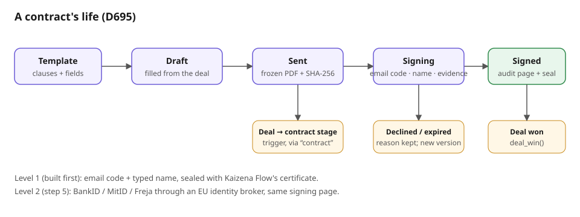

# Contracts for deals, signed on our own page (D695)

A design, not yet built. The owner's choice (16 November 2026): a contract builder for deals with signing **of our own**, not
DocuSign. Each step below gets its commit and its line under D695 when it is built.

## 1. What Homer and Lisa get

**Homer**, on a deal's page: *New contract*. He picks a template (or the one the store uses), sees the contract filled in from
the deal (who, the company, the linked quote's lines, the store's business details), and presses **Send for signing**. The
customer gets an email with a link, reads, signs; Homer gets the signed PDF and the deal moves on by itself. He reads nothing
first.

**Lisa**, one step away (Customise): the template's clauses and optional clauses, the fields, who signs and in what order (the
store's signer first or last), a reminder schedule and an expiry, the signing level (section 5), a new version of a sent
contract, the audit trail of each signature.

## 2. What is reused

| Need | Reused from |
|---|---|
| A contract on a deal | `contracts.deal_id` (as built: a contract carries its deal, not a `deal_links` row, since it has no value of its own for `dealValue()`) |
| The deal moving without a person | `deal_quote_sent()` / `deal_win()` and `deal_moves.via` (D464) |
| Fixed once sent | the invoice snapshot (`src/lib/invoice-snapshot.ts`) |
| The PDF, kept once with its SHA-256 | `src/server/invoice-pdf.ts`: `documentHtml()` → Chromium → private `documents` bucket |
| A link that is the whole access | `src/lib/document-token.ts`, a new kind `ctr_` (and `sig_` for each signer) |
| Fields | deals, `customer_companies`, `draft_orders`, business details, custom fields (D118) |
| Emails, reminders, expiry | email templates, `runJobs()` in the five-minute dispatcher |
| History | the customer timeline (D462, kind `contract`), the audit log |
| Text in other languages | `src/lib/messages/{lang}.ts`; a template has a drawing per store language |

## 3. The model (`commerce`)

- `contract_templates` (store, name, language, `blocks` jsonb, version, archived). Blocks are a small set: heading, paragraph,
  field, optional clause, the quote's lines, a signature box per signer role. Fields are a closed list worked out in code
  (`src/lib/contract-fields.ts`, pure), never free SQL or HTML.
- `contracts` (store, deal, template and its version, title, language, status, `snapshot` jsonb, `pdf_path`/`pdf_sha256` of the
  sent document, `signed_pdf_path`/`signed_pdf_sha256`, `token`, `expires_at`, `sent_at`, `completed_at`, `replaces_id`).
  Status: `draft → sent → (viewed) → signed | declined | expired | cancelled`.
- `contract_signers` (contract, role `store|customer|other`, name, email, order, `token`, `viewed_at`, `signed_at`,
  `declined_at`, reason, level, the evidence of section 5).
- `contract_events` (contract, signer, kind, at, ip, user agent, the document's SHA-256 at that moment), written by
  triggers and the signing route; never updated or deleted.

The database holds the rules: a contract's snapshot and sent PDF never change after `sent_at` (as invoices'); a change is a new
contract that `replaces_id` the old one and cancels it; a signed contract is never deleted while its retention lasts; a signer
signs at most once; `completed_at` is set only when every signer has signed. Tests in `src/db/commerce.test.ts`.

## 4. Deals

- Sent: the deal moves forward to its pipeline's **contract stage** (a new `deal_stages.contract_stage`, at most one per
  pipeline, as the quote stage), never back, never when closed; `deal_moves.via` `contract`.
- Signed by all: the deal is **won** (`deal_win()`), unless Lisa chose the stage it moves to instead.
- Declined: the deal stays open, the reason on its history; Homer sees *Declined: …* with *Send a new version*.

## 5. Signing

The signing page `/s/{store}/{market}/sign/{token}` (the store's look, its language, no account needed) shows the whole
contract as HTML from the same snapshot as the PDF, a download of the PDF, and one action: **Sign** (or Decline, with a reason).

**Level 1, simple electronic signature (eIDAS art. 3(10)), built first, no vendor:**

1. The signer proves the email the link was sent to with a six-digit code (limited tries, short life, counted per IP).
2. They type their full name, tick *I have read and agree*, and press Sign.
3. Kept as evidence: the code's check, name typed, time, IP, user agent, the SHA-256 of the document they were shown (it must
   equal `pdf_sha256`, or signing is refused), every view.
4. When the last signer signs, the server builds the **signed PDF**: the sent PDF with an added audit page (each signer, their
   evidence, the hashes), then **sealed** with Kaizena Flow's own certificate (a PAdES signature over the whole file) so any
   change to it shows in a PDF reader. Kept once in `documents`, emailed to every signer.

**Level 2, advanced signature (AdES) with national ID, step 5:** the same page, but step 1 is BankID (Norway), MitID, Freja,
Smart-ID … through one EU identity broker (chosen then: Criipto, Signicat or Scrive, processing in the EU). The broker's signed
identity assertion is kept as the evidence; the seal can become a qualified one from the same vendor. Its credentials are a
platform or store setting, never an environment variable (D15). Lisa chooses the level per template, once level 2 exists (after level 1 is in use, section 8).

The store's signer signs inside the admin (already signed in with two-step), with the same evidence.

## 6. Around it

- **Emails**: sent, reminder, signed (with the PDF), declined, expired; to the deal's owner as staff alerts.
- **The AI manager** gets tools to draft a contract from a template for a deal, send it and read its status. It never writes
  a price or a clause's figures: those come from the linked quote and the template (grounding rule). A tool change means a new
  recording on Platform → AI.
- **Webhooks** (D354) `contract.sent|signed|declined`; the Admin API (D355) reads contracts.
- **Retention**: a signed contract is kept 3 years 6 months after the agreement ends (Bokføringsloven § 13(2)); erasure keeps it
  (legal obligation) and removes the person from everything else; the export lists contracts under purpose `sales`.
- **Permissions** (as built): a deal's: reading with `customers:read`, drafting, sending and cancelling with `customers:write`. The store's signer is a member of the store, held by the database (the deal's owner, else the one who made the draft, else a member Lisa names); no new permission key, so roles need no change.
- **Usage and limits** counts contracts sent per month; the feature sits under `sales` (D464), offered as Deals is.
- **The platform**: Kaizena Flow's own store has Deals (D466), so it gets contracts in the same change (its own sales
  agreements); `docs/platform-parity.md` needs no new row.

## 7. Steps

*Step 1, as built (16 November 2026):* the four tables (`src/db/schema.ts`), the rules
(`supabase/migrations/20261116191654_contracts_rules.sql`: a sent contract frozen, signers once and in order against the sent PDF's
SHA-256, the events append-only, sending moves the deal to the contract stage, the last signature wins it with `closed_via` `contract`),
`src/db/contracts.test.ts`, the blocks and fields (`src/lib/contract-fields.ts`), and the registers: the person's export lists their
contracts (`marketing`, with their deals), erasure deletes the contracts sent to the person or naming their address as a signer (nothing
is signed before step 3, which keeps a signed one under bookkeeping law instead), a merge moves them (`commerce.customer_merge`), the
whole-store file holds the templates and a store copy takes none.

*Step 1, the server and the PDF (16 November 2026):* `src/server/contracts.ts` makes Homer's first template in the store's language
(`src/lib/contract-templates.ts`, Norwegian bokmål and English), a draft on a deal from it (the deal's owner as the store's signer, its
person as the customer's), changes a draft's words and signers, sends it (`fillContract()` with the facts from the deal, its person and
company, the store's business details and the first linked quote, its amounts written by `formatMoney()`; a field with no value stops it and
is named), draws the PDF from the snapshot (`ContractDocumentView`, `contractHtml()`, the invoices' closed Chromium page), keeps it once in
`documents` under `{store}/contracts/` and freezes snapshot, file and SHA-256 in one statement; a new version and a cancel. A quote block
with no quote linked is left out rather than stopping the send. Erasure removes the person's contract files after its transaction.
`src/server/contracts.int.test.ts`. Nothing in the admin calls it yet (step 2), and sending emails nobody until the signing page (step 3).

1. Tables, rules and their tests; `contract-fields.ts`; snapshot and the sent PDF.
2. Templates: the editor (Homer's one template made on first visit in the store's language; Lisa's blocks), *New contract* on
   a deal.
3. The signing page at level 1, the email code, the signed PDF with its seal, emails, reminders and expiry (cron).
4. Deals' contract stage and win, the timeline, webhooks, the AI manager's tools.
5. Level 2: an EU identity broker for BankID and its neighbours.

*Step 2, the admin (16 November 2026), first part:* a deal's page has a Contracts card (its contracts and their state, and
*New contract* while the deal is open), and each contract its page (`/admin/{store}/deals/{deal}/contracts/{id}`): a draft's title, words
and signers in `ContractEditor` (Homer changes words in place; Lisa adds, moves and removes blocks, leaves out an optional clause, picks
the store's signer from the team and adds the customer's), beside the preview filled in from the deal now with what still stops it, kept in
view on a wide screen; a sent one's signers, its PDF (`…/pdf`, read from storage, no Chromium), a new version and a cancel. The deal's
history and its won line say a contract moved or won it. Words in English and Norwegian (`deals.*.ts`, `contracts`; «kontrakt» in
Norwegian, as a deal there is «avtale»). Actions through `storeAction()` (`contract-actions.ts`). `e2e/signed-in/contracts.spec.ts`.
*Step 2's second part (17 November 2026):* the store's templates (`/admin/{store}/deals/contract-templates`, a quiet link beside
Pipelines on the board, Lisa's depth): a new one from the starter in Norwegian or English, named so it is not taken; its name, language,
words (`BlocksEditor`, shared with a draft), days to sign and days between reminders, beside a preview with each field shown by its name;
its version rises when its words change; put away, never deleted, the last one kept. *New contract* offers a choice once there is more than
one template, and a contract takes its template's reminder days. `contracts.int.test.ts` (templates), `e2e/signed-in/contracts.spec.ts`.

*Step 3, signing (17 November 2026), as built:* the owner chose Kaizena Flow's own self-made seal for now (a trusted provider's
certificate with BankID, step 5). **The database** (`20261117003018_contract_signing`, `20261117003025_contract_signing_rules`,
`20261117010744_contract_signers_asked`): a signed contract is kept for the retention kind `contracts` (54 months from signing, which
covers Bokføringsloven § 13(2)'s 3 years and 6 months after the end of the year it was signed in; for an accountant to review): erasure
and staff never delete it, it outlives its deal (the deal set null), and only `pruneContracts()` deletes it with its files; a deal
deleted takes its other contracts; email codes (`contract_codes`: a hash, ten minutes, five tries, five an hour) and the seal
(`contract_seals`: one certificate, its key encrypted with `SETTINGS_ENCRYPTION_KEY`, made on first use, so no new secret). **The
server** (`src/server/contract-signing.ts`): *Send for signing* freezes the contract and asks the first signer: the store's in the admin
(emailed only when someone else sent it), then the customer by an email with their own link, `/s/{store}/{market}/account/sign/{token}`
(a no-extras path as the hosted documents, `isSignLinkPath()`; the link and the code are never kept in the email log). The customer
proves their email with a code, types their name, agrees and signs, against the sent PDF's SHA-256; the store's signer signs in the
admin, the evidence saying only that they were signed in. A decline tells the sender and the store's signer. **The signed PDF**
(`src/server/contract-jobs.ts`, `contract-seal.ts`), made by the job in `/api/cron/document-pdfs` (which carries Chromium): the sent PDF,
checked against its SHA-256, the signing record's page after it (who signed, how, when and from which address, every event, the
fingerprints; `ContractAuditView`), sealed with a PAdES signature over the whole file, kept once and emailed to every signer. Poppler's
`pdfsig` reads a sealed file as valid, the whole document signed, its issuer unknown (the self-made seal). The same job expires
contracts, reminds a waiting signer (after the contract's reminder days, three by default, three times at most), deletes used codes and
prunes. **Words** in Norwegian and English (`contract-signing-text.ts`, the audit page in `contract-text.ts`). **Tests:**
`src/db/contracts.test.ts`, `contract-seal.test.ts` (the signature's digest is the file outside it), `contract-signing.int.test.ts`,
and `e2e/signed-in/contracts.spec.ts` (the store signs in the admin, the customer on the store's page with a code; the send's PDF is played
there, as the e2e server keeps no files). *Found while building:* the signers' guard refused keeping when a signer was asked, so
reminders could not be counted (fixed by `20261117010744`).

*Step 4, first part (17 November 2026):* the pipelines page marks the stage sent contracts go to (*Sent contracts go here*, a tick box,
at most one a pipeline, none by default, as the quote stage's rule in `saveStages()`); a contract sent moves its deal there and a signed one
wins it, as step 1's rules said. A person's and a company's timeline shows each contract sent, signed or declined, with the deals (kind
`deal`, linked to the contract's page). *Left for step 4's second part:* `contract.*` events to an owner's endpoints and workflows (a
migration for the workflows' trigger list and a new API contract version), and the AI manager's contract tools (a prompt change: the
agents' eval is recorded again on Platform → AI once it is live).

*Step 4, the AI manager (17 November 2026):* three tools (`src/lib/contract-tools.ts`, `src/server/contract-tools.ts`, rules in
`docs/rules/admin/ai.md`): `list_contracts` (contracts, their signers' turn and the templates; never an email, a decline's reason or the
words), `draft_contract` (a draft on an open deal from a template, saying what stops it being sent) and `remind_contract_signer` (the
owner's yes; once a day at most). The design said the manager would also *send*: it does not, as sending draws the PDF with Chromium and
only the contract's page route carries it; the manager gives that page and the owner presses Send for signing. In the same push the pages
held out of the manager's prompt for a deploy (Forms, D705; text messages, D632) went back in, so one eval run covers both.
`src/server/contract-tools.int.test.ts`. The API contract is 1.35.

## 8. The owner's answers (16 November 2026)

- **Level 2 after level 1 is in use**: step 5 waits until stores have sent contracts at level 1.
- **A contract is always its own document**: a quote is never signed as the contract. A template may still show the linked
  quote's lines as a block (fields only), but the thing signed is the contract.
- **The store signs by the deal's owner or a named signer**: the contract's store signer is the deal's owner by default; Lisa
  may name another member of the store. With no active owner on the deal, the one who makes the draft is its store signer.
