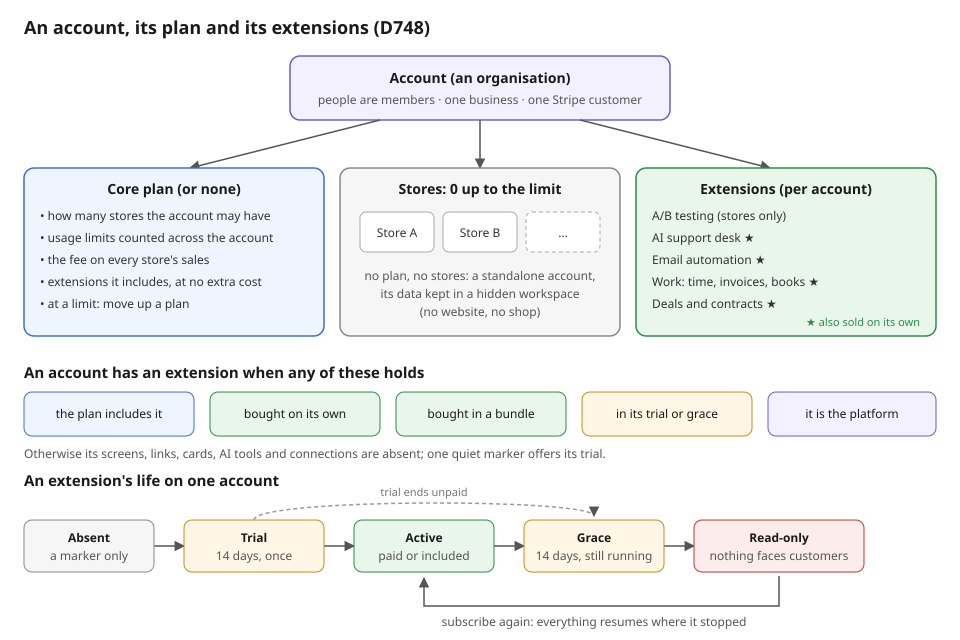

# Paid extensions, account plans and standalone products (D748)

A design, not yet built. The owner shaped it in an interview on 17 November 2026: keep the core plan lean and affordable, and sell
the deeper tools as **extensions** that those who need them add. Each step in section 13 gets its commit and its line under D748
when it is built.

## 1. The intent, in the owner's words

- The core subscription stays lean and cheap. Five parts of the platform become paid extensions: **A/B testing**, **AI support
  desk**, **email automation**, **Work** (time, invoicing and the books) and **deals and contracts**.
- A plan can **include** an extension at no added cost.
- Four extensions are also sold **on their own** (standalone): the support desk, email automation, Work, and deals and contracts.
  Someone who signs up for one of them sees **no website or store feature at all**. Adding the core plan or another extension
  from there is dead simple: one obvious press.
- Until an account opts in, an extension's links, cards, associations and connections are **absent**. A subtle but clear marker
  where it would help offers its trial with one press, or a subscription once the trial has ended.
- Every extension has **its own trial**.
- **The octopus**: the parts are interconnected by design. Each arm works alone; the more arms an account has, the more the
  system knows and the more they work as a team (the support desk and the storefront's shopper chat are separate, and a team
  when both are there). Remove an arm and the system knows less, but nothing breaks.

## 2. What was decided

| Question | Decision |
|---|---|
| Unit of billing | **The account**, not the store. Plans move from the store to the account; a plan sets how many stores the account may have |
| What an account is | **An organisation** that owns the stores, the plan and the extensions. People are members. Every sign-up creates one quietly; the screens say "account", never "organisation" |
| Usage limits | Counted **across the whole account** (orders, products and the rest of `LIMIT_KEYS`) |
| At the store limit or a usage limit | **Move up a plan** (no single-store add-on) |
| Existing owners with several stores | Their stores become one account on **the highest plan any of them had**, with a store limit of at least the stores they have |
| A standalone product | The extension's own price, the same whether or not the account has a plan. Standalone just means extensions without a core plan |
| The AI manager | In every account, standalone too. It sees only the arms the account has |
| Trial | 14 days per extension, once per account per extension |
| Ended trial, failed or stopped payment | 14 days of grace with everything running and a clear notice, then **read-only**: nothing that faces customers runs, the owner can read and export everything, data is kept while the account lives. Subscribing again resumes where it stopped |
| Existing accounts | A trial for every extension they already use: 60 days from launch day, with reminders 30, 14 and 3 days before it ends |
| Discovery | Subtle, clear markers with one-press trial or subscribe; the AI manager may suggest, tastefully (section 6) |
| Who can buy | Only the account owner. Others see the marker as "Ask your account owner"; an owner can dismiss a marker for good |
| Paying twice | Never. The checkout and the AI manager always show **the cheapest way** to get what the owner chose (section 8.3) |
| Prices | Settings, not code. Bundles allowed, buying one by one always possible |
| Starting low | **A founding price**: list prices set where the business is sustainable, a founding price for 12 months, locked for those who start in the launch period |
| AI over prices | A setting chosen by whoever owns the prices: off, proposes and the owner approves each change, or changes on its own inside a range. The same feature for Kaizena Flow's extension prices and for every store's own product prices (section 9) |
| Bulk email | Marketing sends go through **Amazon SES in Ireland**; Resend keeps transactional mail. An own sending domain like ActiveCampaign's (section 10) |
| Pricing table | A new block, **on any of Kaizena Flow's pages and in the admin**, from one source (section 11) |
| Standalone pages | Each standalone product gets **its own landing page** (for search), and there is one combined sign-up where you pick what you want |
| The platform | The platform admin **always has every extension** |

## 3. The five extensions and where their edges are

The rule for every edge: **e-commerce stays whole in the core.** An extension takes what is its own; what a shop needs to sell,
deliver, invoice an order and report its VAT stays.

| Extension | Takes with it (tables today) | Stays in the core | Standalone |
|---|---|---|---|
| **A/B testing** | Page experiments (`experiments`, `experiment_*`) and their test versions of pages (`search_experiments` is the platform's own search test, not a store's) | — | No: it needs a site |
| **AI support desk** | The support inbox, agents, replies, inbound email (`support_*`), chat widgets on the owner's own sites (`support_widgets`, `support_widget_site*`, D582) | The storefront's shopper chat agent (D81) | Yes |
| **Email automation** | Automations (`automations`, `automation_steps`, `automation_sends`), broadcasts (`broadcasts`, `broadcast_*`), segments (`segments`), marketing from the store's facts (D352), the account's own sending domain | The subscriber list and consent (D295, collected at checkout), transactional email (order mails, notifications D238) | Yes |
| **Work** | Clients, assignments, tasks, time and timers, Work invoices and credit notes (`work_*`), **the ledger and the books**: ledger (`ledger_*`), the VAT return (D496), SAF-T (D497), bank statements (D486), subscriptions (D503), receipts by email (D504), budget (D505), year-end (D506), accountants (D512), the threshold watch (D514), Peppol e-invoices for Work (D463) | Invoices and credit notes for shop orders (D159), the shop's VAT, OSS and IOSS reports (D161) | Yes |
| **Deals and contracts** | Deals and pipelines (`deal_*`, D464), contracts (`contract_*`, D695), activities (D468), the leads inbox (D475), email on the timeline (D476), sales reports (D520), moving in from Pipedrive (D477), the AI manager's CRM and contract tools | Customers, their orders, addresses, accounts, customer groups, company accounts and B2B (D108, D321), quotes and price on request (D431), the customer's timeline (D462) showing commerce events | Yes |

The store features (D178) stay as they are, **under** the entitlement: an extension decides whether a switch exists at all; the
store's own switch (such as `sales` for Deals, or Work switched on per store) still says whether that store uses it.

### 3.1 The octopus: what arms do together

Each pair below lights up only when both arms are there; with one arm gone, the other works alone without a hole.

| Together | What they add |
|---|---|
| Support desk + shopper chat (core) | One team: the chat hands over to the desk with the conversation, the desk's answers teach the chat's knowledge |
| Support desk + Deals | A conversation shows its customer's open deals; a sales question becomes a lead |
| Support desk + Email automation | A solved conversation can start a follow-up flow; unhappy customers are left out of campaigns |
| Email automation + Deals | Leads are nurtured by flows; a deal's stage starts or stops a flow |
| Deals + Work | A won deal becomes a client and an assignment; a signed contract opens the first invoice |
| Work + the shop (core) | Shop orders, payouts and fees post to the ledger by themselves |
| A/B testing + Email automation | A winning headline or offer can be carried into the next campaign |
| Any arm + the AI manager (core) | The manager's tools, briefing and autopilot reach every arm the account has, and only those |

## 4. Hidden until opted in

### 4.1 One answer to "does this account have it?"

`extensionState(organisationId, extensionId)` returns one of `absent`, `trial`, `active`, `grace`, `read_only`, `platform`
(`src/lib/extensions.ts` pure, `src/server/extensions.ts` reading it, cached per account and refreshed by every writer of
entitlement). Active comes from the plan's grant, a bought extension or a bought bundle. The platform's own rows answer
`platform` always.

### 4.2 What is absent

Everything the extension brings, wherever it would show: navigation items and pages, home and briefing cards, the cards and
tabs it adds to other screens (a deal on a customer, "New invoice" on a client, a conversation's thread on an order), its AI
manager tools in the assistant, in `runOwnerTool()` and in the owner MCP server, its webhook topics and Admin API routes, its
cron jobs (they skip accounts without it), and its words in search across the admin.

It reuses the store-feature machinery (D178): the `feature` tags on navigation items and `ADMIN_PAGES`, `TOOL_FEATURES` for
tools, a requirement that can now name an extension as well as a feature. A scan test holds that every route, tool and cron job
of an extension's tables is tagged with it, so a new screen cannot leak.

### 4.3 Read-only

After grace: the extension's screens open with a banner and **Subscribe**, every list and record can be read and exported,
nothing can be created or changed, and everything that faces customers stops (automations and broadcasts do not send, the support
widget does not answer and the inbox stops receiving, A/B tests stop splitting and show the original, Work sends no reminders
or repeating invoices, contracts cannot be sent for signing). Subscribing again resumes the paused flows from where they stood.

## 5. Markers

- **Where**: at most one per screen, at the point where the extension would help, in words for what Homer gets ("Answer these
  emails in one inbox, with AI. Try free for 14 days"), never a greyed-out copy of the feature.
- **One press**: the owner starts the trial from the marker; nothing to fill in. After a trial: *Subscribe*, with the price
  and what is included.
- **Quiet**: an owner can dismiss a marker for good (`extension_marker_dismissals`); dismissed, it never comes back on that
  screen. Members who cannot buy see "Ask your account owner".
- **The extensions page** (`/admin/account/extensions`): every extension with its state, the pricing table (section 11), and
  start, subscribe or cancel.

## 6. The AI manager suggests, tastefully

- A suggestion stands on a **fact the manager was given** by a tool (40 support emails this week, a list of 800 subscribers with
  no flow, 30 hours logged outside the platform), never a guess, and says what it would cost from the price list.
- **At most once** per extension per 30 days, never in the middle of an unrelated task, and never again for 90 days after the
  owner says no or dismisses it.
- The owner can say yes in the conversation: the manager starts the trial through a tool, as the marker would.
- Its prompt carries `UNTRUSTED_TEXT`, and the agent eval gets a case where a tool answer tries to make it upsell (prompt
  versions, D391).

## 7. Standalone products

- **Sign-up**: each standalone product has its own landing page on kaizenaflow.com (`/support-desk`, `/email-automation`,
  `/work`, `/deals`: built from `docs/site-design.md`, saved as drafts for the owner to publish) with its own sign-up, and one
  combined sign-up where you tick what you want. Both create the account and start the chosen trials.
- **What they see**: only the extensions they have, the account's settings and the AI manager. No website, store, products,
  orders, themes or pages; no marker for the core plan inside the extension's screens.
- **Adding more**: the account menu's **Add to your account** shows the core plan ("Open an online store") and the other
  extensions, each one press to start a trial.
- **Where the data lives**: every extension's tables carry `store_id` today. A standalone account gets a **workspace**: a
  `stores` row of kind `workspace`, with no website and no shop, never shown as a store and not counted against the store limit.
  Every existing table, guard and `owned()` filter keeps working. When the account later opens a store, the workspace's data can
  move to it or stay as the account's own.

## 8. Plans per account, and billing

### 8.1 The account

- New tables: `organisations` (name, business details, billing country, Stripe customer per mode) and `organisation_members`
  (person, role: owner or member). `stores.organisation_id` points at the owner.
- People keep their roles per store (`store_members`, P5); an accountant or agency working in many clients' stores is a member
  there and never pays for them.
- Moving over: one organisation per owner, holding the stores they own. A store with owners in more than one organisation goes to
  the owner who created it; the others stay members (section 14 asks the owner to confirm).

### 8.2 One subscription per account

- One Stripe subscription per organisation, on Kaizena Flow's own Stripe account with the organisation's own Stripe customer (a
  standalone account has no Connect account). Its items: the plan's price, each bought extension's price, each bundle's price,
  and metered items for use beyond allowances. One invoice, one card fee.
- The plan's limits (`plan_limits`) gain `stores`; usage is summed over the account's stores (`store_usage_daily`);
  `limit_overrides` already speaks of an owner. The fee on sales belongs to the account's plan, read by `storeFeeBps()` through
  the store's organisation.
- `store_billing` keeps working until the move is done, then becomes a view of the account's billing (add, never rename or drop
  while old code runs).
- Free trials of the core plan (D420) move to the account as well.

### 8.3 The catalogue and the cheapest way

- `extensions` (id, words, standalone or not, store-only or not), `extension_prices` (per currency, interval and size, with
  allowances; never edited in place, as `plan_prices`), `extension_bundles` with `extension_bundle_members` and their prices,
  `plan_extension_grants` (a plan includes an extension at a size), `organisation_extensions` (source `bought`, `bundle` or `trial`, the size,
  the bundle, when the trial ends, when payment ended and when the grace period ends; the price paid and a locked founding price come with
  E4 and E6). What a plan includes is never a row of its own: it follows the plan.
- `cheapestCover(wanted, plan, catalogue)` (pure, `src/lib/extension-cover.ts`): the cheapest set of bundles and single
  extensions that covers what the owner picked, after what the plan already includes. The checkout shows its answer ("The
  Customers bundle is €17 less than these three"); the AI manager quotes the same function; nobody pays for what the plan
  includes.
- Founding prices reuse timed plan prices (D524), extended to extensions and bundles.

## 9. The AI tunes prices, as far as the owner allows

One feature on both sides (the platform parity rule):

| Owner of the prices | What is tuned |
|---|---|
| Kaizena Flow (platform admin) | Plan, extension and bundle prices, allowances, trial and grace lengths, founding offers |
| A store owner | Their own product prices |

A setting per side with three levels: **off**; **proposes** (each change with its reasons and the figures behind it, approved
with one press); **on its own inside a range** the owner sets (for example ±20 %, never below cost). It reads trials, conversions,
cancellations and usage for the platform, and sales, margin and stock for a store. Arithmetic is code. A changed platform price
is a new price row, and subscribers keep their price unless the owner decides otherwise. A store's prices still change only
through `commerce.set_price`, so the 30-day reference price (`prior_30d_minor`) stays right.

## 10. Email automation: own sending domain, and SES for bulk

- **An own sending domain**, as ActiveCampaign does it: the account adds its domain, gets the DNS records (SPF, DKIM, DMARC, a
  return path), and sends from it once verified. A store's own sending domain (D727) is the start; it gains the account level, so
  a standalone account sends from its domain and stores can still each have their own.
- **Bulk marketing through Amazon SES in eu-west-1 (Ireland)**, at about $0.10 per 1,000 emails; transactional mail stays on
  Resend. The sending guard (D730) and pauses watch both.
- **Send allowance**: each size includes 10 emails per contact per month, so a heavy sender pays for their volume and no tier
  loses money.

## 11. The extension pricing table

- A new page block, `extensions`, beside the plans block (D142): on **any of Kaizena Flow's own pages** (a store's pages never
  hold it), and drawn by the same code on the account's **Extensions** page in the admin.
- It reads `extensions`, `extension_prices`, bundles and plan grants where the page is shown, cached under a tag every writer of
  those refreshes. Visitors get only public data.
- Each extension: its words, list price and founding price, the allowance, "Included in Grow and up" from the plan grants,
  "Also on its own" for standalone products, and **Start free trial**. Bundles show what they save against one by one.
- It speaks the page's language (`t(lang)`), and amounts are shown without VAT, as plan prices are.

## 12. The first price sheet

Prices are per month, excluding VAT; NOK is ×10 and yearly is 10× monthly, as for plans. Every number is a setting.

| Extension | List | **Founding (12 months)** | Included | Beyond |
|---|---|---|---|---|
| A/B testing | €29 | **€19** | Unlimited tests | — |
| AI support desk | €39 | **€29** | 100 AI-handled conversations a month, unlimited people | €0.40 per AI-handled conversation |
| Email automation | €25 / €59 / €119 / €199 | **€19 / €49 / €99 / €179** | 2,500 / 10k / 25k / 50k contacts, 10 emails per contact per month | the next size |
| Work | €35 | **€25** | 3 people; accountants free | €5 per person |
| Deals and contracts | €35 | **€29** | 3 people | €8 per person |
| Bundle **Customers** (Support + Email + Deals) | €85 | **€59** | as each part | — |
| Bundle **Everything** | €119 | **€89** | as each part | — |

| Plan (today) | Includes |
|---|---|
| Basic (€20) | Nothing: the lean core |
| Grow (€50) | A/B testing |
| Advanced (€300) | A/B testing, email automation at 10k, the support desk |
| Plus (€1,000) | Everything, email automation at 25k |

Why these numbers (the research, 17 November 2026): comparable tools charge per person, per contact and per AI resolution
(Gorgias and Intercom about $0.90 to $0.99 per resolution plus seats; ActiveCampaign and Klaviyo $139 to $189 at 10,000
contacts; Fiken 229 to 349 kr; Pipedrive $14 to $39 per person; A/B tools $59 to $399). Flat prices with allowances undercut
them for small businesses. What each customer costs Kaizena Flow: A/B testing, Deals and Work almost nothing; an AI-handled
conversation about €0.05 (Claude Haiku 4.5) to €0.20 (Claude Sonnet 5), so the allowance counts conversations the AI handled,
resolved or not; email about $0.10 per 1,000 through SES. Every row keeps a margin at its allowance.

## 13. Build steps

Each step leaves production working and changes nothing an owner sees until step E4.

| Step | What | Done when |
|---|---|---|
| E1 | **Organisations**: tables, `stores.organisation_id`, one organisation per owner backfilled, membership; screens unchanged | Every store has an organisation. **Built 18 November 2026**: `commerce.place_store()` places every store at commit, whichever way it was made; an account is named after its first store, never after a person |
| E2 | **The catalogue and entitlement**: extension tables, `extensionState()`, the platform always `platform`, every account `active` (`legacy`) until launch; the platform admin's editor beside plans | Prices and grants editable; nothing hidden yet. **Built 18 November 2026** (below) |
| E3 | **Gates**: every route, card, tool, MCP tool, webhook topic, API route and cron job tagged with its extension; scan test | An account without an extension sees none of it (tried on a test account) |
| E4 | **Account billing**: one subscription per account with items, the store limit, usage across the account, the fee per account plan; existing stores moved to the highest plan | Every paying store billed through its account |
| E5 | **Trials, grace, read-only, markers**; the Extensions page; existing accounts' `legacy` turned into 60-day trials with reminders | Launch day for extensions |
| E6 | **Bundles, the cheapest way, founding prices** | The checkout never charges twice |
| E7 | **Standalone**: workspaces, the product landing pages and the combined sign-up, Add to your account | A support-desk-only sign-up sees no store feature |
| E8 | **The pricing table block** on Kaizena Flow's pages and the admin | On the plans page and the landing pages |
| E9 | **The AI manager**: suggestions (section 6) and price tuning on both sides (section 9), with eval cases and a new recording | Run on Platform → AI |
| E10 | **Email**: account sending domains, SES in Ireland for bulk, the send allowance | A standalone account sends from its own domain |
| E11 | **Metering**: AI-handled conversations, extra people, contacts, reported to Stripe | Use beyond allowances is billed |

**E2 as built.** `legacy` is not a row but `platform_settings.extensions_launched_at` (null until E5), so an account made before launch has
every extension too; E5 sets it and turns what each account already uses into its 60-day trials. Platform → Plans → Extensions edits
words, sizes, allowances, prices in every currency the plans or the catalogue use (`extensionCurrencies()`), bundles and plan grants.

**E3 as built, first part (18 November 2026).** The facts ride in the cached store read and are read against the clock, so no page
pays a query more; a trial still ends on time. Gated at the store's level: navigation, `ADMIN_PAGES`, every page of an extension's
folders (`requireExtension()`, a panel that E5 turns into the marker), their actions and routes, and the AI manager's and MCP's
tools (`TOOL_EXTENSIONS`). The second part takes the account's level, cross-links, webhook topics, jobs
(`commerce.extension_on()`) and the storefront.

**E3 as built, second part (18 November 2026).** Jobs ask `commerce.extension_on()`: scheduled A/B starts and the storefront's split
(visitors see the original; `refreshExtensionFacts()` refreshes the tests' cache tag too), broadcasts (asked once per sending broadcast,
never per recipient), email automations and back in stock, repeating Work invoices, ledger posting, activity reminders, Pipedrive moves and
signer reminders. A desk without the support desk reads as switched off (`deskSettings()`: the shop's chat answers alone). The account's
level: a membership's `store.workOn` needs the Work extension (`liveStore()`), the Work tab, Work's store list, an accountant's clients and the
combined inbox count only stores whose account has it. Cross-links: `dealsOn()` replaces `featureOn(store, "sales")` everywhere (customer,
company, order and draft pages, Home's Today card, attention, leads, email filing, custom fields, segments), the control center asks per
extension, the marketing hub shows tests, automations and the sending guard only with theirs, and the page builder's "A/B test this" only
with A/B testing.

**E3 as built, third part (19 November 2026).** Webhook and workflow topics an extension owns (`TOPIC_EXTENSIONS`: an A/B test's answer,
a conversation waiting for a person, a broadcast sent and marketing paused, Work's clients and invoices, contracts and deals) are offered on
the endpoints and integrations pages and as a new workflow's trigger only while the account has the extension (`topicOffered()`); the finder
offers deals and the inbox's conversations only with theirs (`recordKindsFor()`); a store's chat on its owner's other websites draws nothing
without the support desk. The pages customers open from an extension (signing a contract, a Work invoice, a broadcast's tracked link) are
left as they are: E5's read-only state decides them, since a customer may hold such a link from before.

**E4, planned in four parts (19 November 2026).** Billing moves account by account: an account with a row in
`commerce.organisation_billing` is billed through its account (one plan, one subscription, one trial, limits across its stores); one
without is billed store by store (`store_billing`), as today. The owner's answer for the three running subscriptions (all in Stripe's test
mode: one account with two Basic stores, one with Plus): **moved automatically at launch**, so the move is E5's launch day, and until then
no account has a row except a test account the platform admin moves by hand.

1. **Dark rows and reads**: the table; `commerce.store_plans`, what counts for each store; every reader of a store's plan reads the view;
   limits across the account. Nothing changes while no account has a row.
2. **Stripe**: the account's customer, one subscription with items (the plan and the extensions; bundles in E6, metered use in E11), the
   extension prices synced, the webhook by `kaizen_organisation_id`, plan moves and plan events per account.
3. **Screens**: Account → Billing for its owner (plan, extensions, invoices, how it pays), the platform's accounts list and its overrides
   per account; a moved store's Billing page sends the owner to the account's.
4. **The move**: a preview per account (its stores and their plans, the highest, what changes in money, an account above its plan's store
   limit keeps its stores but adds none until it moves up), "Move this account" for a test account, and at launch every account: the
   subscription of the store on the highest plan becomes the account's (no new charge), the others end with credit for the unused time,
   the owner gets an email, trials move to the account, and sign-ups after launch start with an account trial. "Highest" is the plan's
   position, then its price: Plus and Advanced both have position 2 in production.

**E4 as built, part one (19 November 2026).** `organisation_billing` (one row per account; Kaizena Flow's own account is refused; a price
belongs to its plan). `commerce.store_plans` gives each store its account's plan, price, subscription, status and trial when the account
has a row, else its own; Kaizena Flow's fee takes the store's own override, then the account's. Readers moved to it: limits, the fee and
the store's billing read (`getStoreBilling()`, with `byAccount`), setup, the trial job, plan reminders, the platform's home, overview,
briefing, customers, channels, API, integrations and discounts, the AI manager's and the account assistant's reads, domain prices and the
control center; plan analytics counts one line per subscription; the house-customers job writes the view's rule out beside the store it reads (through the view each
store was read twice: CI's query budget). What a plan includes (`organisation_extension_facts()`,
`extension_on()`) is the account's plan once it has a row (a workspace with no store has one too). Limits of an account with a row: its
plan's numbers against what its stores use together (each store's count, summed), its stores' overrides at their widest, and
`stores_owned` counting the account's stores; A/B tests running stays per store (the engine's five are a store's). A store billed through
its account refuses its own plan actions (choose, cancel, a code, the portal: `ACCOUNT_BILLED`) until part three gives it the account's
page. Left on the store's own row: the trial pause mark (which store the trial's end made private, now written even without a row), the
open-plan check when a store closes, and the store's invoices.

**E4 as built, part two (19 November 2026).** `src/server/account-billing.ts` (pure rules in `src/lib/account-billing.ts`): an account's
one subscription on Kaizena Flow's Stripe account, billed to its first store's Stripe account (`customer_account`, kept on the row; an
account with no store waits for E7's business details). Its items are the plan's price and each extension bought on its own
(`syncExtensions()`: a Stripe product per extension, a price per size's price, through the same `syncRecurringPrice()` as the plans). A
change keeps the items it still wants (no new proration), adds the new and deletes the rest, prorated; one currency and one interval per
subscription; an extension the plan includes is refused (never paid twice), and a plan change keeps the extensions bought, less any the
new plan includes. Stripe's word (`applyAccountSubscription()`, from the billing webhook when the subscription names
`kaizen_organisation_id`, else the store's own path) sets the account's row, makes each extension item a bought row, and ends a bought
extension taken off or no longer paid for with 14 days of grace. Plan moves and the platform's plan events are kept for an account as for a
store, under its first store (the one Stripe bills, so Kaizena Flow's sales name the same store); the store triggers now share the two
functions. Owner and platform actions: choose (Checkout first, then at once), assign (invoiced, for the move), cancel or keep, Stripe's
portal, invoices.

**E4 as built, part three begun (19 November 2026).** Account → Billing draws the account's one plan first for an account billed through its
account: price, status and renewal, "every store in your account is on this plan", the extensions it pays for, change plan (the extensions
come along), the latest invoices, Stripe's page and cancel; the stores' list stays, without the stores' own totals and Manage links. An
account billed store by store sees the page as before. Still to come in part three: the platform's accounts list with overrides per
account, and a moved store's own Billing page pointing to the account's.

**Migration versions and the advisors after each release** (the decision, D748, points here):

- E1: `20261117235828_organisations`, `20261117235841_organisations_rules`, applied by CI 18 November 2026 04:48 UTC; all 60 stores placed.
  Advisors: no new warning (INFO only: RLS on, no policy, on both new tables).
- E2: `20261118080146_extensions`, `20261118080153_extensions_catalogue`, applied by CI 18 November 2026 08:53 UTC; 5 extensions, 8 sizes,
  32 prices (EUR, NOK), 2 bundles and the grants of Grow, Advanced and Plus. Advisors: no new warning (INFO only: RLS on, no policy; new
  indexes not yet used).
- E3: `20261118082207_extension_facts` and `20261118103538_extension_on_early` (`extension_on()` stops at its first answer: the query budget
  caught jobs reading every store's billing of an account on each call), applied by CI 18 November 2026 11:06 UTC; production on d67f931
  with E3's both parts; `extension_on()` is true for all 60 stores (not launched). Advisors: nothing on the new functions; no new warning.

The platform parity rule: the platform admin has every extension from E2; Kaizena Flow's own site sells them from E8.

## 14. Still open

Settled by the owner when the step that needs it starts:

1. Do the Tripletex and Fiken integrations (shop orders to an outside accountant's system) stay in the core, or go with Work?
2. A store with owners in two organisations at the move: the creator takes it (proposed); confirm.
3. Yearly extension prices mid-period: prorated to the account's renewal date (proposed).
4. How long read-only data is kept for an account that never comes back: while the account lives (proposed), then the usual
   closing rules (D171, D377).
5. A store's own sending domain (D727) also sends its order emails, so it is kept in the core for now (E3 left its card in place); the
   spec put it with Email automation. Confirm which.
