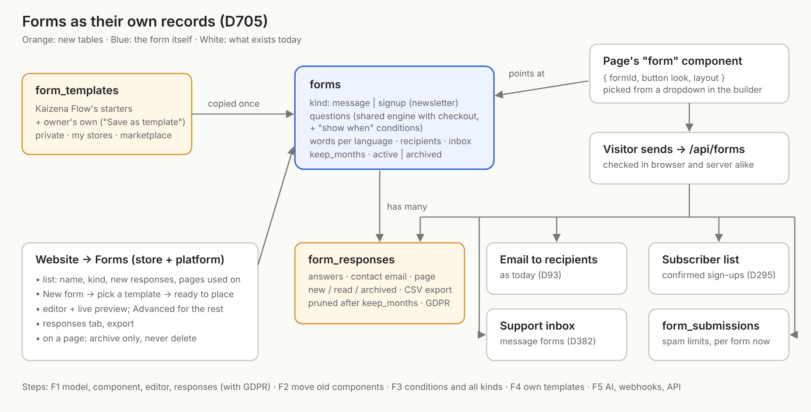

# Forms as their own records (D705)

Written 17 November 2026. The plan for a forms editor: forms an owner creates, edits and deletes in one place and picks in the
page builder's form component, with the answers kept, the newsletter sign-up as one kind of form, and form templates the owner can
make and share. Steps F1 and F2 are built (17 November 2026, sections 9 and 10 say how they differ from this plan); each step below says what it builds and
what holds it.

The owner's choices, 17 November 2026:

1. **Responses are kept** (until now D93 only emailed them, and D382 put a store's messages in the support inbox).
2. **The newsletter sign-up becomes a form** (kind `signup`), picked in the same component.
3. **Form templates the owner can customise**: Kaizena Flow's own to start from, the owner's own made from any form, shared as D125's templates are.

Read before starting: D93 (forms on pages), D295 (the subscriber list), D304 J3 (a sign-up's incentive and tags), D357 and
`docs/checkout-fields-tasks.md` (checkout questions, whose question engine forms will share), D382 (messages in the support inbox),
D125 (templates and their sharing), D129 (duplicating a store), D162 (personal data).

## 1. Where we are

- A form lives inside the page: `EmailFormBlock` and `NewsletterBlock` (`src/lib/page-content.ts`) hold their recipients, subject,
  questions and words in the page's content. Using a form twice means two copies; a saved part (`saved_parts`) is a third.
- `findForm()` (`src/server/forms.ts`) finds the form by its block id in the owner's published pages, two levels of nesting deep
  (rows' columns, and a Columns component's columns), and the limits count sends per block id (`form_submissions.block_id`).
- Seven kinds of question (`FORM_FIELD_KINDS`) with words in one language; the page's translations (D55) carry the rest.
- Nothing is kept but the emails (`email_messages`) and, for a store with support on, the inbox's conversation.
- The checkout's questions (`checkout_fields`, `src/lib/checkout-rules.ts`) are further along: ten kinds, words per language, help,
  half width, a number's or date's bounds, a sensitive answer's consent, conditions, and an editor that adds, moves, switches off and
  deletes.

## 2. The model



```
form_templates ──(copied into, once)──▶ forms ◀──(formId)── a page's `form` component
                                          │
                                          ├──▶ form_responses   (kept; listed, exported, pruned)
                                          ├──▶ form_submissions (limits and a sign-up's waiting link, as today)
                                          ├──▶ email to recipients / support inbox (D93, D382)
                                          └──▶ marketing_subscribers (a confirmed sign-up, D295)
```

### `commerce.forms`

One row per form; written only by `src/server/forms-admin.ts` (new).

| Column | What |
|---|---|
| `id`, `store_id` | `store_id` null for Kaizena Flow's own (the platform has the same feature, CLAUDE.md conventions). |
| `kind` | `message` or `signup`. |
| `name` | The owner's name for it, 1 to 80 characters; never shown on the site. |
| `status` | `active` or `archived`. An archived form shows nothing and receives nothing. |
| `questions` | `FormQuestion[]` (section 3), checked by zod and a `jsonb_typeof` check; at most `FORM_FIELDS_MAX`. A signup's email question is fixed and first. |
| `words` | Button, success message, consent, a signup's placeholder: each a `Words` (`{ text, byLocale }`, the checkout's own). |
| `delivery` | Recipients (0 to 5), the email's subject, and where a message goes: `email`, `inbox` or `both` (moves D382's store setting onto each form; the store setting stays the default for new forms). |
| `signup` | A signup's double opt-in, ask-name, incentive discount and tags (today's `NewsletterBlock` fields); null for a message form. |
| `keep_months` | How long responses are kept: 1 to 36, 12 unless chosen. |
| `template_id` | The template it was made from, if any; only for "made from", never a link that changes the form. |
| `created_*`, `updated_*` | Who and when. |

Questions are one checked JSON list rather than a table: they are always edited and saved together and nothing reads one alone,
which is why the checkout's are rows (the cart reads them per question, with their conditions on the basket).

### `commerce.form_responses`

One row per message, and per confirmed sign-up.

| Column | What |
|---|---|
| `id`, `store_id`, `form_id` | `form_id` with `on delete cascade`. |
| `answers` | `[{ questionId, label, value }]`, labelled in the owner's language as the email is (`checkMessage()`). |
| `contact_email` | The first email answer, lower case: how the person's export and erasure find it (D162). Never ties the row to a customer, as D382 does not. |
| `path`, `locale` | The page and the visitor's language. |
| `state` | `new`, `read` or `archived`. |
| `delivery` | How the email went (`sent`, `logged`, `failed`), and the support conversation's id if it went there. |
| `sensitive` | A sensitive question was answered (its consent ticked): the list masks those answers until opened. |
| `created_at` | |

Responses go after their form's `keep_months` (`pruneFormResponses()`, daily, through `runJobs()`). A sign-up's consent stays the
subscriber list's (D295): the response is the record that the form was sent, not the consent itself.

`form_submissions` keeps its job (limits, a sign-up's waiting link) and gains a nullable `form_id`; the limits then count per form.
`block_id` stays until the old components are gone (add, never rename).

### `commerce.form_templates`

| Column | What |
|---|---|
| `id`, `store_id` | Null for Kaizena Flow's own, which every store sees. |
| `kind`, `name`, `description`, `category` | Category: contact, sales, bookings, newsletter, feedback, events, other. |
| `content` | A form without what belongs to one store: no recipients, incentive or tags. Its words in every language it has. |
| `sharing` | D125's: `private` (this store), `stores` (the owner's other stores) or `marketplace`. Kaizena Flow's are always the marketplace's. |
| `hidden_at`, `hidden_by` | A platform admin hides a marketplace template; forms already made stay. |
| `created_*`, `updated_*` | |

Using a template copies it into a new form; editing the template later changes the next copy, never forms already made (a global
link, as D98's, would change live forms' questions under responses already kept).

## 3. One question engine with the checkout

The checkout's answer rules move into `src/lib/questions.ts` (pure, no zod, so the storefront bundle stays small, D211):
`shownField()`, `shapedAnswer()`, `boundsOf()`, `wordsIn()` and the kinds. `checkout-rules.ts` imports them; behaviour there is
unchanged and `checkout-rules.test.ts` must pass untouched.

A form's question (`FormQuestion`) is the checkout field's shape plus what forms need:

- Kinds: `name`, `text`, `email`, `phone`, `textarea`, `select`, `radio`, `checkbox`, `checklist`, `number`, `date`.
- Words per language (`label`, `help`, `placeholder`), required, `width` (`full`/`half`), `bounds`, `options`, `sensitive`: the checkout's.
- **`showWhen`** (new, forms only): asked only when earlier answers hold: `{ questionId, op: "is" | "is_not" | "any_of" | "answered" | "ticked", values? }`,
  at most 5, all must hold, and only questions above it may be named (no loops; a question named by another cannot be moved below it,
  the editor says why). A hidden question is never required and its answer is never sent. Checked by the same function in the browser
  and on the server (`checkMessage()` gains it).
- Later, not in these steps: file uploads (a storage and malware-scanning question of its own), payments in a form, hidden fields from
  the address (campaign codes).

## 4. The page component

A new component `form`: `{ formId, button?, layout? }`. Only its look is on the page; what it asks is the form's.

- The site reads the form by id (`publicForm()` as today: no recipients, subject, incentive or tags reach the browser) through a cached
  read tagged `forms:{storeId}`, refreshed by every write of a form.
- `/api/forms` takes `form` (its id) in place of `block`. The server answers only for an active form of that owner that a published
  page carries (a `jsonb_path_exists` over `$.**` for the id, so any depth counts, fixing today's two-level limit), so D93's rule stays:
  only a form the site shows receives anything.
- The old `emailForm` and `newsletter` components keep working until step F2 moves them, then leave the builder's list.
- The builder: the component's settings start with a `Dropdown` of the store's forms (name, kind, response count), *New form* (picks a
  template, opens the editor in a modal, places the new form) and *Edit this form* (opens the editor; it says the form is on other pages
  too). An archived or deleted form leaves the component showing nothing, and the canvas says so, as D188 does for a form with no address.

## 5. The owner's screens

**Website → Forms** (`/admin/{store}/forms`, `website:write` to change; responses readable with `customers:read`, as they are a
person's data). The same at `/admin/platform/forms`.

For Homer (the default view):

- The list: each form's name, kind, new responses, the pages it is on, and *New form* as the one main action.
- *New form* shows the templates as cards (Kaizena Flow's, the owner's own, the marketplace's); picking one opens the editor with the
  recipients set to the owner's email, so the form is ready to place.
- The editor beside a live preview, in the store's theme: questions in a list to add, drag and delete (the checkout's `FieldList`
  pattern), and *After sending*: the message shown, and who is emailed.
- Responses: newest first, unread in bold, one opened in a panel; *Export CSV*.

One step away (Advanced, for Lisa): every question's help, width, bounds and conditions, words per language, the inbox choice,
retention, a signup's double opt-in, incentive and tags, *Save as template* with its sharing, and the template library's own editor.

**Deleting.** A form on a page (published or draft) cannot be deleted: the dialog lists the pages and offers *Archive* instead. A
form on no page deletes after a confirm that says how many responses go with it and offers the export first. Each change and each
export is in the audit log (an export with its count only, as D295's).

## 6. Copies, templates of stores, and the old components

- **Duplicating a store** (D129) copies its forms with no recipients and its templates as they are, and maps every `formId` in the
  copied pages to the copy. Responses are never copied.
- **A new store's copy of the template's pages** (`clone_page_content()`) and **demo content** (D260) make the forms their pages use
  from the template store's forms, with no recipients.
- **A saved part or a marketplace template with a form component** carries a snapshot of the form; using it in another store makes the
  form there from the snapshot. Within the same store it points at the same form.
- **The old components** (step F2): a custom migration function makes one form per old component (per store, per block id; a
  component found on several pages becomes one form), rewrites drafts, published content and saved parts to `form` components, and fills
  `form_submissions.form_id`. Code reading both shapes deploys first; the migration follows in the next push.

## 7. AI and integrations

- The AI manager's website tools (`src/server/site-tools.ts`): list forms, make one (from a template or questions), change one, place
  one on a page, and summarise responses. Responses are a visitor's own words: they reach the model under `UNTRUSTED_TEXT`, a new eval
  case hides instructions in a response, and the tool never shows a sensitive answer.
- A `form.response` event for the owner's endpoints (D354) and a workflow trigger (D356); the Admin API gets forms and responses
  under new `forms:read`/`forms:write` scopes (D355).

## 8. Steps

| Step | Builds | Held by |
|---|---|---|
| **F1** (built) | `forms` and `form_responses` tables and rules; the `form` component and `/api/forms` by form id; responses kept, with their personal data rules from the start (the `PERSONAL_DATA` register, export, erasure, the retention job); Website → Forms list, editor and responses, store and platform; Kaizena Flow's first templates (Contact, Quote request, Booking enquiry, Callback, Feedback, Event registration, Newsletter). | `src/db/commerce.test.ts`, `forms.test.ts`, `forms-admin.int.test.ts`, `checkout-rules.test.ts` unchanged, an e2e of make, place, send and read. |
| **F2** (built) | Old components moved to forms (migration), removed from the builder's list; copies (D129, `clone_page_content()`, saved parts). | The migration's PGlite test with every old shape; `store-copy` tests. |
| **F3** | `src/lib/questions.ts` taken out of the checkout; `showWhen` conditions, every question kind, words per language in the editor; the inbox choice per form. | `questions.test.ts`; the browser and server checks agree. |
| **F4** | `form_templates`; the owner's own templates: *Save as template*, the library, sharing and the platform's hiding; Kaizena Flow's starters editable from the platform. | `form-templates.int.test.ts`. |
| **F5** | AI tools and their eval case, webhooks, workflows, Admin API. | `agent-eval.test.ts`, the Admin API's tests. |

## 9. F1 as built (17 November 2026)

- **Tables.** `commerce.forms` and `commerce.form_responses` (migrations `*_forms` and `*_forms_rules`): a form keeps its store and kind,
  a response takes its form's store from the database and only its `state` changes. `form_templates` waits for F4, the step that first
  uses it, and `form_submissions` needs no `form_id`: a `form` component's form id is what the limits count by (`block_id`).
- **One path for both.** `formAsBlock()` (`src/lib/form-records.ts`) turns a form into the shape of the page's own email form or sign-up,
  in one language, with the form's id as its id, so `/api/forms`, `checkMessage()`, the emails, the support inbox (D382), the confirmation
  link and the limits of D93 serve saved forms unchanged. `findForm()` finds a saved form by id (`getForm()`), takes answers only while it
  is active, can deliver and a published page carries it at any depth (`formIsPublished()`), and checks in the owner's main words; the
  answers are kept with `keepResponse()` (a message, also when its email failed; a sign-up when it needs no confirmation or on its
  confirmation).
- **The component.** `FormBlock` (`type: "form"`, `formId`, `button`, `layout`) replaces *Email form* and *Newsletter* in the palette (the
  old ones stay editable until F2 moves them). The site reads the form through `siteForm()`, cached under `forms:{storeId}` (or
  `forms:platform`), refreshed by every write. The builder gets the owner's forms in the editor's context (`builderForms()`, drawn without
  their recipients); the settings pick one with links to make or change it, the canvas draws it with the component's look and says when it
  is archived or cannot deliver. A template or copied page's component loses its form (`formId: null`).
- **Starters in code.** Kaizena Flow's seven starters are `FORM_STARTERS` (en, nb, sv, da; English for any other language); a new form is
  made in the store's main language with its other languages' words, sending to the store's contact address (else the owner's), so it is
  ready to place. Editing the main words keeps the other languages' until F3 edits those.
- **Screens.** Website → Forms (`/admin/{store}/forms`, `/admin/platform/forms`): the list (kind, pages, responses, new ones, a form that
  cannot deliver), *New form* (the starters and a blank form), one form (questions, who it emails, the words after sending, the preview,
  where it shows; subject, consent, a sign-up's code and tags and the months kept under Settings; archive and delete), and its responses
  on a page of their own (`/forms/responses/{formId}`: open, read, archive, delete, reply by email, CSV). Changing a form needs
  `website:write`; the responses page is in the customers area (an `AREA_OVERRIDES` entry in `src/lib/permissions.ts`, as the books are), so
  reading them needs `customers:read` and changing them `customers:write`; the platform's all need its website area. The actions refresh
  the page themselves (`refresh()`).
- **Personal data.** `form_responses` is in the register (found by `contact_email`, exported with its answers under `forms`, deleted on
  erasure), never copied with a store, and pruned daily after its form's months, never later than the `form_responses` rule (36 months).
- **The AI manager learns of Forms.** The four Forms pages without parameters were kept out of the AI manager's prompt for the deploy
  that carried the forms' migration (`NOT_YET_IN_PROMPT`); the push after it (17 November 2026) took them out, with the text messages'
  pages (D565), and the agents' eval is recorded again on Platform → AI.
- **Not yet.** The A/B tests' form goal (D148) counts a `form` component by its form's id, which no test names yet; copies of a store
  (D129) copy forms since F2 (section 10).

## 10. F2 as built (17 November 2026)

- **The move.** Migration `*_forms_lifted` runs `commerce.lift_page_forms()` once: every page (draft and published) and saved part with an
  inline email form or sign-up, at any depth, gets a form of its owner for each and a `form` component in its place, keeping the component's
  id and look (button, layout, spacing, its CSS id and class). The form takes the words and their translations from the page
  (`translations.{locale}.block.{id}.…`), the questions, recipients, subject, consent and a sign-up's settings; it is named *Contact form
  (page title)* or *Newsletter (page title)*. Production had one: the newsletter in the `kaizenalabs` store's footer, with no sends.
- **Nothing breaks on the way.** The form's id is made from its owner and the component's id (`commerce.lifted_form_id()`, shaped as
  `clone_id()` shapes ids, and `liftedFormId()` in `src/server/forms.ts`), so a page's draft and published copy share one form, and
  `findForm()` still finds it when a page cached before the move sends with the old component's id, or a confirmation link emailed before it
  is opened. A version of a page saved before the move (D305) still holds the old component, which still works if restored.
- **Copies.** `clone_page_content()` (a new store from a template or starter, D175) copies the template's forms its pages show, without
  where they send or a sign-up's code and tags; `copy_remap()` (a duplicated store, D129, and Kaizena Flow's site copied into its own store,
  D469) copies the source's forms its content names, as they are. Only the source's own forms are copied (a page naming another store's
  form copies nothing), and responses never are. A template or marketplace part used in another store still leaves its form component
  empty (`template-content.ts`).

