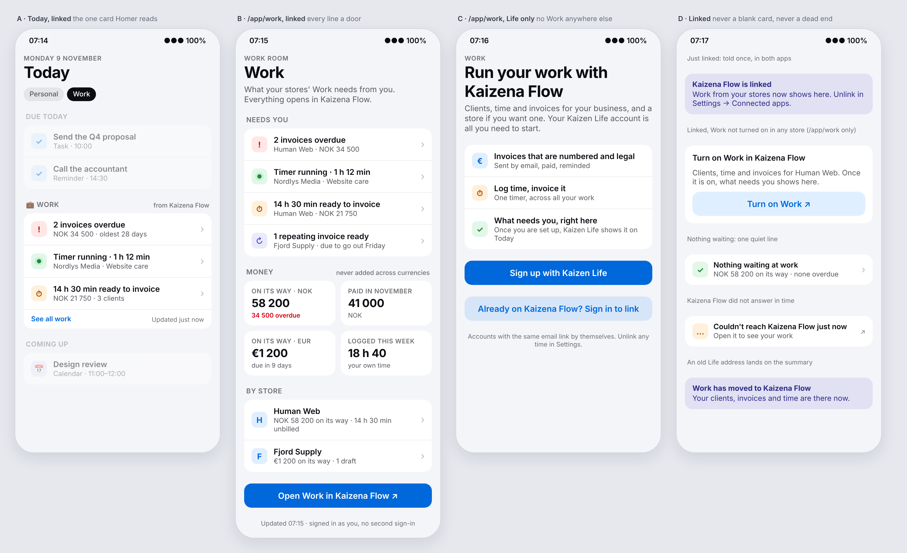
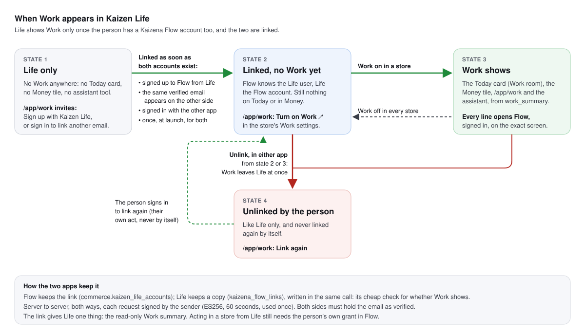
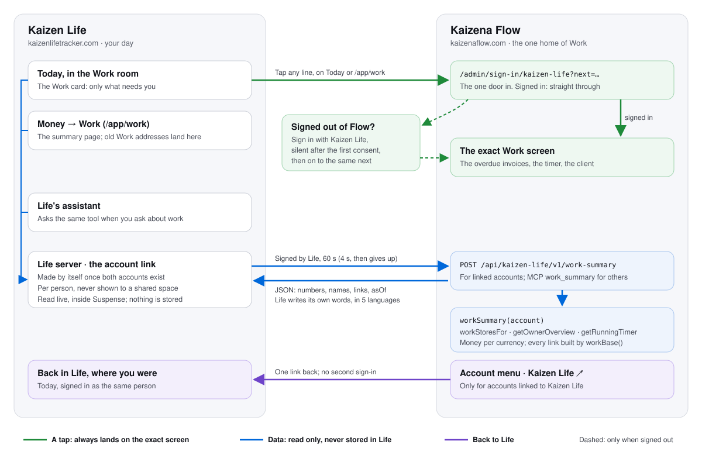

# Work in Kaizen Life: a summary from Kaizena Flow, and Life's own Work retired (proposal)

Status: **proposed 9 November 2026; the Flow side is built (D507, see "As built: the Flow side" at the end).** Life's side is still to build.

The owner's ask: *now that Work is built into Kaizena Flow, Work can go from Kaizen Life; what Life needs instead is a summary of
Work across the person's stores, with links back to Kaizena Flow. Information and navigation between the two must be intuitive,
relevant and seamless.*

The owner then decided two things the same day:

* **Only Work goes; personal Finances stays in Kaizen Life.**
* **Work appears in Life only for someone who has both accounts.** Someone who uses only Kaizen Life sees no Work at all. As soon as
  the person has an account on both, the accounts are linked and the Work summary appears. Until then, `/app/work` invites the
  person to sign up to Kaizena Flow.

This is a plan, not a design: each phase gets its decision when it is built. "Life" is `/home/user/lifesaver-app`
(kaizenlifetracker.com); "Flow" is this repository. The Life-side checklist, file by file, is in Life's
`docs/work-moves-to-kaizena-flow.md`.

Pictures:

* `docs/life-work-summary/mockup.png`: what Life shows.
* `docs/life-work-summary/linking.svg`: when Work appears.
* `docs/life-work-summary/flow.svg`: how data and taps travel.

Evidence is marked:

* **[repo]** read in the code on 9 November 2026.
* **[prod]** counted in the production databases the same day (counts only, no person's data read).
* **[docs]** read in a vendor's own documentation.
* **[U]** not verified.

## 0. Summary

1. **Work is present in Life only when there is Work to show.**
   * **Life only:** nothing. No Today card, no Money tile, no assistant tool. `/app/work` is an invitation to sign up to Kaizena
     Flow with the Kaizen Life account.
   * **Linked:** the summary. If no store uses Work yet, `/app/work` says how to turn it on.
2. **The accounts link by themselves**, as soon as the person has both. This happens when:
   * they sign up to Flow from Life;
   * the same verified email appears on the other side;
   * they sign in to one app with the other;
   * at launch, once, for those who already have both.

   A link is told to the person in both apps, can be undone in either, and is never made again by itself once undone.
3. **Flow is the one home of Work; Life shows only what needs the person.** Life keeps no copy of a client, invoice or hour. Every
   line opens the exact Flow screen.
4. **One reader, two doors.** Flow gets `workSummary(account)`, built from readers that already exist (`workStoresFor`,
   `getOwnerOverview`, `getRunningTimer`). Life reads it over the account link: a server-to-server call signed by Life, for that
   linked account only, read only. Other assistants get the same reader as the MCP tool `work_summary`, which WP13 of
   `docs/work.md` planned.
5. **One tap, no second sign-in.** Every link in the summary goes through one door in Flow, `/admin/sign-in/kaizen-life?next=…`.
   * Signed in to Flow: it goes straight through.
   * Signed out: it signs in with Kaizen Life and goes on to the same screen. After the first consent this is silent [repo, docs].

   Today a signed-out deep link into Flow loses where it was going [repo]. That is fixed for every link, not only Life's.
6. **The way back.** Flow's account menu gets *Kaizen Life ↗* for linked accounts. Today Flow never links to Life [repo].
7. **Life's Work goes, its Finances stay.** The `/app/work` address stays, and is the invitation or the summary.
   * **Goes:** clients, invoices, time, repeating invoices, reports, print pages and the revenue wall (Views).
   * **Stays:** Organizations, which are employers and businesses with salary and costs that feed personal Finances. They move
     under Money.
8. **Data first.** Human Web's Life Work was imported on 30 September, and Life's Work has not been touched since [prod].
   * A second Life space was never imported: 4 invoices from August [prod].
   * Everything is archived before any table is dropped.
9. **Now is the cheapest moment** [prod]. Nobody has connected Life to Flow (no `kaizen_store` connection in Life), and nobody has
   signed in to Flow with Kaizen Life (no `custom:kaizen-life` identity in Flow). Nobody needs migrating.



## 1. What is there today

### 1.1 Life's Work [repo, prod]

* **Screens:**
  * `/app/work` (tabs: overview and organizations), `/app/work/invoices`, `/app/work/invoices/[id]`, `/app/work/clients/[id]`,
    `/app/work/organizations/[id]`, `/app/work/reports` and its print page, `/app/work-invoice-print/[id]`.
  * The revenue wall `/app/views`, and its public `/views/[token]`.
  * `/api/work/report`, `/api/agent/work`, and the cron job `/api/cron/work-recurring-invoices`.
* **Navigation:**
  * The Money door (`components/app-shell/nav-defs.tsx:75-80`) lights for `/app/money`, `/app/finances` and `/app/work`.
  * The Money hub (`app/app/money/page.tsx`) shows two tiles: Finances and Work.
  * `page.work` is a feature in Life's plans ("Freelance work module").
* **Data:**
  * Across two spaces: 8 clients, 8 assignments, 16 tasks, 28 time entries, 17 invoices (5 paid, 10 sent, 2 drafts). There is no
    repeating invoice and no running timer.
  * The newest invoice was made on 16 September, and no time was logged after September.
  * The revenue wall has never been shared.
* **Tied to Finances:**
  * Invoices write expected income into the personal budget (`finance_work_invoice_projections`, 13 rows).
  * A paid invoice links to its Finances transaction (`work_invoices.finance_transaction_id`).
  * `lib/finance/comparison.ts` takes VAT out of invoice payments.
  * A Finances category that Work uses cannot be deleted.
* **Organizations are not Work in Flow's sense.**
  * They are `life_area_groups` with domain `work` (5), with a salary (1), reimbursable expenses (2) and repeating costs (11).
  * They feed employment income and expense projections in Finances.
  * Flow did not port them, on purpose (`docs/work.md` §0.1).
* **"Work" also means tasks.** Two other things carry the word and are not touched:
  * task and project work items (`docs/work.md` §1, row B);
  * the *Work room*, a Life space of kind `work`.

### 1.2 What Flow already has [repo, prod]

* **Readers over all of a person's stores** (D123, `src/server/work-owner.ts`):
  * `workStoresFor(account)` covers owner and admin memberships that hold `settings:read`.
  * `getOwnerOverview()` gives money per currency, never added across currencies, a part per store, and attention lists
    tagged with their store.
  * `getRunningTimer(account)` gives the one running timer across stores.
  * Every Work address is made by `workBase()` (`src/lib/work-paths.ts`).
* **The bridge to Life** (D95, D96, D439):
  * Each Supabase project is the other's OpenID provider (`KAIZEN_LIFE_SSO`).
  * Signing in with Kaizen Life admits only owners and platform admins (`admitFromKaizenLife()`).
  * Someone with no account lands on `/sign-up?via=kaizen-life`, prefilled (`kaizen-life-prefill.tsx`), and goes through the usual
    self-serve sign-up, with its confirmation email (D359).
  * `/api/mcp` takes Life's Supabase tokens (owned stores only) and Flow's own `kfa_` tokens.
* **Gaps:**
  * No reader answers "my Work across stores" for another app.
  * `workAttention()` writes English sentences only.
  * A signed-out visit to any `/admin/...` page forgets the page that was asked for (`src/components/admin/session.tsx`,
    `requireAccount()`).
  * Nothing in Flow's admin links to Life, and nothing links the two accounts apart from a sign-in identity.
* **In production:**
  * Work is on in 2 stores.
  * Human Web holds 49 invoices, 48 of them imported (from Life on 30 September, and from Tripletex, D494), 9 clients and 14
    tasks.
  * No time is logged in Flow today.

### 1.3 Life's link to Flow [repo, prod]

* Provider `kaizen_store` (`lib/integrations/kaizen-store.ts`) uses OAuth against Flow's Supabase OAuth server, for Life's
  assistant to act in stores through `/api/mcp`.
* Its tokens are kept per person in `integration_connections`.
* Its default site is `https://kaizenstore.cloud` (`lib/integrations/env.ts:153`), and every text says "Kaizen Store".
* Nobody has connected it in production.

## 2. What the person should experience

### 2.1 Rules the design keeps

1. **Work is present only when there is Work to show.** A Life-only person never meets Work, except at `/app/work` itself, which
   invites. A linked person sees the card, the tile and the assistant's answers only while some store uses Work.
2. **One home per thing.** Work is done in Flow. Life never offers a form that changes Work.
3. **Relevant before complete.**
   * The Today card shows only what needs the person: overdue invoices, a running timer, time ready to invoice, repeating
     invoices ready.
   * Nothing waiting is one quiet line.
   * The whole picture is one tap away on `/app/work`.
   * Homer reads the card. Lisa opens the page: per store, per currency, paid this month, her own hours this week.
4. **Every line is a door to the exact screen.**
   * "2 invoices overdue" opens Flow's invoices filtered to overdue.
   * The timer opens the store's Work.
   * A store row opens that store's Work overview.
   * *Open Work in Kaizena Flow* opens the combined view.
5. **Never a second sign-in** (3.5), and never a second account to wire up by hand when the email is the same (3.3).
6. **Money stays honest.** It is per currency and never added across currencies. It is formatted in the person's language.
7. **Personal, not shared.** The link and the summary are the person's. They never appear for other members of a shared space.
8. **Honest about freshness and failure.**
   * The summary says when it was read.
   * If Flow does not answer within 4 seconds, one line says so and links to Flow.
   * Old numbers never pass as new.
9. **Life writes its own words.** Flow sends numbers, names, dates and links. Life words them in en, nb, sv, de and es, and shows
   names as text, never as HTML.

### 2.2 What shows where



| | Today | Money hub | `/app/work` | Assistant | Settings → Connected apps |
| --- | --- | --- | --- | --- | --- |
| **1. Life only** | nothing | Finances only | the invitation (picture C) | no Work tool; asked about invoicing, says Kaizena Flow does it and links `/app/work` | *Kaizena Flow: not linked*, with sign up or sign in to link |
| **2. Linked, no store uses Work** | nothing | Finances only | *Turn on Work in Kaizena Flow ↗* (picture D) | no Work tool | *Linked since …* · *Unlink* |
| **3. Linked, Work on in a store** | the Work card, in the Work room (elsewhere only when urgent, open question 6) | the Work tile with its live line | the summary (picture B) | `work_summary` | *Linked since …* · *Unlink* |
| **4. Unlinked by the person** | nothing | Finances only | the invitation, with *Link again* first | no Work tool | *Not linked* · *Link again* |

Notes:

* **The address works for everyone.** `/app/work`, old bookmarks, saved nav bars, links from Life's own marketing pages and the
  assistant all lead to it. It shows the state's page.
* **Life's plans do not gate it.** `/app/work` no longer checks `page.work` (open question 4).

### 2.3 The journeys

* **A Life-only person opens `/app/work`.** They see an old bookmark, a saved bar or the features page, and land on the invitation
  (picture C).
  * *Sign up with Kaizen Life* goes to Flow's sign-up, starting with Sign in with Kaizen Life.
  * An unknown person lands on `/sign-up?via=kaizen-life`, prefilled.
  * Kaizen Life has already verified the email, so Flow skips its own confirmation email for that address (open question 9). The
    self-serve slots and limits still apply.
  * The new account is linked at once. When Flow's setup ends, it offers *Back to Kaizen Life*, which opens `/app/work`.
* **Someone already on Flow with another email.** They choose *Already on Kaizena Flow? Sign in to link*, sign in to Flow
  through the door, and are linked by that sign-in. Their consent in Flow is the proof.
* **Someone who is on both with the same email.** They do nothing; the link is made by itself. Life shows *Kaizena Flow is
  linked* once (picture D), and Flow sends one email saying so, with *Unlink* in it.
* **Morning in the Work room, linked.** Today shows the Work card (picture A). One tap on a line lands on that Flow screen,
  signed in.
* **Money → Work, linked.** The tile says what is waiting. `/app/work` shows *Needs you*, *Money* per currency, *By store*, and
  *Open Work in Kaizena Flow*.
* **An old Life Work address.** `/app/work/invoices/…`, `/app/work/clients/…`, `/app/work/reports` and `/app/views` land on
  `/app/work`. When linked, it shows one line, *Work has moved to Kaizena Flow*. Life's ids are not Flow's, so nothing is guessed.
* **Unlinking.** In either app, under connected apps. It takes effect at once in both, and Work leaves Life.
* **From Flow back to Life.** *Kaizen Life ↗* in Flow's account menu opens Life's Today. Only linked accounts see it.

## 3. How it works



### 3.1 Flow: `workSummary(account)`

The pure shaper goes in `src/lib/work-summary.ts`, and its reads in `src/server/work-summary.ts`. It reads with the readers that
exist (`workStoresFor` → `getOwnerOverview` → `getRunningTimer`): about five queries on `readDb()`, all scoped to the account's
memberships with `settings:read`, as Work's screens require. A store with Work off is listed by name only, so `/app/work` can
offer to turn it on. Kaizena Flow's own store is covered like any other the person belongs to (platform parity).

The answer is data, not sentences:

```ts
type WorkSummary = {
  asOf: string;                                   // ISO time the figures were read
  workOn: boolean;                                // some store the person can read uses Work (state 3 against state 2)
  open: string;                                   // the combined Work view, through the handoff door (3.5)
  turnOn: string | null;                          // where to turn Work on, when no store uses it and the person owns one
  needs: Array<{                                  // what needs the person, most urgent first; empty when nothing does
    kind: "overdue" | "timer" | "unbilled" | "recurring_ready" | "drafts_waiting";
    urgent: boolean;                              // overdue 14 days or more, timer 12 hours or more (workAttention's rules)
    store: { slug: string; name: string } | null; // null when the line covers several stores
    count?: number;
    money?: { minor: string; currency: string };  // bigint as a string; one currency per line
    minutes?: number;
    since?: string;                               // oldest due date, timer start or oldest unbilled day
    client?: string;                              // the timer's client; never a list of names
    task?: string;
    href: string;                                 // absolute, through the handoff door
  }>;
  currencies: Array<{ currency: string; onItsWay: string; overdue: string; dueSoon: string;
                      paidThisMonth: string; drafts: { count: number; minor: string };
                      unbilled: { minutes: number; minor: string } }>;
  stores: Array<{ slug: string; name: string; workOn: boolean; href: string;
                  currencies: WorkSummary["currencies"]; unbilledMinutes: number }>;
  myMinutesThisWeek: number;                      // the person's own time, Monday to now, in each store's time zone
};
```

* **Links are Flow's.** Every `href` is built with `workBase()` and wrapped in the handoff door. Life never builds a Flow address.
* **Least data.** A client's name appears only where a line is about one client. Lists of people never cross. Both projects are in
  eu-west-1.
* **Two doors, one reader:**
  * the account link's `work-summary` door (3.3), for Life;
  * the MCP tool `work_summary` (no `store` argument, like `list_stores`; JSON in `structuredContent`), for outside assistants
    and for Flow's own AI manager under `settings:read`.

  A new tool description needs a new agent-eval run and its recording (CLAUDE.md, *AI features must stay grounded*).

### 3.2 Life: reading it

* **The cheap check.** Whether Work is present is a local read of Life's copy of the link, `kaizena_flow_links` (3.3). It takes no
  call to Flow and runs in the main wave of Today, the Money hub and `/app/work`.
* **`lib/integrations/kaizena-flow-work.ts`.** `getWorkSummary(userId)`:
  * calls Flow's `work-summary` door for the linked account, signed by Life;
  * gives up after 4 seconds;
  * checks the answer's shape with zod (an answer of another shape is a failure, never half drawn);
  * returns `null` on any failure.

  An answer of `not_linked` clears Life's copy of the link, so the two can never disagree for long.
* **Today.**
  * A new section id `work` in `SECTION_ORDER` (`app/app/today/page.tsx`), with its label in five languages.
  * Drawn only when linked, by an async server component in `<Suspense>` with a skeleton, as `flagged-emails-section.tsx` does
    (Life's AGENTS.md, *Slow or external reads*).
  * It draws nothing when `workOn` is false.
  * It is on by default in the Work room. Elsewhere it shows only when a line is urgent, or when the person added it.
* **`/app/work`.** The state's page (2.2), drawn the same way. The invitation needs no call to Flow.
* **Money hub.** The Work tile, only in state 3, with its line drawn inside Suspense.
* **No cache, so no write-through.** Life stores nothing it reads and changes nothing in Flow. The one thing Life copies is the
  link itself, and that copy is written in the same call that changes the link (3.3), as Life's AGENTS.md asks for synced data.

### 3.3 The account link

**What it is.** Flow knows which Life user an account is, and Life knows which Flow account a user is. A link gives Life one thing:
the read-only Work summary for that account. Acting in a store from Life's assistant (`ask_store_assistant`, `log_time`, …) still
needs the person's own grant on Flow's consent screen (D96, D439). A link never lets Life change anything.

**Records:**

* **Flow keeps the link.** `commerce.kaizen_life_accounts`:
  * columns: `account_id` unique, `life_user_id` unique, `how` (`identity` or `email`), `linked_at`, `unlinked_at`,
    `unlinked_from` (`flow` or `life`);
  * written only by `src/server/kaizen-life-links.ts`;
  * audited as `account.kaizen_life_linked` and `account.kaizen_life_unlinked`;
  * RLS on with no policies, like every `commerce` table.
* **Life keeps a copy.** `kaizena_flow_links`:
  * columns: `user_id` unique, `flow_account_id`, `linked_at`, `unlinked_at`;
  * RLS lets a person read their own row, and only the service role writes;
  * every change is written in the same call on both sides.

**The channel.** Server to server, both ways:

* Each request is a JWT signed with the sender's private key (ES256). Its audience is the receiver, it lives 60 seconds, and its
  `jti` is kept, so it is never accepted twice.
* Keys live in env: Life's private key in Life and its public half in Flow, and the other way round. They are validated when used
  (`src/lib/env.ts`).
* The doors:
  * Flow: `POST /api/kaizen-life/v1/{lookup,link,unlink,work-summary}`.
  * Life: `POST /api/kaizena-flow/v1/{lookup,link,unlink}`.
* Bodies carry ids. A lookup also carries the email being matched, which is never logged (`log()`: ids and counts).
* Each door is budgeted: lookups and links 30 a minute per address, the summary 60 a minute per account.
* A Life-only person's email reaches Flow only in a lookup, and Flow keeps nothing from a lookup that finds no account.

**When it links: as soon as the person has both.**

1. **Through the other app's sign-in, which proves both accounts are the same person.** This covers Flow sign-in or sign-up with
   Kaizen Life (the `custom:kaizen-life` identity, whose `sub` is the Life user) and Life sign-in with Kaizena Flow. It links at
   once, as `identity`.
2. **A new verified account on either side asks the other.**
   * Flow asks when `confirmSelfSignup()` makes an owner, when an invitation is accepted, and when `linkAccount()` first ties a
     sign-in to an account.
   * Life asks when an email is confirmed, or when a Google sign-in creates the user.

   The same verified email on the other side links, as `email`. **Both sides must hold the email as verified**, or nothing links:
   someone who types another person's address on one side must never receive that person's Work.
3. **At launch, once.** A script finds every pair with the same verified email on both sides and links them. It runs a dry run
   first and reports counts only, and each person is told as in the next paragraph.
4. **Different emails.** From `/app/work`, *Sign in to link* goes through route 1.

Two things never happen:

* **A pair the person unlinked is never linked again by itself.** `unlinked_at` is kept on both sides. Only the person, by route
  1 or 4, links them again.
* **A changed email on either side does not move or break a link.**

**Telling the person.** When a link is made:

* Life shows *Kaizena Flow is linked* once.
* Flow emails the account once, from the platform's sender and in the account's language, with *Not you, or not wanted? Unlink*.
* Both apps list the link under connected apps with *Unlink*, which takes effect at once in both.

**Signing in with Kaizen Life once linked.** `admitFromKaizenLife()` admits a linked account whatever its role, because the link
already proves it is the same person. Today it admits owners and platform admins only, so an admin of someone else's store could
not follow a tap from Life without typing a password.

**Privacy.** Linking by email without asking is fair only if the same company runs both apps and both privacy texts say so [U].
Life's privacy policy names **HumanWeb AS** as the data controller (`messages/en/legal.json:13`), while Flow's own documents
describe Human Web as a sole proprietorship (ENK) that becomes an AS in 2027 (`docs/own-books-and-sales.md`). Before linking goes
live:

* settle who runs each app (open question 3);
* add the link to both privacy texts;
* update Life's `docs/compliance/data-map.md` and Flow's record of processing.

If the two are not the same controller, the link must be offered and confirmed with one tap instead of made by itself.

**Life's assistant acting in stores** keeps needing the person's grant through the `kaizen_store` connection. Moving that grant to
Flow's own OAuth server (D439, a pre-registered *Kaizen Life* client) is still worth doing while nobody is connected, but it no
longer blocks the summary.

### 3.4 Signing up to Flow from Life

* The invitation's *Sign up with Kaizen Life* opens Flow's door, `/admin/sign-in/kaizen-life?next=/admin`, with intent `sign-up`.
* The door starts Sign in with Kaizen Life (silent if the person approved Flow before).
* An unknown person lands on the prefilled sign-up (D95, `kaizen-life-prefill.tsx`).
* Because the address comes verified from Kaizen Life's identity, the self-serve flow can treat it as confirmed and skip the email
  round trip. The slots and limits of D359 still apply.
* The account is created linked (route 1).
* Setup ends with *Back to Kaizen Life*, which opens `https://kaizenlifetracker.com/app/work`.

### 3.5 One tap, no second sign-in

* **The door: `src/app/admin/sign-in/kaizen-life/route.ts`.** It reads `next` through `safeNext()` (`/admin…` only, same origin).
  * A signed-in person goes straight to `next`.
  * A signed-out person, while `KAIZEN_LIFE_SSO` is on, goes straight into Sign in with Kaizen Life (the sign-in page's action,
    `src/app/admin/sign-in/actions.ts:94`), carrying `next` through `/auth/callback?via=kaizen-life`.
    * Life's consent page redirects at once for a client the person approved before (`app/app/oauth/consent/page.tsx:32`).
      Supabase's `getAuthorizationDetails` returns a redirect when consent exists [docs].
    * So from the second time on, the person sees only the page they tapped.
  * With SSO off, the door goes to `/admin/sign-in?next=…`.
* **Every signed-out deep link keeps its destination.** The `(gated)` layout's `SessionRecovery` and `requireAccount()` go to
  `/admin/sign-in?next=<the page>`, checked by `safeNext()`. Invoice emails, push notifications and shared links gain it too.
* **`KAIZEN_LIFE_SSO` goes on in production** once it is checked end to end.

### 3.6 The way back

`AdminAccountMenu` (`src/components/admin/admin-shell-parts.tsx`) gets *Kaizen Life ↗*:

* It opens `KAIZEN_LIFE_URL` (`src/server/kaizen-life-link.ts:34`) at `/app/today`.
* It shows only for linked accounts.
* Its words are in the admin's catalogue (D312).

## 4. Retiring Life's Work, keeping Finances

The file list is in Life's `docs/work-moves-to-kaizena-flow.md`. In short:

* **Goes:**
  * the clients, assignments, tasks, time, timers, invoices, repeating invoices, reports and print screens, with their actions,
    queries and components;
  * `/api/work/report`, `/api/agent/work` and the cron job;
  * the revenue wall (Views: Work revenue, never shared);
  * Analytics' Work tab;
  * the invoice VAT setting;
  * the Contacts "make client" card;
  * the activity feed's links to Work items (the events stay as history; their links go to `/app/work`);
  * most of `work.json` (471 keys per language).
* **Moves:**
  * Organizations move to the Money hub, as their own tile (named per open question 2). The life-area domain `work` keeps its
    key, and its `basePath` becomes `/app/money`. An organization page loses its client list; a linked person sees *Your clients
    are in Kaizena Flow ↗* in its place.
  * The repeating-cost helpers that life areas share move from `lib/work/` to `lib/life-area/`.
  * Organization tools and their scopes (`read:work`, `write:work`, tool domain `work`, which also routes the taxonomy tools) keep
    their names.
* **Finances keeps working without Work:**
  * The two invoice projection syncs and their reads go. The budget no longer shows expected income from Life's invoices; phase 5
    can bring it back from Flow, for linked people.
  * The "Payment received" link goes with `work_invoices`; the transactions stay.
  * The category guard goes.
  * `comparison.ts` stops taking VAT out of invoice payments.
* **Navigation:**
  * `/app/money` keeps `/app/work` in its match prefixes.
  * `/app/views` leaves the More list.
  * The command palette offers *Work* only in state 3.
* **Marketing.** Life's features page, *The entrepreneur* use case, `llms.txt` and `marketing.json` say *invoices and time with
  Kaizena Flow*, and link to `/app/work`.
* **Database, last.** One migration, 30 days or more after the code is gone, drops:
  * the `work_*` tables of Work proper, with their enums and triggers;
  * the two invoice projection tables;
  * `spaces.work_default_vat_percent`;
  * `view_share_tokens`.

  It keeps `life_area_*`, `work_activity_messages` and everything task-related.

## 5. Phases

Each phase can ship on its own. In both repos `main` deploys to production, so every phase passes that repo's checks first (Flow:
lint, typecheck, unit and integration tests; Life: `npm run check` and `npm run smoke`).

| Phase | Where | What | Done when |
| --- | --- | --- | --- |
| **0. Data** | Life, owner | Archive every Life Work row of both spaces. Decide the second space (open question 1). Confirm nothing changed in Human Web's Life Work since 30 September. | Each Life invoice is in Flow or in the archive, noted in `docs/work.md`. |
| **1. Flow** | Flow | `workSummary` and the MCP tool. The link: table, writer, the four doors, the signed channel, the link moments (routes 1 and 2), the email, *Unlink* in Connected apps. Linked accounts admitted through Kaizen Life. The handoff door and the kept `next`. Sign-up from Life without a second confirmation email. The account menu link. Agent-eval run and recording. A decision, plus `docs/rules/admin/integrations.md`, `commerce.md` and `docs/work.md`. | Tests, against a fake Life signed with test keys, cover: a summary across two stores and two currencies; a left or cut-off store hidden; unverified email never linking; an unlinked pair never relinked by itself. A signed-out tap lands on the right screen. |
| **2. Life** | Life | Names ("Kaizena Flow", `kaizenaflow.com`). Life's link copy, its three doors, the link moments, the notice, *Unlink* in Settings. The presence rules (2.2). The invitation, the Today section, the summary page, the Money tile, the assistant's tool, the redirects. Words in five languages. Privacy texts and the data map. Smoke checks for the guard, the signed call and each state. | A Life-only test user sees no Work anywhere and the invitation at `/app/work`. Signing up to Flow from it links, and the page turns to *Turn on Work*. |
| **2b. Launch** | both | Once both are deployed and open question 3 is settled, run the backfill (route 3): dry run, then for real. | The owner's own accounts are linked and see picture B with Human Web's real figures. |
| **3. Life: Work removed** | Life | Section 4, except the database, in one change, with `tools:check`, `i18n:check` and `i18n:scope` clean. | No Life screen writes Work. Finances, life areas, household and the forecast work as before, except the invoice projections. |
| **4. Life: tables dropped** | Life | The drop migration, 30 days after phase 3. Advisors checked, types regenerated, the export's table list trimmed. | No Work tables, and the archive still opens. |
| **5. Later, if wanted** | both | See the list after this table. | Each by the owner's choice. |

Candidates for phase 5:

* For linked people, expected payments from Flow in the personal forecast (opt-in per space).
* *Stop timer* on the card.
* The revenue wall rebuilt in Flow.
* Work webhook topics, so Life can notify.
* *Add as a client in Kaizena Flow* from Contacts.
* A line about overdue invoices in Life's morning briefing.
* The assistant's store grant moved to Flow's own OAuth server.

## 6. Open questions for the owner

1. **The second Life space** (4 invoices: 1 draft, 2 paid, 1 sent, the last from August).
   * Recommended: keep it in the phase 0 archive only, unless that work goes on.
   * If those were real invoices, the Bookkeeping Act wants their documentation kept for five years [U]. The archive is that copy.
2. **What Organizations are called under Money.** *Jobs and income* is proposed.
3. **Who runs each app (blocks automatic linking).**
   * Life's privacy policy says HumanWeb AS; Flow's documents say Human Web is an ENK, becoming an AS in 2027.
   * Automatic linking by email needs one controller named in both privacy texts. Otherwise each link is confirmed with one tap.
4. **Is the summary free in Life's plans?** Recommended: yes, for linked people. They pay Flow, and `page.work` stops gating
   `/app/work`.
5. **Where a Life-only person can meet the invitation.**
   * Recommended: only at `/app/work` itself and in Settings → Connected apps. The address is reached from bookmarks, saved bars,
     Life's marketing pages and the assistant.
   * There is no Money tile or Today card for them, as decided.
6. **The Work card outside the Work room.** Recommended: only when something is urgent (an invoice 14 or more days overdue, or a
   timer running 12 hours or more).
7. **The revenue wall (Views).** Recommended: retire it with Life's Work, and rebuild it in Flow only if it is missed.
8. **The name.** The request says "Kaizena Life". Is Kaizen Life being renamed? This plan uses today's name.
9. **Skipping Flow's confirmation email for a sign-up from Kaizen Life.** Recommended: yes, since Kaizen Life has verified the
   address.

## 7. Evidence

* **[repo]** Flow:
  * Work: `src/server/work-owner.ts`, `src/lib/work-owner.ts`, `src/lib/work-overview.ts`, `src/server/work-attention.ts`,
    `src/lib/work-paths.ts`, `src/server/work-time.ts`, `src/server/work-tools.ts`.
  * Sign-in and the bridge: `src/server/store-mcp.ts`, `src/lib/oauth.ts`, `src/server/kaizen-life.ts`, `src/server/auth.ts`
    (`linkAccount`, `requireAccount`), `src/server/self-signup.ts`, `src/app/(platform)/sign-up/kaizen-life-prefill.tsx`,
    `src/app/admin/sign-in/actions.ts`, `src/app/admin/(gated)/layout.tsx`, `src/components/admin/session.tsx`.
  * Docs: `docs/work.md` (§0, §1, WP13, WP15 and the import run), `docs/decisions.md` (D95, D96, D122, D123, D359, D439),
    `docs/own-books-and-sales.md`.
* **[repo]** Life:
  * Screens and navigation: `components/app-shell/nav-defs.tsx`, `app/app/money/page.tsx`, `app/app/finances/page.tsx`,
    `app/app/work/**`, `app/app/today/page.tsx`, `app/app/today/flagged-emails-section.tsx`.
  * The rest: `lib/life-area/domains.ts`, `lib/integrations/{kaizen-store,env}.ts`, `app/app/oauth/consent/page.tsx`,
    `lib/agent/{mcp-tools,tool-domains}.ts`, `app/api/agent/organizations/route.ts`, `lib/billing/feature-keys.ts`,
    `messages/en/legal.json`, `docs/compliance/data-map.md`, and Life's `AGENTS.md`.
* **[prod]** Counts only, 9 November 2026:
  * Life (`ugljipgbugzilpfmeprc`): Work and finance tables, invoices per space and status, `integration_connections` per provider,
    `view_share_tokens`, organizations with their salaries and costs. Invoice numbers were compared as hashes only.
  * Flow (`ybsozesfuxuitoacntfo`): `commerce.work_*`, stores with Work on, `auth.identities` for `custom:kaizen-life`.
* **[docs]** Supabase, *OAuth 2.1 Server: Getting started* and `oauth.getAuthorizationDetails`: a client approved before is
  answered with a redirect, not a consent screen.

## As built: the Flow side (D507, 9 November 2026)

The owner confirmed one company runs both apps, so the link is made by itself as section 3.3 says. What differs from the plan above:

* **The door is `/admin/sign-in/kaizen-life?next=…`**, not `/admin/from/…`: `from` is not a reserved store address, and a store
  called `from` would have lost its admin to it. `sign-in` is reserved.
* **The link's table is `commerce.kaizen_life_accounts`.** `kaizen_life_links` already holds the tokens of Flow's own assistant at
  Kaizen Life (D96). The signed requests taken are kept in `commerce.kaizen_life_jtis`.
* **The doors.**
  * Flow's are `/api/kaizen-life/v1/{link,unlink,status,work-summary}`. Kaizen Life links its user by asking `link` with either
    the verified email (`how: "email"`) or the Kaizena Flow identity its user signed in with (`how: "identity"`, the Flow Auth user
    id). Asked again, `link` answers the link that stands, so Life can heal a copy it lost.
  * Life's doors, which Flow asks, are `/api/kaizena-flow/v1/{lookup,link,unlink}`.
  * Every request is signed both ways with `signLinkRequest()` (ES256; issuer, audience, the door's path, the body's SHA-256, 60
    seconds, a `jti`).
* **Money is integer minor units as numbers.** These are the same numbers Work's screens use; they are not strings.
* **`myMinutesThisWeek` is left out for now.** Life's weekly review can take it when Life is built.
* **What Life must build for its side to work** (Life's `docs/work-moves-to-kaizena-flow.md`, phase 2):
  * the three doors, checking Flow's signature with Flow's public key;
  * its copy of the link;
  * the moments it asks Flow's `link` (an email confirmed, a sign-in with Kaizena Flow);
  * the presence rules, the invitation, the Today card and the summary page.

  Life signs with its own private key. Flow holds Life's public key in `KAIZEN_LIFE_LINK_PUBLIC_KEY`, and Life holds Flow's.
* **Not built yet:**
  * the one run at launch for people already on both (phase 2b, once Life's doors exist);
  * skipping Flow's confirmation email for a sign-up that comes verified from Kaizen Life (open question 9).
  * A page's own `requireAccount()` still sends a signed-out person to the plain sign-in page. Only the admin's session recovery
    keeps the page asked for, because the server does not know the path, and links from Life go through the door anyway.
* **To switch it on in production:**
  * make an ES256 key pair for each app;
  * set `KAIZEN_LIFE_LINK_PRIVATE_KEY` (Flow's) and `KAIZEN_LIFE_LINK_PUBLIC_KEY` (Life's) in Vercel;
  * turn `KAIZEN_LIFE_SSO` on once Sign in with Kaizen Life is checked end to end.

  Until then nothing is linked, and the doors refuse everything.
