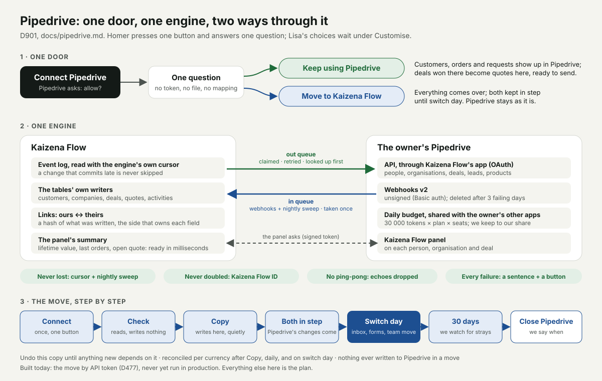

# Pipedrive: beside it, moving from it, and past it (D901)

The owner (25 November 2026): "Although we aim for full parity with Pipedrive and to supersede it, we also need to provide a solid and
seamless integration with Pipedrive as well for store owners. Additionally we need to make it dead-simple to import and switch to Kaizena
Flow for those who want to." Then, on the gap assessment and its nine questions: "Go with your recommendations, however focus on
versatility, flexibility, reliability and ease of use. Write the plan."

**This file is the plan; section 13 says what is built.** It takes over S7 of `docs/own-books-and-sales.md` (moving from Pipedrive) and
the Pipedrive half of its section 3.3 (the pilot's exit), and lists the CRM units a Pipedrive team needs (section 9). Each unit gets its
own decision when it starts. Code, tests and texts follow this file; where they disagree, this file is corrected first. Section 12 lists
the spikes to run before code, section 14 what only the owner can do.

Evidence is marked so nobody builds on a guess:

* **[repo]** read in this repository, or in production as counts only, on 25 November 2026.
* **[docs]** read on Pipedrive's own developer pages (developers.pipedrive.com, pipedrive.readme.io) on 25 November 2026. Sources at the end.
* **[U]** *not verified*: a spike in section 12.

---

## 0. Summary

1. **Three promises, one engine.**
   * **Keep Pipedrive.** A store that sells here and runs its sales in Pipedrive gets both kept in step. Customers, companies, orders
     and requests show up in Pipedrive. A deal won there becomes a quote here, ready to send. A panel inside Pipedrive shows what the
     person bought.
   * **Move to Kaizena Flow.** Connect, Check, Copy, keep both in step while the team tries it, then a guided switch day. Nothing is lost
     or doubled, and the copy can be undone while nothing new depends on it.
   * **Past Pipedrive.** A team that never had Pipedrive misses nothing: the parity units of section 9.
2. **Where we start** [repo]. The move exists (D477: by API token, read only, organisations, persons with an email, pipelines, stages,
   deals, activities and notes). It has never been run in production. Nothing writes to Pipedrive. Deals are open to 3 of 61 stores.
3. **The owner's choices** (25 November 2026, "go with your recommendations"):
   1. Both directions: here → Pipedrive and the panel first; Pipedrive's won deals → quotes here second.
   2. One public Pipedrive app, Kaizena Flow's own (an app's type cannot be changed later [docs]).
   3. Free and in the core. Keep Pipedrive needs no extension. The move needs Deals (the *Deals and contracts* extension) and turns it on.
   4. Contacts without an email are allowed (P1), and an email stays unique per store where there is one.
   5. Human Web's own Pipedrive account is the first real run, as a check that writes nothing (G0).
   6. Microsoft 365 before Gmail for mailbox sync, as S5 already planned (Gmail's restricted scopes need Google's yearly assessment).
      If Human Web's mail is Gmail, the owner says so and the order swaps (section 14).
   7. Nobody is subscribed by a move. One deliberate *Do you still want our emails?* message is offered, which adds only those who confirm.
   8. HubSpot after Pipedrive, on the same engine (section 11).
   9. EU data: Connect says once, plainly, that the store's data goes to the owner's own Pipedrive under the owner's agreement with
      Pipedrive, and shows where the account is hosted when Pipedrive tells us. Nothing blocks (Pipedrive is the store's processor, not ours).
4. **The four qualities are rules, not wishes** (section 3): ease of use for Homer, flexibility for Lisa, versatility of the one engine,
   and reliability held by code and tests.
5. **Order** (section 10). Now: the real check on Human Web's account, and the app's registration (Pipedrive's review takes up to 21
   business days [docs]). Next: the app's Connect and the engine, with the move made complete. Then the switch day and Keep Pipedrive side
   by side, with the parity units that the pilot shows the team misses. Then Human Web switches, and Deals opens to every store.

---

## 1. The promises (what Homer sees)

### 1.1 One door

**Integrations → Pipedrive** and **Settings → Moving in** lead to the same card. It has one button, **Connect Pipedrive**. Pipedrive's own
page asks him to allow Kaizena Flow. Back here there is one question, with two big answers:

* **Keep using Pipedrive.** *Your customers, orders and requests show up in Pipedrive. Deals you win there become quotes here, ready to send.*
* **Move to Kaizena Flow.** *We bring everything over and keep both in step until you're ready. Pipedrive stays as it is.*

Nothing else is asked. Every later choice has a default chosen from the store's own facts (6.3), shown as one sentence, with *Customise*
for Lisa. The answer can change later. A store that keeps Pipedrive can move later with everything already linked, and a move can stop
and become Keep.

### 1.2 Keep Pipedrive

After the answer the card says, for example: *Sending to Pipedrive: 1 240 people who bought or asked in the last 12 months, their 86
companies, and their orders. About 2 days, as Pipedrive allows.* Then it goes quiet and speaks only when something needs him. In
Pipedrive, every person's, company's and deal's page has a **Kaizena Flow** panel (5.4).

### 1.3 Move to Kaizena Flow

```
 Connect ──► Check ──► Copy ──► Both in step ──► Switch day ──► 30 days ──► Close Pipedrive
  (once)    (reads,   (writes   (changes in      (last catch-up,  (we watch   (we say when; he
            writes    here,      Pipedrive keep   the inbox and    Pipedrive   cancels it himself)
            nothing)  quietly)   coming)          the team move)   for strays)
```

* **Check**: *Here's your Pipedrive.* Counts, the open pipeline's value per currency, and one sentence for each thing that cannot come and why.
* **Copy**: *Your deals are here*, with **Open Deals**.
* **Both in step**: one line, *Kept in step with Pipedrive: last change 2 minutes ago.*
* **Switch day**: **Move my team**, a short checklist pressed through (7.4).
* **After**: *You can close Pipedrive now*, once nothing new has appeared there for 30 days.

### 1.4 Past Pipedrive

A team that has never used Pipedrive finds a CRM with nothing missing (section 9). The pilot's exit (10.3) says when that is true.

---

## 2. Where we start

### 2.1 Built [repo]

| Part | Where | Note for this plan |
|---|---|---|
| Moving in from Pipedrive by API token: a check, then the import, then *Bring over what's new* | D477, `src/server/pipedrive.ts`, `crm_moves`, `crm_move_links` | Read only, tested against a stand-in only. What it leaves behind is listed in section 7.2. A second run brings only new records, never changes. |
| Deals, pipelines, stage chance, deals won by payment, quotes moving deals | D464 | One person and one company per deal; lost reason is free text |
| Activities, *Today*, push when due | D468 | Call, meeting, task only |
| The leads inbox (derived from requests, no table of its own) | D475 | |
| The Bcc filing address | D476 | |
| Sales reports | D520 | |
| Contracts with signing | D695 | |
| Deal, activity and lead events to endpoints and workflows | D757, `src/lib/webhook-topics.ts` | Not to Zapier or Make; the Admin API has no deals |
| The event log, read with a cursor of one's own | D718, `src/server/event-log.ts` | The engine's way to never miss a change here |
| OAuth with tokens refreshed under a row lock | Canva (D898), Shopify (D445) | The pattern for Pipedrive's grant |
| One-by-one sending with a failure ladder and a lookup before any retry | Tripletex (D453) | The pattern for writing to Pipedrive |
| A move engine: check, copy, catch-up, move day, reconciliation, undo | Shopify (D445) | The pattern for section 7 |
| Custom fields on customers, orders and deals | D118 (`field_groups` entities) | Not on companies |

### 2.2 In production, 25 November 2026 [repo, counts only]

* No store has connected Pipedrive: `crm_moves` and `crm_move_links` are empty.
* No email has been filed: `filed_emails` is empty.
* 20 deals in 3 stores, 36 activities.
* `sales` is open to the 3 pilot stores of 61 (`platform_settings.sales_open` is off).

### 2.3 What Pipedrive's API allows [docs]

* **API versions.** Since 1 August 2026, v1 endpoints that have a v2 version are out of support: they "may remain functional" but "may be
  changed or removed without further notice". These are activities, deals, persons, organizations, products, pipelines, stages and
  itemSearch. Notes, users, leads, files and mailbox are not on that list and are still documented. D477 reads v2 for everything but users
  and notes, so it is fine today. v2 also has Fields (`/api/v2/dealFields`, `personFields`, `organizationFields`, `productFields`,
  `activityFields`), Products, deal products (`/api/v2/deals/{id}/products`) and Projects.
* **OAuth 2.** Authorise at `https://oauth.pipedrive.com/oauth/authorize`; exchange the code at `/oauth/token` with the client id and
  secret by HTTP Basic. An access token lasts 60 minutes. A refresh token expires if it is not used for 60 days, and each use resets it. The
  token's answer carries `api_domain`, the company's own API host.
* **Scopes** (fixed per app): `base`, `deals:read|full`, `contacts:read|full`, `leads:read|full`, `activities:read|full`,
  `products:read|full`, `mail:read|full`, `users:read`, `deal-fields:full`, `contact-fields:full`, `product-fields:full`,
  `webhooks:read|full`, `recents:read`, `search:read`, `goals:read|full`, `projects:read|full`, `admin` and a few for phone, video and
  messengers. Making webhooks needs `webhooks:full` (or `admin`).
* **Limits.** Each company has a daily budget of 30 000 tokens × the plan's multiplier (Lite 1, Growth 2, Premium 5, Ultimate 7) × seats
  (plus any purchased top-ups). It is shared by every app and token of the company and resets at midnight on Pipedrive's server. Costs
  include about 2 for a single read, 20 for a list page, 10 for an update and 40 for a search; v2 costs less. Bursts are counted per user
  and token over 2 seconds: an OAuth app gets 80 to 480 by plan, four times an API token. Search is 10 per 2 seconds on every plan. Too
  many returns 429.
* **Webhooks v2.** A delivery has `meta`, `data` (the record as it is now) and `previous` (the changed fields). Pipedrive tries again after
  3, 30 and 150 seconds. After 10 first-try failures a webhook is banned for 30 minutes, and one with no success for 3 days is deleted.
  Authenticity is only HTTP Basic auth that we choose; nothing is signed. A user may have 40 webhooks.
* **Inside Pipedrive.** An app may add one panel per detail view (deal, person, organisation):
  * a **JSON panel** that Pipedrive fills from our endpoint, within 10 seconds, at most 10 objects of 20 fields, with a `token` signed with
    the client secret or the panel's own;
  * or a **custom panel** (our page in an iframe, with Pipedrive's SDK, 100 to 750 pixels high).
  * **App actions**: links or modals from Pipedrive's menus.
* **Apps.** A public app is reviewed (up to 21 business days) and stays unlisted until we press Publish. It needs:
  * a privacy policy, terms, a support contact and a pricing page;
  * 3 to 5 images, a demo video, working test accounts and a review contact;
  * the Developer Partner Agreement;
  * OAuth with the uninstall flow.

  A private app is shared by an unlisted link without review. Neither can become the other.
* **Not found**: whether the API says where an account is hosted (S6); a "changed since" filter on v2 lists (S2; `recents` exists);
  the uninstall callback's details (S8).

---

## 3. The four qualities, as rules

### 3.1 Ease of use (Homer)

* **One door, one button, one question** (1.1). No token to find, no file, no field mapping. No *sync*, *webhook*, *field* or *API* on his
  screens: *kept in step*, *comes over*, *shows up in Pipedrive*.
* **Defaults from facts, said as sentences** (6.3, 7.2). He is never asked what the two accounts can answer: who is who (by email), which
  pipeline (the one with most open deals), which currency (the deal's own), which team member (by email).
* **One main action a screen.** The card is silent when all is well. When something is wrong it says one sentence with one button.
* **Safe to press.** Every press says what it will do and can be pressed again without harm. Nothing that comes over or goes out emails,
  subscribes, charges or invoices anyone.
* **Progress in words and time.** *About 2 days, as Pipedrive allows*, never tokens or percentages.

### 3.2 Flexibility (Lisa, one step away under *Customise*)

* **Per kind of record**: on or off; which way (here → Pipedrive, Pipedrive → here, both); who (everyone, those who bought or asked,
  companies only, a segment of D296); from when.
* **Orders as**: figures on the person only; a note per order; or a won deal per order (with its products), from an amount, in a pipeline
  and stage of her choice.
* **A deal won in Pipedrive as**: nothing; a quote to send (the default); a quote sent at once (after a confirmation); or a Work invoice
  draft (stores with Work).
* **Who owns each field** (6.4), and the field table (each Pipedrive field ↔ ours, with *Don't send*).
* **The panel's facts**, and the share of Pipedrive's daily budget we may use (default half).
* **Pause.** A history per record (what was sent, when, and Pipedrive's answer) with *Send again*.
* **Check everything** (the reconciliation, 7.5). **Disconnect**, keeping the links or forgetting them.
* **In a move**: which pipelines, owners and closed deals (from which year); whether files and email come; the switch day's time;
  *Undo this copy*.
* **Other ways in**: *Use an API token instead* (a move only, today's D477 connect), and *Bring a file* (M7).

### 3.3 Versatility

* **One engine for three modes** (section 4): **keep** (ongoing, both ways), **move** (copy, kept in step, switch day) and **once** (a copy
  and nothing more, today's D477).
* **Every kind of store**: a shop; a store that sells only Work, with no shop; B2B with company accounts and quotes; and Kaizena Flow's
  own store (3.5).
* **Every Pipedrive plan**, Lite to Ultimate, within its budget.
* **Every currency.** A deal in a currency the platform does not keep keeps Pipedrive's figure in its note and is never counted as zero
  (D464's rule). Every language the admin speaks.
* **Three ways in**: the app (default), the API token, the export file.
* **A second CRM on the same engine.** HubSpot is a `source`, a client and a mapping, not a new engine (section 11).

### 3.4 Reliability (rules the code holds)

1. **Nothing is lost.**
   * Changes here are read from the event log with the engine's own cursor (`consumeEvents()`, D718), so an event that commits late is
     never skipped.
   * Changes in Pipedrive come by webhook, plus a nightly sweep of what changed (S2). A delivery Pipedrive dropped, or a webhook it
     deleted, is caught within a day.
2. **Nothing is doubled.**
   * In Keep, every record we make in Pipedrive carries our id in a field, *Kaizena Flow ID*, made at Connect.
   * A create whose answer was lost is looked up before any retry (Tripletex's rule).
   * Before the first send, Pipedrive's people and organisations are read once (list pages, cheap) and linked by email and name. Nobody
     already there is made again.
3. **No ping-pong.**
   * A change that came from Pipedrive is never sent back: the sync's writes carry a transaction flag, as imports carry
     `commerce.deal_importing`, so their events are marked.
   * A delivery that equals what we last wrote (its hash on the link) is dropped (S3).
4. **One owner per field** (6.4). A conflict is counted and shown to Lisa, never decided twice in two directions.
5. **Within Pipedrive's limits.**
   * The daily budget is read from Pipedrive's answers and kept to our share. Bursts stay under the plan's limit.
   * Search is avoided (the link table answers first), and a 429 is waited out.
   * When the share is spent, what waits goes after Pipedrive's midnight, and the card says so: *140 changes wait for Pipedrive's
     allowance; they go tonight.*
6. **A grant that stays.**
   * Tokens are refreshed only inside a transaction that locks the connection's row (Canva's rule).
   * A daily refresh keeps a quiet store's refresh token from expiring at 60 days.
   * A refused refresh, or the app uninstalled in Pipedrive, stops the engine and keeps the links. The card asks for **Connect again**.
7. **Webhooks that stay.**
   * Each connection's webhooks are checked daily and made again if Pipedrive deleted them.
   * Each delivery is answered at once (stored, then worked by the dispatcher) and taken once, by its id.
   * Basic auth uses a secret per connection, compared in constant time, because Pipedrive signs nothing.
8. **Every failure classified**, as Tripletex does:
   * Pipedrive's own trouble: a retry ladder.
   * A limit: wait.
   * A refused grant: pause and ask.
   * A refused record: it waits for a person, with a stable `error_key` and a sentence from the catalogue, never Pipedrive's raw answer.
9. **Seen.** Through the card on Integrations, the store checkup and a once-a-day staff alert. The jobs run inside `tracked()`, so a
   failure shows on the platform home.
10. **Proved.**
    * A stand-in Pipedrive answers as Pipedrive's v1 and v2 OpenAPI documents say, with webhooks, limits, lost answers, expired tokens and
      an uninstall. Nothing in CI calls Pipedrive.
    * Before each unit ships, a live check runs against a Pipedrive developer sandbox.
    * Through the pilot, the reconciliation (7.5) is green every day.

### 3.5 The platform

Kaizena Flow's own store (D467) is a store. It gets the card on its Integrations and Moving in pages with no step of its own, so Kaizena
Flow's sign-ups (D466's *Sign-ups* pipeline) can be kept in step with a Pipedrive account too. Kaizena Flow sells plans through Stripe,
not goods: K4 (products) does not apply to it. `docs/platform-parity.md` gets its row under *Built for both* in the change that ships K1.

---

## 4. One engine



```
            Kaizena Flow                                              Pipedrive
 ┌──────────────────────────────────┐                    ┌──────────────────────────────┐
 │ the tables' own writers          │                    │                              │
 │ (D366, D108, D464, D468, D431) ──┼─► event log ─► out │                              │
 │             ▲                    │   (cursor)  queue ─┼─► API (OAuth, api_domain) ──►│ people, organisations,
 │             │                    │                    │                              │ deals, leads, products
 │          in queue ◄──────────────┼── webhooks v2 ◄────┼── changes                    │
 │     (taken once by id)           │   + nightly sweep  │                              │
 │                                  │                    │  Kaizena Flow panel ─────────┼─► asks our summary (JWT)
 │ links: ours ↔ theirs, hash,      │                    │                              │
 │ owner side, deleted where        │                    └──────────────────────────────┘
 └──────────────────────────────────┘
```

**Tables.** G2's decision settles the names. Add, never rename: `crm_moves` and `crm_move_links` keep working for the code that reads
them until it no longer runs.

* **The connection** (`crm_moves` grows into it). One per store and source, holding:
  * the grant, encrypted, and the `api_domain`;
  * the mode (keep, move or once) and the settings;
  * the webhook secret, the status and the problem.

  A row made by API token keeps working.
* **The links** (`crm_move_links` grows). For each record:
  * our id and Pipedrive's id, by kind;
  * a hash of what was last written and read;
  * the side that owns it, when it was last in step, and on which side it was deleted.
* **The out queue.** One row per record to send, claimed `for update skip locked` with an expiring claim, with its tries and `error_key`.
* **The in queue.** Pipedrive's deliveries by their id, holding ids and changed fields only, pruned after 30 days.
* **The panel's summary.** For each linked person, company and deal:
  * lifetime value per currency, orders, the last order;
  * open quotes and subscriptions.

  It is kept fresh by events, so the panel answers in milliseconds, far inside Pipedrive's 10 seconds.

**Writers.** Whatever comes here goes through its table's existing writer: customers (D366), companies (D108), deals (D464), activities
(D468), quotes (D431), products (D165), custom field values (D118). The engine has no SQL of its own, the Shopify move's rule. Three
modules:

* `pipedrive-client.ts`: the only code that talks to Pipedrive. It makes one call function with an injectable `fetch`, to an
  `api_domain` checked anchored to `https://{name}.pipedrive.com` (Shopify's `isMyshopify()` rule).
* `pipedrive-map.ts`: pure, both directions.
* `pipedrive-sync.ts`: the queues.

**Jobs.** The dispatcher's `pipedrive` job (it already runs every 40 seconds for D477) works the out and in queues. A daily job does three
things: it refreshes grants, checks webhooks, and sweeps changes in both directions.

---

## 5. Kaizena Flow's Pipedrive app (G1)

### 5.1 The app

* **The app.** One public app named Kaizena Flow, registered by Kaizena Flow on Pipedrive's Developer Hub. The pilot uses it before the
  listing (S1). The listing (K5) follows once two stores have used it for a month.
* **The listing's pages.** These are written for kaizenaflow.com from `docs/site-design.md` and saved as drafts for the owner: a privacy
  note for the app, terms, a support contact, a pricing line (free) and a help article in the docs portal.
* **Scopes.** `users:read`, `contacts:full`, `deals:full`, `leads:full`, `activities:full`, `products:full`, `contact-fields:full`,
  `deal-fields:full`, `webhooks:full`, `recents:read` and `search:read` (used sparingly). `mail:read` is added for M6 only if Pipedrive
  lets an install leave it out (S1). Otherwise email comes by the Bcc address and P21 instead.
* **Scope checks.** A test holds the app file's scope list equal to the code's. Another holds the move and once modes to reads: the code
  writes to Pipedrive only in Keep.

### 5.2 Connect

* **The grant.** Pipedrive's authorisation code, with the state, the store, the account and the back page sealed (Canva's pattern). The
  callback refuses unless the person signed in now is the one who pressed. The grant is kept encrypted, never logged or audited.
* **After Connect, Kaizena Flow reads:**
  * who connected, and whether they are a Pipedrive admin. A non-admin sees only what Pipedrive lets them, so Check says *You see 340 of
    your company's deals. Connect as a Pipedrive admin to bring them all.*
  * the company's plan and seats, for the budget;
  * where it is hosted, if Pipedrive says (S6).
* **Who may.** The owner connects and disconnects (D41). `settings:write` changes *Customise*. Audited as `integration.pipedrive_*`, with
  counts only.

### 5.3 Uninstall

Uninstalling in Pipedrive, or pressing **Disconnect** here, stops the engine and keeps the links, so connecting again resumes without
doubling (S8). *Forget the links* is Lisa's, behind a confirmation.

### 5.4 Inside Pipedrive

**One JSON panel** on each person, organisation and deal, named *Kaizena Flow*:

* customer since;
* lifetime value per currency;
* the last three orders (number, date, total, status);
* an open quote, with *Send*;
* a subscription;
* **Open in Kaizena Flow**.

It shows only the facts the owner chose; the default has no address and no payment detail. The panel's `token` is checked with the
client secret. The company leads to the store by the connection, and the person to the customer by the links. Someone not linked shows
*Not in Kaizena Flow yet*, with **Add**.

**App actions:**

* **Make a quote in Kaizena Flow**, from a deal: its person, company and products, opening our draft.
* **Open in Kaizena Flow**.

A custom (iframe) panel comes later, only if the JSON panel's 10 × 20 is too little.

### 5.5 Without the app

Today's paste of an API token stays, for a move only, under *Use an API token instead*. Both ways read through the same client and mapping.

---

## 6. Keep Pipedrive (K units)

### 6.1 Here → Pipedrive (K1)

| Ours | In Pipedrive | Matched by | Homer's default | Lisa |
|---|---|---|---|---|
| Customer | Person | The link, then any of their emails (P2) | Those who bought, asked for a quote, buy for a company or are in a deal, in the last 12 months; then each new one who does | Everyone, a segment, or none |
| Company | Organisation | The link, then its organisation number (a field), then its name, ignoring case | The companies of those people | Every company |
| Paid order | Kaizena Flow's figures on the person and organisation (lifetime value, orders, last order, customer since) | — | Figures always. A store with company accounts, quotes or Work also gets a won deal per company order, its lines as products | Figures, a note per order, or a won deal per order from an amount; pipeline and stage |
| Refund, cancellation | The figures; the order's deal (value down, or lost as *Cancelled*) | — | On | — |
| Quote request, quote or contact form, chat with an address, sign-up request (Kaizena Flow's store) | A lead in Pipedrive's leads inbox, labelled *Kaizena Flow* | The person by email | On, with what they asked for as the title and their message as the lead's note (S12, legal read) | Off; title only |
| Quote sent (D431) | Its deal (the linked one, or a new one): value, products, the quote stage | The link | On; the stage named like *Proposal* or *Quote*, else none | The stage, or no move |
| Quote paid | Its deal won | The link | On | — |
| Product | Product: name, SKU as code, price per currency (VAT included, as ours, said in the field's name) | The link, then SKU | Only when orders go as deals with products | Always, or never |
| Subscription | Monthly recurring value on the person and organisation | — | On | Off |
| Customer erased (D162) | The person deleted in Pipedrive | The link | On: the store controls both copies and erases where it sent | *Tell me instead*, listed on the card until done |
| Email consent (D295) | Never Pipedrive's marketing status (Pipedrive's Campaigns would email them) | — | Not sent | A read-only field *Subscribed in Kaizena Flow* |

**A first run sends history.** It goes oldest last and newest first, and is spread over days if the budget asks. A store of 5 000 people
on Pipedrive Lite with one seat (30 000 tokens a day) takes about two days at half the budget. The card says so in words.

### 6.2 Pipedrive → here (K2)

* **A deal won** becomes a quote (a draft order of source `quote`, D431) for its person and company. Its products are matched to ours by
  SKU, then by name; any that are not matched come as custom lines with their price. The quote is ready to send and **never sent without a
  press** by default. In a store with Work it is a Work invoice draft instead. The quote links the deal, so paying it later wins the deal
  in Pipedrive (6.1).
* **A person or organisation** comes here only when needed: on a won deal, or labelled *Kaizena Flow*. Lisa can choose *All*. It follows
  D366's rules: no password, email not proven, nothing emailed, nobody subscribed. Someone already here keeps what they have: only empty
  fields fill, unless Lisa made Pipedrive the owner of that field.
* **Deleted in Pipedrive**: never deleted here. The link is marked, and Lisa sees a list.
* **Merged in Pipedrive**: the links follow the kept record (S3).
* **Activities, notes and pipelines** stay in Pipedrive, which is the CRM in Keep. Lisa may show Pipedrive's activities on the timeline,
  read only.

### 6.3 Defaults from facts

| The store's facts | Homer's defaults |
|---|---|
| Company accounts, quotes or Work | Company orders go as won deals with products; quotes move deals to the quote stage |
| A shop selling to consumers | Figures on the person only; leads from requests |
| A Pipedrive pipeline with a stage named like *Proposal* or *Quote* | Sent quotes move deals there |
| Pipedrive Lite or Growth with one or two seats | Half the daily budget; 12 months of history, spread over days |

### 6.4 Who owns what

| Field | Owner | The other side |
|---|---|---|
| Name, phone, address, company | The side that had it first. After that, the latest change by time wins, and each conflict is counted for Lisa | Filled when empty |
| Email | Ours for a customer who signs in here (it is their login); otherwise the side that had it first | Filled when empty |
| Orders, totals, subscriptions, lifetime value | Ours | Read only in Pipedrive, in fields named *Kaizena Flow …* |
| Deal stage, owner, expected close, value before a quote | Pipedrive | — |
| A deal's value once a quote is linked | Ours (D464: one truth) | — |

### 6.5 What Keep never does

* It never emails, subscribes, charges or invoices anyone.
* It never sends a payment detail, a password, a staff note, a restricted order (D475's rule) or someone who only browsed or only
  subscribed (unless Lisa's segment says so).
* It never deletes anything in Pipedrive but an erased person's record.

---

## 7. Move to Kaizena Flow (M units)

### 7.1 Check

Check reads everything and writes nothing: D477's run, now over the app. It shows:

* people and companies;
* deals open, won and lost, with the open value per currency and the value won this year per currency;
* activities still to do, notes, files, and emails if chosen;
* the Pipedrive users.

Each thing that cannot come gets one sentence saying why and what to do. A non-admin connection is warned (5.2).

### 7.2 What comes over

| Pipedrive | Here | Today (D477) | Complete with |
|---|---|---|---|
| User | Team member by email; else **Invite** (M2) or a member Homer picks | Owner by email, else nobody | M2 |
| Organisation | Company (D108): address, custom fields, labels as tags, parent company | Name and address | P3, P4 |
| Person | Customer (D366): every email and phone, their organisations, custom fields, labels as tags (marketing status: 7.3) | Only with an email; one email and one phone | P1, P2, P3 |
| Lead | An open deal in a pipeline *Leads*, one stage *New*, with its labels and source | Not read | M1, P9 |
| Pipeline, stage | Pipeline and stage, with chance and rotting days | Name, order, chance | P11 |
| Deal | Deal (D464): value and currency, owner, close, status, lost reason, labels, source, products, people, followers, custom fields, stage history | The core fields | P7, P8, P9, P10 |
| Product | Matched to ours by code = SKU, then name; unmatched kept on the deal's lines with their price and offered as draft products | Not read | P7 |
| Activity | Activity (D468) with its type, attendees, done or not, note; due as Pipedrive says | Call, meeting or task; Pipedrive's own type kept in the note | P15 |
| Note | On its person, company or deal, pinned kept | On a person by email, else their deal's | P4 (company notes) |
| File | Attachment, in private storage | Not read | P26 |
| Email thread | A filed email (D476) on the people, companies and deals it names | Not read | M6 |
| Custom field definitions | Custom field groups (D118) per kind, typed by the table below | Not read | P4 (companies) |
| Filters, goals, Projects, Campaigns, automations, web forms, Scheduler, LeadBooster | Not copied; each named on switch day with its counterpart here | — | 7.4 |

**Field types.**

| Pipedrive | Here |
|---|---|
| `varchar`, `varchar_auto` | text |
| `text` | textarea |
| `double` | number |
| `monetary` | money, in its currency |
| `date`, `daterange` | date, two dates |
| `time`, `timerange` | time, two times |
| `enum` | select |
| `set` | checkboxes |
| `phone` | phone |
| `address` | textarea |
| `user`, `org`, `people` | text with the name; the id is kept on the link |

### 7.3 Consent

Nobody is subscribed by a move (D366). Check counts Pipedrive's marketing status: *214 people were on your email list in Pipedrive*.

* If Pipedrive's API gives the consent's evidence (when and how, S4), the Shopify move's Decision 1 (`docs/moving-from-shopify.md` 6.2)
  applies as it does for Shopify.
* Otherwise Lisa may send one *Do you still want our emails?* message through the broadcasts' confirmed sign-up. Only those who press join.

The same legal read as the Shopify plan's section 12 covers both.

### 7.4 Both in step, then switch day

**Both in step (M3).** Until switch day Pipedrive stays the source. A change there (a stage moved, a deal won, a note) comes over within
minutes by webhook, or by the nightly sweep. A record changed here since it came is the team's now: it keeps its change, and the conflict
is counted. Today's *Bring over what's new*, which brings only new records, becomes this.

**Switch day (M4).** One screen, **Move my team**, now or at a time Homer picks:

1. **Last catch-up.**
2. **Reconciliation** green (7.5), or each red line with its fix.
3. **Email.** Pipedrive's Smart BCC address is replaced by our filing address, with a copy button and how-to for Gmail and Outlook. Each
   member's mailbox follows once P21 or P22 is built.
4. **Where new leads arrive.** Pipedrive's web forms, LeadBooster chatbot and Scheduler links are replaced by our forms (D705), chat and
   booking links (P18). We name the ones Pipedrive's API can list (S10) and give each its replacement to paste.
5. **Zaps and Make scenarios** on Pipedrive point to our events with the same meaning (*Deal won* is `deal.won`), listed side by side.
6. **Pipedrive's automations** become our workflows (P24). The common ones are made in one press (*when a deal is won, add a task*).
7. **Reminders on.** Copied activities due from today get their push; they were marked told while copying.
8. **The team told.** Each member gets an email, *From today our deals are in Kaizena Flow*, with how to put the admin on their phone (D361).

In a move nothing is ever written to Pipedrive, and nothing there is closed or deleted by us.

### 7.5 Reconciliation

| Kind | Compared |
|---|---|
| People, companies, deals by status, activities to do, notes, files | Count, each difference named (*2 people left out: no name, no email, no phone*) |
| Deals | Open and won value per currency and pipeline, in integer minor units |
| Owners | Deals per owner |

Shown after Copy, daily while in step, and on switch day. Homer sees *Everything is here ✓*, or one line per kind that differs, each with
what to do.

### 7.6 After, and closing Pipedrive (M5)

* **30 days.** The sweep looks once a day for anything new in Pipedrive (*2 deals were added in Pipedrive since you moved: **Bring them
  over***), so a teammate's old habit loses nothing.
* **After 30 quiet days**: *You can close Pipedrive now*, with Pipedrive's own export as his archive and how to cancel. We never cancel for him.
* **Undo this copy** (Lisa's, behind a confirmation). Before switch day, and while nothing made here depends on what came (an activity, a
  quote or a contract on a copied deal), it takes back what the move made, through each writer, and leaves alone what the team made.
  After that the page says why it is gone. The links already say what the move made (`crm_move_links`).

### 7.7 Without connecting (M7)

* **The API token**, as today.
* **A file.** Pipedrive's export (deals, people, organisations, activities and products, as CSV or XLSX), or HubSpot's, is read into the
  same mapping and checked and applied as any D165 import. Rows are linked by Pipedrive's id column, so connecting later never doubles.

---

## 8. The AI manager

* **New tools.** The CRM tools (`src/lib/crm-tools.ts`) gain *How is the move from Pipedrive going?* (the run's counts) and *What is
  waiting for Pipedrive?* (the card's facts).
* **Grounded.** Matching, mapping, sums and the reconciliation happen in code, never in the model. What people typed (notes, messages,
  emails) is not given to the model (`crm-tools.ts`'s rule) unless a decision and the DPIA (`docs/dpia-ai.md`) allow it.
* **The eval.** A new tool or changed tool description needs the eval run and its recording (`.claude/rules/ai-prompts.md`).

---

## 9. Past Pipedrive: the parity units

From the gap assessment of 25 November 2026: of 28 Pipedrive capabilities, 3 exist, 13 are partial and 12 are missing [repo]. Each unit
gets Homer's default and Lisa's depth, and the platform's store gets it with the store. *Needed by* says which part of this plan waits for
it.

### 9.1 Contacts

| Unit | What | Needed by |
|---|---|---|
| **P1** | **A person without an email** (section 9.6) | M1: Pipedrive's phone-only people and everything about them |
| **P2** | Several emails and phones a person (work, home, mobile), one of each primary; matching uses all, sign-in the primary | M1, K1 matching |
| **P3** | A person in several companies; a parent company | M1 (later is fine: the first company comes) |
| **P4** | Custom fields, tags and notes on companies (`field_groups` gains `company`) | M1 |
| **P5** | Suggested duplicates: same phone, same name in one company, an email's domain | After switch |

### 9.2 Deals

| Unit | What | Needed by |
|---|---|---|
| **P6** | **A list view**: columns, filters (owner, stage, status, label, value, close, custom fields), saved filters, bulk move, owner, label and close, export | Switch day: a team with many deals works from lists |
| **P7** | **Products on a deal**: a draft order linked to the deal (D431's draft, not shown to the customer until sent), so VAT, prices per market and money rules are never written twice | M1, K2 |
| **P8** | Several people on a deal; followers who are told what changes | After switch |
| **P9** | Labels on deals and leads; a deal's source (website, chat, import, referral, by hand) | M1 |
| **P10** | A list of lost reasons (Lisa edits it; Homer picks; *Other* with words) | M1 |
| **P11** | Rotting: days per stage, the card turns red, *Today* lists it, its owner is told once | Switch |
| **P12** | Recurring value on deals and products (monthly or yearly) | Later |
| **P13** | Who sees what: own deals only, the team's, or everyone, per role | Before `sales` opens to all |
| **P14** | Sales goals per person and team (won value and count, activities done) on Home and Analytics → Sales | Later |

### 9.3 Activities

| Unit | What | Needed by |
|---|---|---|
| **P15** | Activity types Lisa adds (demo, lunch, deadline, email), each one of our three kinds underneath | M1 |
| **P16** | A calendar view (day and week); drag to move | Switch |
| **P17** | A calendar feed per member (ICS, read only) first; two-way Google and Microsoft calendars with P21/P22 | Switch (the feed) |
| **P18** | Bookings become activities: a booking resource tied to a team member; a booking lands as an activity, on the timeline, and as a lead | Switch day (Scheduler's counterpart) |
| **P19** | A call's outcome and length | Later |

### 9.4 Email

| Unit | What | Needed by |
|---|---|---|
| **P20** | **Send email from a person, company or deal.** It goes from the store's sending domain (D727) with the member's name, using templates with personal fields (M2.6). It is kept on the timeline, and replies come back through the reply address (D332) and are filed. Open and click tracking stays off until a legal read (S12) | Switch |
| **P21** | Microsoft 365 two-way mail (Graph), per member, filed on people, companies and deals | After switch (S5's next) |
| **P22** | Gmail two-way mail (Google's yearly security assessment first) | Later |
| **P23** | Sequences: emails, tasks and waits on a person or deal, stopping on a reply, a booked meeting or a won deal | Later |

### 9.5 Automation, files, AI, data

| Unit | What | Needed by |
|---|---|---|
| **P24** | Workflow actions on the CRM (add an activity, move a deal, set an owner, add a label, make a deal from a lead); triggers for a rotting deal and a late activity | Switch day (Pipedrive's automations) |
| **P25** | Assignment rules: new leads to the team in turn, or by country or product | Later |
| **P26** | Files on deals, people and companies (private storage, a size limit, erased with their person) | M6 |
| **P27** | AI on the CRM: a deal's summary from its facts, the next step, a follow-up drafted from facts (P20 sends it) | Later |
| **P28** | Deals, companies and activities by file, in and out (= M7's reader, also for HubSpot's and any spreadsheet) | M7 |
| **P29** | **Deal, activity and lead events to Zapier and Make; the Admin API gains deals, activities, companies and leads** | Now: owners can join Pipedrive themselves meanwhile |
| **P30** | Push for deals: assigned to you, won, rotting | Switch |

### 9.6 P1, the largest change

`customers.email` is required and unique per store (`src/db/schema.ts`), and `customer_tags` and `customer_notes` are keyed by email.
Email reads are spread across `src/server`. The change is staged so that running code keeps working (CLAUDE.md, Database):

1. **The migration.** The email becomes optional, and unique where present. A check asks for at least a name. The shop's own paths still
   require an email (checkout, sign-in), so a shopper always has one.
2. **The type.** The row's type becomes `email: string | null`, and the type check lists every place that reads it. Each place decides:
   * sign-in, order email and marketing never reach a contact without an email;
   * segments leave them out;
   * merge, export and erasure work by id.
3. **Tags and notes** gain the customer's id beside the email, written both ways until every reader uses the id.
4. **The move** stops skipping people without an email. Their deals, activities and notes come with them.

*Rejected:* a separate contacts table. Two kinds of person would split the timeline, merging, the export and erasure.

---

## 10. Order of work

### 10.1 The tracks

| When | Ground | Move | Keep | Parity |
|---|---|---|---|---|
| **Now** | **G0**: the spikes (section 12); Human Web's real check with today's token import, writing nothing; the app registered (21-day review clock) | — | — | **P29** (small, and useful at once) |
| **Next** | **G1** the app and Connect; **G2** the engine (queues, links, budget, webhooks, stand-in Pipedrive) | **M1** everything comes over, with what exists; **M2** the team | — | **P1, P2, P4, P9, P10, P15** (what the copy needs) |
| **Then** | — | **M3** both in step; **M4** switch day; **M5** after, and undo | **K1** here → Pipedrive; **K3** the panel | **P6, P7, P11, P16, P17** (feed), **P18, P20, P24, P30** |
| **Then** | — | Human Web switches; a month of use; the exit (10.3); `sales` opens to all | **K2** won deals → quotes; **K4** products; a second pilot store; **K5** the listing | **P13** before `sales` opens; **P14** |
| **Later** | — | **M6** email and files; **M7** files | HubSpot (section 11) | P3, P5, P8, P12, P19, P21, P22, P23, P25, P26, P27, P28 |

### 10.2 Why this order

* The engine and the app serve both promises, so they come first.
* The move is already four-fifths built and gates the pilot's exit, which opens Deals to every store.
* Keep reaches every store at once (no extension), so it follows straight after, side by side with switch day.
* The parity units go in the order the move and the switch need them; the rest follow what the pilot's month shows.

### 10.3 Exits

* **The move's pilot (Human Web).**
  1. Its Pipedrive is copied and the reconciliation is green.
  2. Both are kept in step for at least 14 days with no record lost or doubled.
  3. Switch day is done, then 30 days of selling with Pipedrive unused.
  4. Whatever the team missed is built or decided.

  Then `sales` opens to every store (`docs/own-books-and-sales.md` 3.3), and the Move card shows wherever Deals is offered.
* **Keep's pilot** (a store the owner names that keeps Pipedrive). A month with the reconciliation green, no conflict left unexplained,
  and nothing waiting on Pipedrive's budget for more than a day. Then K5, the public listing.

---

## 11. HubSpot after

The same engine: `source` `hubspot`, its own OAuth app, client and mapping, and its export file through M7's reader. A listing in
HubSpot's marketplace follows. It does not start before the move's pilot exit.

---

## 12. Spikes before code

| Spike | Question | How |
|---|---|---|
| S1 | Can a public app under review be installed by our own and the pilot's companies? Can an install leave a scope out (`mail:read`)? | Developer Hub, a sandbox company |
| S2 | The cheapest way to list what changed since a time: an `updated_since` on v2 lists, or `/v1/recents?since_timestamp=` | The v2 OpenAPI file; a sandbox |
| S3 | Does a v2 webhook's `meta` say a change came from our own app? What does a merge send? | A sandbox, our app writing |
| S4 | What Pipedrive's API gives of a person's marketing status and its evidence (when, how) | The v2 persons with `marketing_status`; a sandbox with Campaigns |
| S5 | Whose mail `/v1/mailbox` returns to an app: the connecting user's only, or the company's? | A sandbox with two users |
| S6 | Does any answer say where the company's data is hosted? | `users/me`, the token answer, company settings |
| S7 | Leads, lead labels and sources (v1), and a deal's stage history (`/v1/deals/{id}/flow` or v2) | The OpenAPI files |
| S8 | The uninstall flow: what Pipedrive calls, and what it expects back | `pipedrive.readme.io/docs/app-uninstallation` |
| S9 | Which answers carry the budget's headers, and the token cost of v2 creates and updates | A sandbox, counting |
| S10 | Can the API list web forms, Scheduler links, LeadBooster and automations, so switch day can name them? | The OpenAPI files |
| S11 | Human Web's account: plan, seats, users, record counts, custom fields, people without an email, files | G0's real check |
| S12 | Legal reads: a lead's message sent to the owner's own CRM (6.1); the *still want our emails?* message (7.3); open tracking in one-to-one email (P20) | A lawyer, with the Shopify plan's section 12 |

---

## 13. What is built

Nothing of this plan yet (25 November 2026). Built before it: D477, the move by API token (2.1).

---

## 14. For the owner

1. **Human Web's check.** Connect Human Web's Pipedrive (Settings → Moving in, with an admin's API token from Pipedrive's *Personal
   preferences → API*) and press **See what comes over**. Nothing comes until **Bring it over** is pressed.
2. **The app.** Make Kaizena Flow's account on Pipedrive's Developer Hub, sign the Developer Partner Agreement, and choose the listing's
   support contact.
3. **Keep's pilot.** Name a store that will keep Pipedrive.
4. **Mail.** Say whether Human Web's mail is Microsoft 365 or Gmail (choice 6).
5. **The legal reads** of S12.

---

## 15. What this plan does not do

* Telephony, Pipedrive's Projects, sending Pipedrive's Campaigns, its prospect data (D893 is ours), its AI, or a browser extension.
* Writing to Pipedrive in a move, deleting anything in Pipedrive but an erased person's record, or cancelling Pipedrive.
* Keeping Pipedrive's activities and notes here in Keep, except Lisa's read-only view (6.2).

---

## Sources

Read 25 November 2026:

* Pipedrive, deprecated API v1 endpoints become out of support (29 July 2026, effective 1 August 2026):
  https://developers.pipedrive.com/changelog/post/deprecated-apiv1-endpoints-become-out-of-support
* Pipedrive, API reference (v1 and v2): https://developers.pipedrive.com/docs/api/v1
* Pipedrive, API v2 migration guide: https://pipedrive.readme.io/docs/pipedrive-api-v2-migration-guide
* Pipedrive, rate limiting (updated 17 September 2026): https://pipedrive.readme.io/docs/core-api-concepts-rate-limiting
* Pipedrive, OAuth authorisation: https://pipedrive.readme.io/docs/marketplace-oauth-authorization
* Pipedrive, scopes and permissions: https://pipedrive.readme.io/docs/marketplace-scopes-and-permissions-explanations
* Pipedrive, webhooks v2 (updated 28 July 2026): https://pipedrive.readme.io/docs/guide-for-webhooks-v2
* Pipedrive, app extensions: https://pipedrive.readme.io/docs/app-extensions
* Pipedrive, JSON panels: https://pipedrive.readme.io/docs/app-extensions-json-panels
* Pipedrive, custom panels: https://pipedrive.readme.io/docs/custom-ui-extensions-panels
* Pipedrive, creating an app (public and private): https://pipedrive.readme.io/docs/marketplace-creating-a-proper-app
* Pipedrive, app approval: https://pipedrive.readme.io/docs/marketplace-app-approval-process
