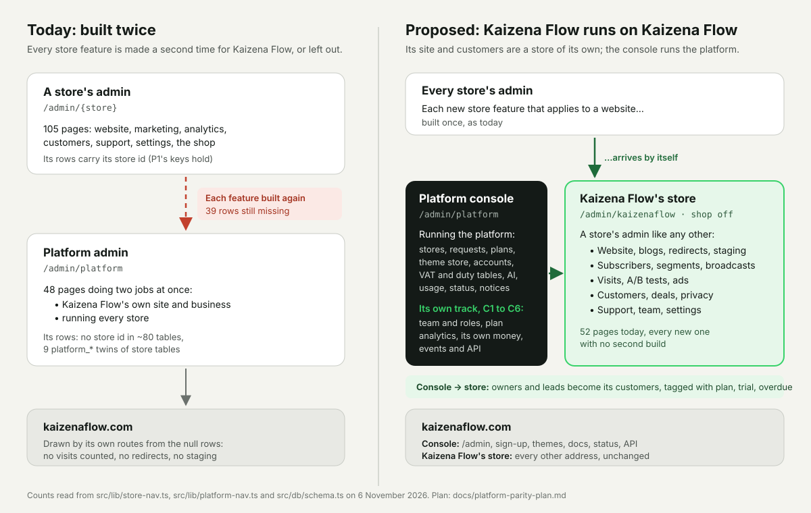
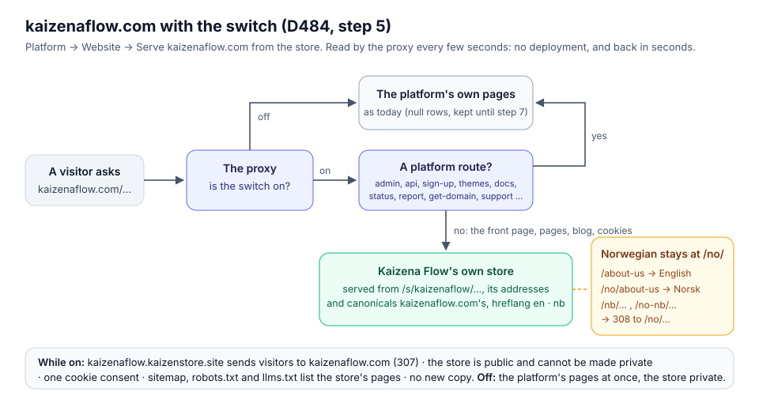

# Kaizena Flow runs on Kaizena Flow: the plan to close the gap

*Proposed and chosen 6 November 2026 (D466: "Let's go with your recommendations. execute the plan"). Built so far: step 1 (D466), step 2 (D467), steps 3 and 4 (D469), step 5's switch, built (D484) and on: kaizenaflow.com has been served from Kaizena Flow's store since 7 November 2026; the console's plan analytics (C2, D470); the platform's team page (C1's first step, D471) and its roles (C1, D510); the home's figures, targets, alerts and morning briefing (C2, D513); Kaizena Flow's own money: its sales (D507), their books (D508) and its payouts (D509); where owners come from and what they are worth (C2, D522) and sign-ups and first paid plans as ad conversions (C2, D523), so C2 is built but its reports.*

The owner, 6 November 2026, comparing Platform → Settings with a store's Settings: *there still seems to be a wide gap between
what the main store owner has on the platform and what a customer's store owner has. Make a plan to give the main store owner the
same pages, tools and features.* The rule is already in `CLAUDE.md` (Conventions) and its list in
[`platform-parity.md`](platform-parity.md). This file says how to close the gap for good, not one row at a time.

## 1. What was found

A store's admin has 105 pages in its sections (`STORE_SECTIONS`, `src/lib/store-nav.ts`). A store with the online shop off (a website,
D178) still has 52 of them, and those 52 are almost exactly what Kaizena Flow's own site needs. The platform admin has 48 pages
(`src/lib/platform-nav.ts`), but they cover two jobs at once: Kaizena Flow's own site and business, and running every store (stores,
requests, plans, VAT and duty tables, AI providers, usage, notices, status).

Read page by page on 6 November 2026 ([`platform-parity.md`](platform-parity.md) has every row):

- **Missing or partial for Kaizena Flow, and it applies: 39 rows.** Blogs and comments, redirects and the 404 report, staging,
  translating the whole site, private mode, an accessibility statement, company details, A/B tests on its own pages, the subscriber
  list, segments, broadcasts, email automations, ads and conversions, visit analytics, analytics of its plans, deals, a customer list
  with leads, privacy requests, custom fields, workflows, an Admin API, its team.
- **One row of the old list was wrong:** A/B tests were listed as *built for both*. Platform → Settings → A/B tests only reads the stores'
  tests; Kaizena Flow cannot test its own pages (`experiments.store_id` is not null, with a key to the page's store).
- **Store-only, rightly:** products, stock, orders, returns, gift cards, price lists, bookings and the rest of the shop. Kaizena Flow sells
  plans, premium themes and domains through Stripe Billing (D18, D35).

## 2. Why the gap keeps opening

Kaizena Flow's own site is kept as rows with no store: `store_id is null` in about 80 tables, and 9 `platform_*` tables that copy a
store's (`platform_theme_installs` for `store_theme_installs`, `platform_page_roles` for `page_roles`, `platform_settings` for a store's
columns). 56 server modules branch on `store_id is null`. So each store feature is built once for stores and again for Kaizena Flow,
and the second build is the one that gets left out:

- 48 store tables have `store_id not null` with keys over `(store_id, …)` (P1). Bringing one to Kaizena Flow means a migration to allow
  null or a twin table, unique keys made `nulls not distinct`, checks per kind of row (`pages` carries three), a gate on
  `requirePlatformAdmin()` and a platform page. D251 chose a twin table for exactly this reason: the store table's *rules and neighbours
  all need a store*.
- A row with a null store loses P1's guarantee: a key over `(store_id, id)` checks nothing where `store_id` is null (Postgres's default
  `MATCH SIMPLE`), so these tables fall back to one-column keys that do not stop a row from pointing into another store
  (`page_versions` is one).
- The store admin gains pages every week. Doubling each one doubles the work for good, and the rule in `CLAUDE.md` asks for both in the
  same change.

## 3. The recommendation: Kaizena Flow's own store, and a platform console

Split the platform admin by its two jobs.

- **Kaizena Flow's store** (`kaizenaflow`): a real row in `commerce.stores`, the online shop off (a website, D178), marked as the
  platform's own (`stores.house`). It serves kaizenaflow.com's pages and blog, and its customers are Kaizena Flow's own: owners and
  people who asked for a store. Its admin is a store's admin like any other, `Kaizena Flow / Kaizena Flow` in the store switcher beside
  `Platform` and the owner's other stores. Every store page that applies to a website is there, today's 52 and every new one, with no
  second build.
- **The platform console** (`/admin/platform`): running the platform. Stores, requests, plans, discounts, referrals, reminders, the theme
  store and demo stores, accounts, VAT and duty tables, AI providers, prices and usage, the status page, notices of illegal content,
  domains for sale, every email sent, interface languages, the platform's integrations and activity log. Its Website section, once
  the site has moved, is one link to Kaizena Flow's store.

| | Build each one twice (the way of D465) | Kaizena Flow's own store |
|---|---|---|
| To close today's gap | About 39 changes, most with a migration, a platform page and tests | Seven steps (section 5), the riskiest one undone with one setting |
| A store feature built next month | Built a second time, or listed here as missing | Reaches Kaizena Flow by itself, wherever it applies to a website |
| The database | More tables allowing a null store, P1 weaker in each | Kaizena Flow's rows are a store's rows, with P1's keys |
| Code | Grows: `platform-*` twins | Shrinks: the null-store paths of the site go (step 7) |
| Testing the product | Kaizena Flow's own site never uses what owners use | Kaizena Flow uses its own store admin every day, and finds what owners would find |

The console still lacks things a store has that are about running a business: a team with roles, analytics of plans, its own payouts
and VAT, events and an API. No store can give those, because Kaizena Flow's business is its plans. They are the console track
(section 6), built beside the steps.

**Where Kaizena Flow needs something a store lacks, build it for stores.** A conversion for a form sent rather than an order, an
automation that starts when a tag is added, a deal won by an outside event: website stores need these too. Kaizena Flow's store then
uses them, and nothing is built only for Kaizena Flow.

## 4. What Kaizena Flow's store needs that no store has

These are the seams. Everything else is a store's as it is.

1. **It is not a customer.** No plan, no limits, no trial end (D420), no suspension when overdue, no closing, no copying. It is left out
   wherever stores are listed or counted: the stores list, the platform home's figures, usage and limits, AI usage (it counts as
   *Kaizena Flow itself*), support's per-store figures, the stores' A/B tests, the status page's checks, the sitemap index of stores, the
   marketplace's owner templates, the Dream Factory. The same as `is_template`, `starter` and `sandbox` today (68 server modules read
   them); a scan test, like `store-writers.scan.test.ts`, holds every place that lists stores to it.
2. **Its team.** Its members are the platform admins, kept in step by a trigger on `accounts.platform_admin`. Nobody else is added
   until the console has a team with roles (C1): from step 5 its pages run on the admin's own site, as Kaizena Flow's pages do today,
   so code on them must come from a platform admin.
3. **Its address.** kaizenaflow.com is its primary domain, fixed: shown on its Domains page, never removed or moved there. Addresses
   stay exactly as they are: English without a prefix, Norwegian under `/no/` (D312, `nb`); the store's language addresses are
   checked to allow `no` for Bokmål.
4. **Kaizena Flow's own parts in its pages.** The plans table (D142, block `plans`), the theme store's sections (D285) and the
   Languages part (D427) are Kaizena Flow's today. They are allowed on its store's pages and on no other store's: a check in the
   database like `pages_product_layout_store`, and the builder offers them there only.
5. **The platform's routes on its host.** On kaizenaflow.com the admin, the API, sign-in, OAuth, sign-up, the theme store, the docs, the
   status page, the notice form, get-domain, the holding pages and referral links stay the platform's (the list is already the reserved
   slugs of the check `pages_slug_not_reserved`); every other address is the store's.
6. **Owners and leads are its customers** (step 2). An access request or a sign-up makes or updates a customer of Kaizena Flow's store,
   and a subscriber when the person agreed to news; the platform writes customer tags (`plan:{plan}`, `store:open`, `trial`,
   `overdue`) that segments, broadcasts and automations already read (D296); a plan's events appear on the customer's timeline (D462);
   an access request opens a deal. The record of processing (Platform → Settings) names the purpose.
7. **What "Kaizena Flow's own" means elsewhere stays.** Kaizena Flow's templates in the marketplace, its support desk for owners asking
   from their admin, the docs guide and the AI's platform tools are about running the platform and keep their null rows until a step
   decides otherwise.

## 5. The steps

Each step is one change or a few, tested in production like everything else. Steps 1 and 2 change nothing on kaizenaflow.com.

| Step | What the owner gets | What it touches | Size |
|---|---|---|---|
| **1. Kaizena Flow's store exists** | `Kaizena Flow / Kaizena Flow` in the store switcher: a store admin with the shop off, private mode on | A migration: `stores.house` (one at most, never a template, starter or sandbox), the store made with English and Norwegian and the business details from `platform_settings.business`; its members from `platform_admin`; every place in seam 1 | M |
| **2. Owners and leads are its customers** | Kaizena Flow's customer list with leads, notes, tags, timeline, import and export; a Sign-ups pipeline in Deals; the newsletter block on Kaizena Flow's pages keeps subscribers (today it only emails the recipients, `src/server/forms.ts`); segments, broadcasts and automations to owners who agreed; privacy requests with the month's clock | Access requests, sign-up and the plan events write to the store (seam 6); existing accounts brought in as customers, never as subscribers without their consent; Platform → Customers links each account to its customer | L |
| **3. The site is copied in** | The whole of kaizenaflow.com in Kaizena Flow's store, behind private mode, to look at beside the live site | One function, like `clone_store()` (ids by `clone_id()`), copies the null rows: pages and articles, saved parts, text styles, CSS versions, content types and entries, media rows (the same files), menus, headers, footers, categories and tags, forms, legal pages; `platform_page_roles` to page roles, `platform_theme_installs` to `store_theme_installs`, `platform_settings`' look, SEO, cookies and business details to the store's. Run again just before step 5 | L |
| **4. Kaizena Flow's parts on its pages** | Pricing, the theme store's sections and the Languages part working in the store's pages | Seam 4 | M |
| **5. The switch** | kaizenaflow.com served by Kaizena Flow's store: visits counted, redirects and the 404 report, staging, blogs and comments, translating the whole site, the accessibility statement, A/B tests on its own pages, ads and conversions | `store-hosts.ts` (seams 3 and 5); every address in today's sitemap answers as before with the same canonical and hreflang, checked by a test before and after; every page drawn both ways and compared (D310's eyes, phone and computer, light and dark, both languages); one setting routes back to the platform's pages while the null rows are kept. The platform's Website pages become read-only from the copy in step 3 | L |
| **6. Support and chat** | One desk for Kaizena Flow: visitors of its site, and owners asking from their admin, with each one's timeline | Decide: move the site's visitors to the store's desk and keep owners on the platform's, or move both now that owners are customers. The AI's platform tools (an owner's store and plan) stay the console's | M |
| **7. One copy** | The platform admin's Website section is one link; nothing to keep in step | The null-store paths of the site removed (`platform-theme-installs.ts`, `platform-roles.ts`, the `(platform)` page and blog routes, `platform-layout.tsx`), the twin tables retired, keys tightened where a null served only the site | M |

### Step 5, as designing it found (6 November 2026)

Steps 1 to 4 are built (D466, D467, D469). The switch is the one step that changes kaizenaflow.com, so it waits for the owner to look at the
copy (Platform → Website → *Copy the site*, then the store's own admin, behind its private mode) and is built with these, found while
designing it:

- **The switch at run time, not in the build.** The proxy (`src/proxy.ts`) already sees every page request and reads stores' facts every few
  seconds (`storeRequestAnswer()`); with `platform_settings.site_from_store` on, a request on Kaizena Flow's own host for a path that is not one
  of the platform's own is answered as Kaizena Flow's store's host (`hostStore` = `kaizenaflow`), so switching and switching back need no
  deployment. The platform's own first segments, which stay: `admin`, `api`, `auth`, `oauth`, `r`, `s`, `sign-up`, `get-domain`, `report`,
  `themes`, `status`, `support`, `unsubscribe`, `holding`, `docs`, `robots.txt`, `sitemap.xml`, `sitemap-kaizen.xml`, `llms.txt`, and the same
  under `/no/` (`sign-up`, `get-domain`, `report`, `themes`, `status`). Everything else (the front page, pages, `blog`, `category`, `tag`,
  `cookies`) is the store's.
- **Norwegian stays at `/no/`.** A store in Norway whose main language is English puts Norwegian at `/nb/…` and reads `/no/…` as its own
  country's old long address (308 to English). Kaizena Flow's store needs the language alias `nb` ↔ `no` in `StoreAddress`
  (`storeAddressOf()`, `addressSegment()`, `shortChoiceOf()`, `longMarketSlug()`, `addressDecision()`), for it alone, so links, canonical
  and hreflang say `/no/…` and `/no/…` is served from the long `no-nb` view.
- **One consent and one chat.** The platform's own pages ask for cookie consent and show Kaizena Flow's chat under no store (`store_id`
  null); the store's pages under the store. Behind one host a visitor must be asked once: the platform's own routes read and write the
  house store's consent while the switch is on, and the chat on them is the store's (step 6 joins the desks).
- **Sitemaps, robots and llms.txt.** `sitemap.xml` keeps listing Kaizena Flow's pages from the store instead of `sitemap-kaizen.xml`'s null
  rows; `robots.txt` and `llms.txt` the same; the store's own `/s/kaizenaflow` sitemap is not listed twice.
- **The theme store's pages** (`platform_page_roles` `themes`, `theme`) stay the platform's and are drawn by `/themes` as now; the copy
  leaves them out of the store's front and special pages.
- **Pictures**: the media library's rows move to the store at the switch (`media.url` is unique, so they were not copied).
- **Pages from the live site, settings from the store** (D474): until the switch, *Copy it again* brings the live site's pages, menus and
  parts over their copies, and the live site's settings only where the store has not changed them; the store's own SEO, logos and look
  stay. So pages are edited on the live site (Platform → Website) and settings in the store (Kaizena Flow → Settings).
- **Checked before and after**: every address in `sitemap-kaizen.xml` answers 200 with the same canonical and hreflang, at phone and
  computer widths, light and dark, in English and Norwegian (`e2e-live/` holds the axe scan; the same list).

**Built (D484), and off until the owner switches it:** the switch is `platform_settings.site_from_store`, turned on and off from Platform →
Website (`SiteSwitchCard`) and read by the proxy every few seconds; the platform's own first segments are `PLATFORM_ROUTES` and
`PLATFORM_ROUTES_NB` in `src/lib/house-routing.ts`, held to the folders of `src/app` by a test; Norwegian at `/no/` is the address alias
`HOUSE_ALIASES`; the store's pages name their languages `en` and `nb` as the site did; the sitemap, robots.txt and llms.txt read the store
while it is on; the platform's own routes ask with the store's consent, and the store's pages keep Kaizena Flow's chat until step 6. Turning
it on makes the store public; turning it off makes it private again and brings the platform's pages back at once. While it is on, the copy is
not made again and the platform's own pages and articles do not save (the theme store's do). **To switch:** copy the site again, look at it
in the store, run `node scripts/site-compare.mjs https://kaizenaflow.com > before.json`, switch, then run it again with
`--against before.json`: it fails on any address of the old sitemap that answers with another status, redirect, canonical or hreflang. Still
to do at the switch: the media library's rows move to the store.

Step 3's copy and step 5's switch are where things can go wrong; the copy is kept side by side, compared, and the switch has its undo.
The null rows are deleted only in step 7, weeks after the switch.

## 6. The console track: running the platform

Built beside the steps, in this order. Each is the store's feature as the model, for Kaizena Flow's business of plans.

| | What | The store's model | Today |
|---|---|---|---|
| **C1** | **The platform's team.** Platform admins invited, given roles (owner, support, content, finance, read-only) and removed on a screen; two-step stays required. Opens Kaizena Flow's store to people who are not owners | Team, roles and permissions (D158) | One boolean, `accounts.platform_admin`, set by SQL; all or nothing |
| **C2** | **Analytics of plans.** Monthly recurring revenue and how it moved (new, more, less, cancelled), trials and how many pay, failed payments, the way from request to approved, opened and paying, cohorts of owners, targets, alert emails and the morning briefing on the platform's home | Subscriptions analytics, Overview, targets and the briefing (D152, D348) | The platform home counts stores, paying, overdue, requests; no revenue, no comparison, no funnel |
| **C3** | **Kaizena Flow's own money.** Its Stripe payouts and what each settles, VAT on its own sales of plans, themes and domains by country, and the books (Tripletex or Fiken: the open row in the list) | Payouts, Finance, VAT reports (D290, D161) | Single invoices under each store; nothing in total |
| **C4** | **Events and API.** The platform's events (D465) signed to its own endpoints, workflows on them, *Add to Slack*, and an Admin API scope for its own tools (stores, plans, requests) | Own endpoints, workflows, Admin API (D354 to D356) | Zapier, Make and a pasted Slack webhook (D465). *Built: own endpoints and Add to Slack, D515; workflows, D516; its own read-only API, D518* |
| **C5** | **Timed plan prices,** if wanted: a campaign as a Stripe coupon with a duration | Campaigns (D114) | Discount codes only |
| **C6** | **The admin on its own host** (`admin.kaizenaflow.com`), so pages of Kaizena Flow's store no longer share the admin's site. Lifts the limit in seam 2 | P7 for stores | The admin and the site share kaizenaflow.com |

## 7. What stays store-only

Products, stock, orders, deliveries, returns, invoices and credit notes for orders, gift cards, customer groups, price lists, companies
(they need the shop, D178 `business`), wishlists, recommendations, product layouts, product feeds, the bonus program, creators,
bookings and hosts, subscription boxes, store setup and billing, the Dream Factory. Kaizena Flow's store has them as any store does,
switched off with its shop. Switching the shop on would later let Kaizena Flow sell one-off services (setting up a store, design work)
through it; that is not part of this plan.

## 8. Risks

| Risk | How it is handled |
|---|---|
| The live site breaks or loses search ranking at the switch | Copy compared page by page before; every sitemap address checked before and after; one setting back; null rows kept until step 7 |
| Edits made on the old pages between the copy and the switch are lost | The copy runs again just before the switch; the platform's Website pages are read-only from then |
| Kaizena Flow's store counted as a customer: billed, limited, closed, listed | Seam 1, with a scan test over every place that lists stores |
| Someone who is not a platform admin adds code to pages on the admin's own site | Members are platform admins only until C1 has roles and C6 moves the admin |
| Owners' data in a second place | One controller, Kaizena Flow; the record of processing and the retention rules name it; a person's privacy request covers both their customer record and their account |
| A store feature assumes a shop | A website store already runs without one (D178 step 5); each step's tests run Kaizena Flow's store as a website |

## 9. What the owner decided

The owner took the recommendations (6 November 2026): Kaizena Flow's own store, `kaizenaflow` named Kaizena Flow; every existing
owner brought in as a customer, with no marketing email without their consent; one desk for visitors and owners; the console's team
and plan analytics first. The questions as they were asked:

1. **The direction:** Kaizena Flow's own store (recommended), or keep building each feature a second time.
2. **Its name and address in the admin:** `kaizenaflow`, named *Kaizena Flow*.
3. **Owners as customers:** every account brought in as a customer (no marketing email without consent), or only those who agree.
4. **Step 6:** one desk for visitors and owners, or the owners' desk kept apart.
5. **The console track's order** (section 6). C1 and C2 are proposed first.

Once the direction is chosen, the rule in `CLAUDE.md` (Conventions) changes with step 5: a store feature that applies to a website
reaches Kaizena Flow's store by itself; a store feature about running a business gets its counterpart in the console, in the same
change or as its next step.
