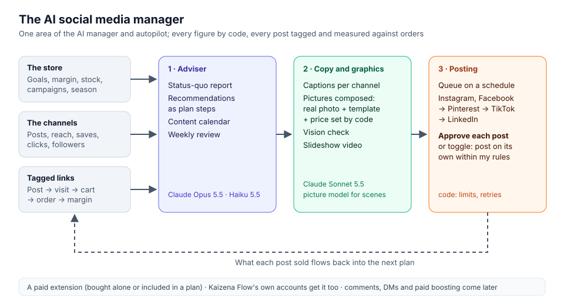

# The AI social media manager (D870, plan, 23 November 2026)

Status: **agreed with the owner (D870); building.** On 25 November the owner moved the post creator first: posts to copy by hand are
useful on day one, need no channel's approval, and give the adviser posts to measure. Order now: the creator (C1 words, C2 pictures),
the adviser (S1.x), posting (S3.x). S1.1 (tagged links) was built first and serves the creator's links.

## 1. The intent, in the owner's words

Social media management is what store owners (and the owner too) find hardest. Kaizena Flow gets an AI social media manager
that knows the store's goals and its performance, in three phases:

1. **An adviser** that assesses the status quo and presents recommendations.
2. **Copy and graphics** on top of the adviser.
3. **Posting** to a set of channels on an automated schedule.

## 2. What was decided

| Question | Decision |
|---|---|
| Where it lives | A new area of the AI manager and the autopilot (`social`), not a separate system: goals (`assistant_goals`), plans, the gates (`autopilotDecision()`), budgets and the reports are reused |
| What it optimises for | **Revenue and margin per post**, not likes. Every link it makes carries a tagged link (UTM) and posts are attributed to visits, carts and orders by our own analytics |
| Channels, in order | **Instagram and Facebook** (one Meta connection), then **Pinterest**, then **TikTok**, then **LinkedIn** (mostly for Kaizena Flow itself). X is left out: a paid API that brings little to a shop |
| Pictures | **Composed, not invented.** The real product photo, a brand template and text set by code; the price comes from the database, the logo from `brand-marks.ts` (D330). The picture model only makes backgrounds and scenes, reframes (1:1, 4:5, 9:16) and removes backgrounds. A made picture of a product the store does not sell is never posted |
| Video | Phase 2 makes slideshows from photos, by code (motion and music). Generative video is a later step, behind its own cost check and the EU rule |
| Approval | **Every post is approved by a person at first.** The owner can switch on *Post on its own within my rules*: a toggle per store (and for the platform), off by default, which lets the autopilot publish what passes the rules without asking. Switching it off takes effect at once, and posts already queued go back to waiting for a yes |
| Comments and DMs | **Out of scope** of these three phases (a fourth, with the support desk's rules) |
| Paid boosting | Out of scope; a later step on the ad accounts of D585 and their limits |
| Pricing | **A paid extension** (the sixth in D748): bought on its own, and may be included in a plan as a grant. Hidden until opted in, 14-day trial, read-only after grace, as every extension |
| The platform | Kaizena Flow's own accounts get the same feature from `/admin/platform` in the same change (parity rule); the platform always has every extension. Kaizena Flow's creator is its own store's (C1b, Marketing → Social posts there), writing from a page of kaizenaflow.com or a topic since it sells no products |
| Order (25 November) | **The post creator first**, for posting by hand, then the adviser, then posting by itself. Its words (C1) before its pictures (C2) |

## 3. First: the post creator (posting by hand)

The owner chooses a product (or writes what the posts are about) and the channels, and presses *Write posts*; each channel gets a
caption and hashtags in the store's brand, the price line set by code from the shop's price, and the post's tagged link (S1.1), one
reference for the batch. *Copy text* puts it on the clipboard; where a channel opens no link in a post (Instagram, TikTok, Pinterest)
the link is copied on its own for the profile, a Story or the Pin. The posts are kept (`social_posts`) and listed newest first, and
the first copy of each is noted. Lisa's theme (the link's campaign) and the price line are under *Customise*.

| Step | What | Done when |
|---|---|---|
| C1 | The words: `/admin/{store}/social`, `writeSocialPosts()` (`src/server/social-posts.ts`, pure parts `src/lib/social-posts.ts`), the claims filter and the brand's avoided words over every caption and hashtag | An owner copies a post with its tagged link. **Done 2026-11-25** |
| C2b | The store's own type and logo on the picture: its heading font at its heading weight and its body font (`fontFile()`, Google Fonts' TrueType files, Inter where the theme names none), and its logo (the dark-background one on a dark theme) | A picture is set in the store's fonts with its logo. **Done 2026-11-25** |
| C1b | Kaizena Flow's own creator: posts about a page of the site (any store's, and kaizenaflow.com's in Kaizena Flow's store, which has pages and no products), its title and description as the facts, its own picture on the post's picture, linking to it | Kaizena Flow's own posts are written and kept as a store's are. **Done 2026-11-25**: in Kaizena Flow's store (`/admin/kaizenaflow/social`), as Find companies is, not a page of `/admin/platform` |
| C2 | Pictures: the product's own photo in a template of the store's look, each channel's shape (1:1, 4:5, 9:16), the price set by code; *Download picture* | A post has a picture to download beside its words. **Done 2026-11-25**: `socialPicture()` (`src/server/social-pictures.tsx`, next/og), `/admin/{store}/social/picture/{id}`; then C2b (below) |

## 4. Then: the adviser

**What it reads**

- *The store:* goals and targets (`goalFigures()`), revenue and margin per product (`periodTotals()`, `order-profit.ts`), stock and
  new arrivals, campaigns and discounts, reviews (counts and ratings only; a review's words never reach a model), the season.
- *The channels:* each connected account's posts and their reach, saves, clicks and follower growth. Instagram needs a wider
  connection than the feed's (`instagram_business_basic` today, D560) with insights; Meta's App Review is applied for at the start of
  this phase, since it takes weeks.
- *The link between them:* a tagged link on every post link and the bio link, read back through the analytics (`analytics-traffic.ts`)
  so a post's visits, carts, orders and margin are known. Posts made before we tagged anything are measured by reach only, and say so.
- *Optionally the market:* a few comparable brands the owner names, through web research (D329).

**What it gives**

- A **status-quo report** in a few verdicts for Homer ("You post twice a week, 80 % product shots; posts with people sell three times
  more"), every figure worked out by code; Lisa gets the breakdown by channel, format, day and hour.
- **Recommendations as plan steps**, each tied to a goal ("Push the five well-stocked products with the highest margin", "Post Tue
  and Thu evenings", "Restart Pinterest"), started only with the owner's yes, as every plan.
- **A content plan**: themes and a month's calendar of slots, not finished posts.
- **A weekly review** beside the autopilot's own (`autopilot-reports.ts`): plan against outcome, the model's note through
  `checkedNote()`.

**Steps**

| Step | What | Done when |
|---|---|---|
| S1.1 | Tagged links on every link the platform builds for social (bio, posts), and attribution of visits and orders to a post | A test order from a tagged link shows on its post. **Done 2026-11-23**: `utm_content` kept on `visits.content`, `postLink()` (`src/lib/post-links.ts`), `postReport()` and `postRows()`, `docs/analytics.md` "Post"; `analytics-posts.int.test.ts` |
| S1.2 | Social accounts: one table for connected channels (Meta first), insights fetched by the dispatcher | A connected account's last 90 days of posts and insights are kept. **Done 2026-11-25** for Instagram (below); Facebook Pages are S1.2b |
| S1.2b | A store's Facebook Page: connected by Facebook Login, its posts' figures read daily beside Instagram's | A chosen Page's last 90 days of posts and their totals are kept and reach the adviser. **Done 2026-11-25**: `facebook_pages`, `refreshFacebookInsights()` (the dispatcher's `facebookInsights`), the card on Social posts; `facebook-pages.int.test.ts` |
| S1.3 | The adviser's facts (`socialFacts()`): store and channel figures in one typed object, by code | The facts test covers an empty, a quiet and a busy account. **Done 2026-11-25**: `socialFacts()` (`src/lib/social-facts.ts`), gathered by `gatherSocialFacts()`; shown under *What the adviser reads* on Social posts |
| S1.4 | The report, recommendations and content plan as manager tools (`social_report`, `social_plan`), the plan as autopilot steps | Homer sees three verdicts and one button; Lisa sees every figure. **Done 2026-11-25** on the page: `writeSocialAdvice()` (`src/server/social-advice.ts`, answer checked by `parseAdvice()`), kept in `social_advice`; the manager tools and the plan as autopilot steps are S1.4b |
| S1.4b | `social_report` and `social_plan` as AI manager tools, and a recommendation started as an autopilot plan on the owner's yes | The AI manager answers "how is my social media doing?" from the kept advice and its facts. **Done 2026-11-25**: `social_report`, `social_plan` and `write_social_posts` (`src/server/social-tools.ts`); a plan with a `write_social_posts` step starts only on the owner's yes, as every autopilot plan |
| S1.5 | The weekly review | It arrives once per week per store, claimed before sending. **Done 2026-11-25**: `sendSocialReviews()` (the dispatcher's `socialReviews`), from Monday 08:00 to who asked the adviser in 60 days; no model asked |
| S1.6 | The extension: an id in `EXTENSION_IDS`, its price rows and plan grants, markers and trial | Hidden for an account without it; the platform has it. **Done 2026-11-25**: `social` (store only), €39 a month, no founding price, in the Everything bundle and in no plan; the owner sets price and plans at Platform → Plans → Extensions |

S1.2 as built: the Instagram feed's connection (D560) asks `instagram_business_manage_insights` too; the dispatcher's `socialInsights` job
reads each post's totals daily into `social_post_insights` (`src/server/social-insights.ts`), shown on Social posts. Other businesses'
accounts need Meta's App Review for that permission, which is the owner's to submit in Meta's console.

S1.2b as built: Kaizena Flow's Facebook app (`FACEBOOK_APP_ID`, `FACEBOOK_APP_SECRET`) signs the owner in with Facebook Login
(`pages_show_list`, `pages_read_engagement`, `read_insights`) from the Facebook card on Social posts; one Page is kept at once, several are
offered to choose among, and only the chosen Page's token is kept (`src/server/facebook-pages.ts`). The dispatcher's `facebookInsights` job
reads its posts of 90 days with their reactions, comments and shares, and with `read_insights` each post's reach and views (Meta's newer
media-view metrics, the older impressions where a Page refuses them), into `social_post_insights` (channel `facebook`). The facts, the
manager's tools and the weekly review carry them. Pages of other businesses need Meta's App Review for these permissions, the owner's to submit.

## 5. Copy and graphics, in depth

- **Post drafts** per channel: caption, hashtags, alt text and the tagged link, by the brand-aware writer (`brandGuide()`), through
  `findClaims()` and `findAvoided()`; a price or stock level appears only as code placed it.
- **Composed pictures**: templates per format drawn by code from the store's theme (colours already checked by `themeWarnings()`),
  the product's own photos, and made backgrounds or scenes through `makeSitePicture()` and `editImage()` (kept in the media library
  with `made_by`). Carousels and Story frames come from the same templates.
- **A vision check** before a draft reaches the queue: the text is readable, the product shown is the product named, it fits each
  format, it looks like the brand. A failing draft is made again, at most twice, then shown with the reason.
- **The calendar screen** (`/admin/{store}/social`): Homer sees the week's drafts and *Approve the week*; Lisa edits each post, swaps
  its picture, sees every variant and the facts each draft was written from.
- **Slideshow video** from photos, by code, for Reels and TikTok.

| Step | What |
|---|---|
| S2.1 | Templates and the composer (picture from code + photo + made background). **Done 2026-11-26** for made scenes (below); carousels and Story frames are S2.1b |
| S2.2 | The caption writer per channel, with the filters and the tagged link |
| S2.3 | The vision check. **Done 2026-11-25** (below) |
| S2.4 | The calendar screen, approval per post and per week. **Done 2026-11-25** (below) |
| S2.5 | Slideshow video. **Done 2026-11-26** (below) |

S2.4 as built: *Your posting plan* on Social posts (`socialCalendar()`, `src/server/social-calendar.ts`) lays the adviser's two weeks with
their drafts (`social_posts.planned_for`); Homer writes the week's posts, then approves the week; Lisa writes, changes the words of (the
claims filter again, the yes taken back), approves or takes back each post (`approved_at`, `approved_by`). Four columns and one route
(`social/calendar`); no job, no table.

S2.5 as built: *Make a video* on a calendar post makes a 9:16 slideshow in the owner's browser (`makeSlideshow()`,
`src/lib/social-slideshow-make.ts`, timings in `src/lib/social-slideshow.ts`): the post's own picture whole over a blurred copy, then the
product's other photos, each zooming and drifting with crossfades, encoded as H.264 MP4 by WebCodecs (mediabunny). It is uploaded straight
to Storage, kept in the library and on the post (`video_media_id`, `src/server/social-slideshow.ts`), and offered to download. No server
encoding and no AI: it costs nothing but the storage.

S2.1 as built: *Make a scene* on a calendar post (`makeSocialScene()`, `src/server/social-scenes.ts`, brief in `src/lib/social-scenes.ts`)
puts a product's own photo on a new background in the shop's style (the library's AI edit, `new_background`), or makes a background in the
site's look for a page or topic (`makeSitePicture()`); the picture is kept in the library and drawn in the photo's place, the words, price
and logo still code's. Each scene is checked (S2.3) and made again while the check fails it, at most three times in all
(`social_posts.scene_media_id`, `scene_tries`); *Use the drawn picture* goes back. Made on request only: each scene is a picture model's
call, metered as the library's.

S2.3 as built: each post written on the calendar has its picture (its Canva one, else drawn) looked at by the store's model that sees
pictures (`checkSocialPosts()`, `src/server/social-vision.ts`; prompt and verdict in `src/lib/social-vision.ts`): readable words, the
subject shown, nothing cut off, the shop's look. The verdict is kept on the post (`checked_at`, `check_problems`, `check_note`); a failed
post is shown with its reason and left out of *Approve the week*, and *Check the picture* asks again. One vision call per post, metered as
`social_posts`. A failed picture is not made again yet: a drawn picture is the same each time, so remaking comes with S2.1's made backgrounds.

## 6. Last: posting on a schedule

- **Publishing**: Meta's content publishing (Instagram and Facebook pages), then Pinterest's API, then TikTok's Content Posting API
  (public posts only after TikTok's audit; private until then), then LinkedIn. Each needs its own app review: started in phase 1.
- **The queue**: a job in the five-minute dispatcher posts what is due, with retries, each platform's rate limits, expiring tokens and a
  post the platform removed; each published post is an event in the log and an audit row with `acted_by`.
- **Approval**: a new gated tool `publish_social_post` in area `social`. While the toggle is off it is never automatic: each post waits
  for a person's yes (`decideApproval()`). With *Post on its own within my rules* on, the autopilot publishes a post that passes the
  rules: the vision check, the filters, the owner's limits (posts per day per channel, quiet hours, words and topics to avoid), and
  never a post about a product that is out of stock or unpublished when it is due (checked again at posting time). Anything outside
  the rules waits for a yes, as before. The toggle is the owner's alone, audited, and the platform-wide pause (AST-07) stops it too.
- **The loop closes**: each post's figures flow back into phase 1's facts; what sold shapes the next plan. A/B tests of captions and
  pictures are a later step.

S3.1 as built: an approved post on the calendar has *Post now* where the store's connection allows posting (`publishSocialPost()`,
`src/server/social-publish.ts`): to Instagram as a media container then `media_publish` (its slideshow as a Reel), to the Facebook Page as a
photo or video. The picture goes up as a JPEG kept in the library. The post is claimed first so it never goes out twice; Meta's id and
address are kept, or its refusal in its words; a published post's words and yes no longer change. The AI manager's `publish_social_post`
asks the owner (the public gate, never automatic until S3.3). Instagram now asks `instagram_business_content_publish` and Facebook's
configuration `pages_manage_posts`: an owner connects again to allow posting. Other businesses' accounts need Meta's App Review for both.

| Step | What |
|---|---|
| S3.1 | Publishing to Instagram and Facebook, approval per post. **Done 2026-11-26** (below) |
| S3.2 | The queue, retries, limits and token refresh |
| S3.3 | The toggle and the rules, through `autonomyDecision()` |
| S3.4 | Pinterest |
| S3.5 | TikTok (after the audit) |
| S3.6 | LinkedIn |

## 7. Models per stage

All calls go through the AI settings' provider (the AI Gateway with its EU-only and zero-retention options) and are metered in
`ai_usage` like every other feature, with the autopilot's budget.

| Stage | Model | Why |
|---|---|---|
| Strategy, the status-quo report, the weekly review | Claude Opus 5.5, `high` effort | Judgement across many signals, weekly, so cheap per store |
| Sorting and tagging posts, extraction | Claude Haiku 5.5 (the Batch API where it can wait) | Volume at a tiny price |
| Captions, hashtags, channel variants | Claude Sonnet 5.5 | Good writing in every store language at a mid price |
| The vision check, reading comparable brands' posts | Claude Sonnet 5.5 (Haiku 5.5 for simple checks) | The AI settings' vision model |
| Backgrounds, scenes, reframing, editing | The AI settings' picture model (`gpt-image-1.5` today) | Product, words and price are code's |
| Video (later) | Slideshows by code; a generative model later | Cost, consistency and the EU rule |
| Timing, scheduling, attribution, every figure | Code | Must be exact |

## 8. Pricing (a proposal; every number is a setting)

What one store costs Kaizena Flow at 30 posts a month, roughly: the weekly analysis about €3, captions about €2, pictures €3 to €12
(two tries each, depending on size and quality), checks well under €1: about **€8 to €18**. Checked against the providers' prices
before the price is set.

| | List | Founding (12 months) | Included | Beyond |
|---|---|---|---|---|
| Social media manager | €39 | **€29** | 30 published posts a month, all channels, the adviser | €0.50 per post |

Set by the owner on 25 November 2026: **€39 a month**, no founding price and no included-post limit for now; which plans include it is chosen at Platform → Plans → Extensions, where the price is changed too (no plan includes it at launch).

## 9. Still open

Settled by the owner when the step that needs it starts:

1. ~~The price and the plan grants~~: settled 25 November 2026 (section 8); the plan grants are the owner's in the platform admin.
2. Whether the adviser alone (phase 1) is a lower tier of the extension, so owners can start cheaply.
3. The owner's default rules for *Post on its own*: posts per day per channel, quiet hours.
4. Which comparable brands, if any, the adviser follows by default for Kaizena Flow's own accounts.
